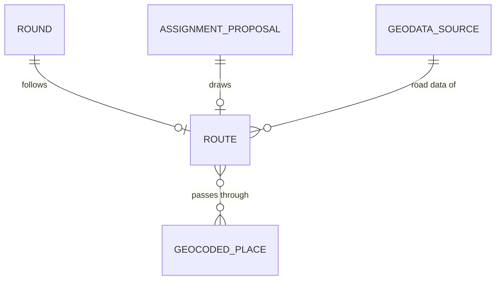
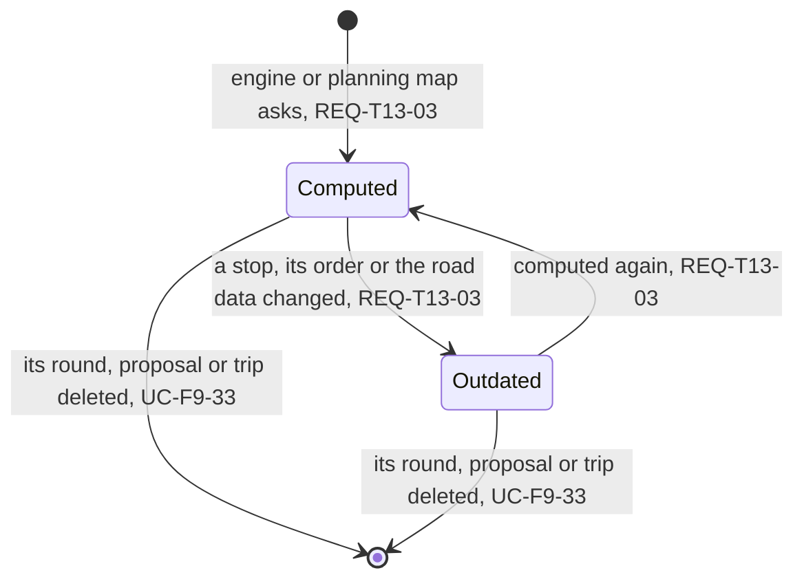

🏠 [Specs](../../../README.md) › ⚙️ [Technical capabilities](../../README.md) ›
🗺️ [T13 Maps and geodata](../README.md) › 🗃️ [Data](README.md) › 🗃️ E-T13-02 Route

# 🗃️ E-T13-02 Route

**Status:** ✅ specified

## Purpose

The way between ordered places for one profile of travel, with its distance, its time and its line on the map. The
scheduling engine reads travel times to rank candidates and order rounds; the planning map draws the line
(REQ-T13-03, REQ-T13-07).

## Fields

| Name | Type | Required | Validation | Default | Example | Personal data | Custom fields |
|---|---|---|---|---|---|---|---|
| for | round, assignment proposal, trip | yes | - | - | Round of Lea, 2026-12-08 | no | no |
| stops | ordered E-T13-01 list | yes | at least 2 | - | 9 stops | maybe | no |
| profile | car, van, truck, bicycle, foot | yes | - | car | car | no | no |
| distance | km | yes | - | - | 41 | no | no |
| travel time | minutes | yes | - | - | 84 | no | no |
| legs | distance and time per leg | yes | one per pair of stops | - | 6 km, 12 min | no | no |
| line | geometry | no | - | - | - | maybe | no |
| road data | E-T13-04 and its version | yes | - | - | road graph 2026-11 | no | no |
| state | list | yes | the lifecycle below | computed | computed | no | no |
| computed at | date and time | yes | - | now | 2026-12-01 14:02 | no | no |

Travel times come from the road graph without live traffic in the first version.

## Relations

- [E-T13-01 Geocoded place](e-t13-01-geocoded-place.md)
- [E-F9-26 Round](../../../02-functional/f09-hr-and-projects/data/e-f09-26-round.md)
- [E-F9-28 Assignment proposal](../../../02-functional/f09-hr-and-projects/data/e-f09-28-assignment-proposal.md)
- [E-T13-04 Geodata source](e-t13-04-geodata-source.md)

## Lifecycle

## Indexes and search

By the record it serves; the travel-time matrix is a cache, not searched.

## Retention

As the record it serves.

## Audit

None of its own; the round or the proposal records what changed.

## Import and export

Export of a round's route as GPX for drivers' own navigation apps.

## Used by

- [UC-F9-33](../../../02-functional/f09-hr-and-projects/use-cases/12-schedule-customer-requests/uc-f09-33-schedule-a-work-request.md)
- [UC-F9-36](../../../02-functional/f09-hr-and-projects/use-cases/12-schedule-customer-requests/uc-f09-36-see-work-and-places-on-a-map.md)
- [UC-F9-30](../../../02-functional/f09-hr-and-projects/use-cases/11-capacity-rounds-and-partners/uc-f09-30-plan-rounds-and-optimise-routes.md)

## Open questions

None.

---

⬅️ [E-T13-01 Geocoded place](e-t13-01-geocoded-place.md) · ⬆️ [Up](README.md) ·
➡️ [E-T13-03 Map layer](e-t13-03-map-layer.md)
