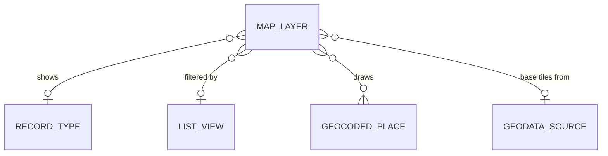
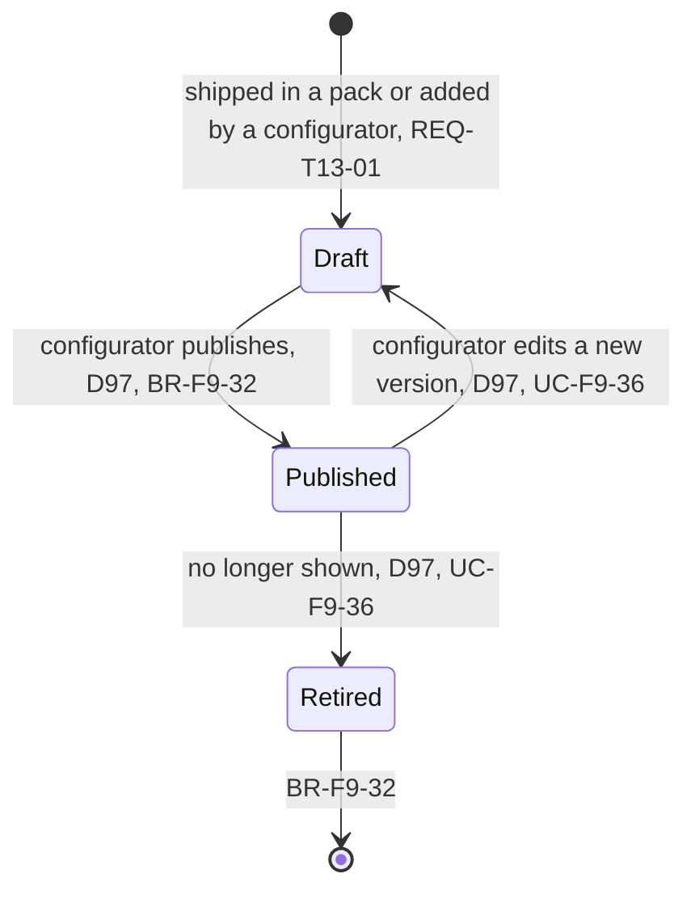

🏠 [Specs](../../../README.md) › ⚙️ [Technical capabilities](../../README.md) ›
🗺️ [T13 Maps and geodata](../README.md) › 🗃️ [Data](README.md) › 🗃️ E-T13-03 Map layer

# 🗃️ E-T13-03 Map layer

**Status:** ✅ specified

## Purpose

One kind of thing a map or a plan shows, and how: the base map, the records of a type as points or areas, routes, live
positions, or a floor or venue plan. Planning screens, the map layout of list views, mini-maps on record pages and area
maps on dashboards are built from layers (decided by the owner on 2026-11-13, VD-18). Only roles with the map right see
records on a map
[BR-F1-32](../../../02-functional/f01-administration/business-rules/br-f01-32-map-right-for-planners-and-managers.md).

## Fields

| Name | Type | Required | Validation | Default | Example | Personal data | Custom fields |
|---|---|---|---|---|---|---|---|
| name | text, per language | yes | unique per map | - | Today's visits | no | - |
| kind | list | yes | see below | records | records | no | - |
| record type | record type | for records and areas | place-bearing | - | Work request | no | - |
| filter | saved list view | no | - | all visible | state is scheduled | no | - |
| style | colour, icon, clustering, label field | yes | - | the kind's | blue pin, clustered | no | - |
| zoom range | from, to | no | - | all | 10 to 18 | no | - |
| shown by default | yes or no | yes | - | yes | yes | no | - |
| right needed | map right, position right | yes | see below | map right | map right | no | - |
| domain | list | yes | the four of VD-19 | - | field and mobility | no | - |
| source | pack or company | yes | - | company | home care sector pack | no | - |
| status | draft, published, retired | yes | - | draft | published | no | - |

Kinds: base map; records as points; areas; routes; live positions; floor or venue plan.

Rights: a records, areas or routes layer needs the map right; a live positions layer also needs to be one of the people
who may see that person's position
[BR-F9-32](../../../02-functional/f09-hr-and-projects/business-rules/br-f09-32-who-sees-a-position.md).
The public store locator (F11) and the customer's arrival time are the exceptions by nature (VD-20).

## Relations

- [E-T13-01 Geocoded place](e-t13-01-geocoded-place.md)
- [E-T13-04 Geodata source](e-t13-04-geodata-source.md)
- [E-F2-04 List view](../../../02-functional/f02-no-code-configuration/data/e-f02-04-list-view.md): the filter of a
  records layer, and the map layout of a list view.
- [C-17 Map](../../../04-ux/design-system/components/c-17-map.md) and
  [C-18 Plan](../../../04-ux/design-system/components/c-18-plan.md) draw the layers.

## Lifecycle

## Indexes and search

By name, kind, record type, domain.

## Retention

As the configuration versions.

## Audit

Every change; published, retired.

## Import and export

Part of a configuration pack; the sector packs ship their domain's layers.

## Used by

- [UC-F9-36](../../../02-functional/f09-hr-and-projects/use-cases/12-schedule-customer-requests/uc-f09-36-see-work-and-places-on-a-map.md)
- [UC-F16-17](../../../02-functional/f16-customer-support-agents/use-cases/06-take-in-every-request/uc-f16-17-follow-the-arrival-of-a-visit.md)

## Open questions

None.

---

⬅️ [E-T13-02 Route](e-t13-02-route.md) · ⬆️ [Up](README.md) · ➡️ [E-T13-04 Geodata source](e-t13-04-geodata-source.md)
