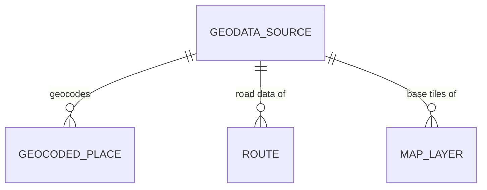
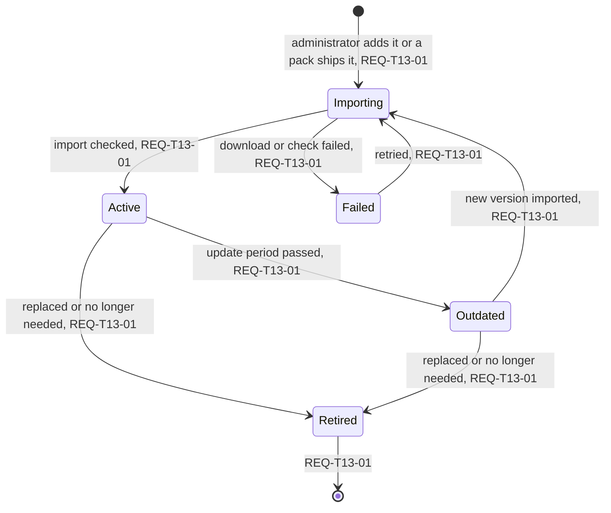

🏠 [Specs](../../../README.md) › ⚙️ [Technical capabilities](../../README.md) ›
🗺️ [T13 Maps and geodata](../README.md) › 🗃️ [Data](README.md) › 🗃️ E-T13-04 Geodata source

# 🗃️ E-T13-04 Geodata source

**Status:** ✅ specified

## Purpose

One body of open geographic data the platform imports and serves from the company's own servers: map tiles, an
address base for geocoding, a road graph for routing, parcels for plots. It records where the data comes from, its
licence and attribution, its coverage and its version (REQ-T13-01 to REQ-T13-04).

## Fields

| Name | Type | Required | Validation | Default | Example | Personal data | Custom fields |
|---|---|---|---|---|---|---|---|
| name | text | yes | unique | - | OpenStreetMap France extract | no | no |
| kind | tiles, addresses, road graph, parcels | yes | - | - | tiles | no | no |
| coverage | countries or regions | yes | ISO 3166 | the company's countries | FR | no | no |
| origin | web address | yes | - | - | the publisher's download page | no | no |
| licence | text | yes | read before import | - | ODbL | no | no |
| attribution | text | yes when the licence asks | shown on every map | - | © OpenStreetMap contributors | no | no |
| version | text or date | yes | - | - | 2026-11-04 | no | no |
| update period | days | yes | - | 30 | 30 | no | no |
| hosted | self-hosted, outside | yes | outside if an administrator chose it | self-hosted | self-hosted | no | no |
| state | list | yes | the lifecycle below | importing | active | no | no |
| last import | date, size, duration | no | - | - | 2026-11-04, 4.1 GB, 38 min | no | no |

The sources shipped for France (D517): OpenStreetMap for tiles and the road graph, the national address base (BAN)
for geocoding, IGN's cadastre parcels for plots; Nominatim on OpenStreetMap data for addresses elsewhere. Their licences
are read before they ship; only OpenStreetMap's (ODbL) is named here.

## Relations

- [E-T13-01 Geocoded place](e-t13-01-geocoded-place.md)
- [E-T13-02 Route](e-t13-02-route.md)
- [E-T13-03 Map layer](e-t13-03-map-layer.md)

## Lifecycle

The previous version keeps serving while a new one imports.

## Indexes and search

By kind, coverage, state; an admin list for the IT provider and the hosting team (D494).

## Retention

The current version and the one before it; older versions deleted.

## Audit

Added, imported (version, size, checks), failed, retired.

## Import and export

Imported from the origin; never exported.

## Used by

- [REQ-T13-01 Self-hosted map tiles](../requirements/req-t13-01-self-hosted-tiles.md)
- [REQ-T13-02 Geocoding of every address](../requirements/req-t13-02-geocoding.md)
- [REQ-T13-03 Routing and travel times](../requirements/req-t13-03-routing.md)
- [REQ-T13-04 Areas and outlines](../requirements/req-t13-04-areas-and-outlines.md)

## Open questions

None.

---

⬅️ [E-T13-03 Map layer](e-t13-03-map-layer.md) · ⬆️ [Up](README.md)
