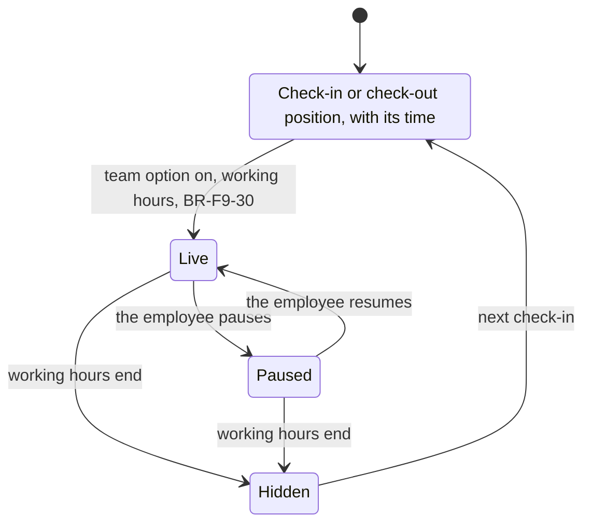

🏠 [Specs](../../../README.md) › 🎨 [UX](../../README.md) › 📐 [Design system](../README.md) › 🧩 [Components](README.md) ›
🧩 C-17 Map

# 🧩 C-17 Map

**Status:** 🔄 draft (GH-2 step S4b, from VD-18 to VD-23 / D501 to D505)

## Purpose

Shows where records, routes and, where allowed, people are on a geographic map: on planning and dispatch screens, as a
layout of list views, as a mini-map on record pages and as area maps on dashboards
[D501](../../../06-decisions/ux/d501-maps-planning-list-views-record-pages-dashboards-in-four-domains.md), for the
roles that hold the map right
([D502](../../../06-decisions/ux/d502-records-on-a-map-for-planners-and-managers-only.md)).

## Anatomy

```text
+-------------------------------------------------------------------------+
| [Layers v] [Search an address]                         [+] [-] [Centre] |
|                                                                         |
|        (12)                 o Stop 4  10:40                             |
|                 o--------o--------o   route of Julie M.                 |
|     [area: Zone North, 31 requests]                                     |
|                         * Julie M., 10:32, live                         |
|                                                                         |
| Legend: o work request  * person  -- route  [] area                     |
| 3 of these records have no place on the map            (c) OpenStreetMap |
+-------------------------------------------------------------------------+
| Stop 4 · Durand SA · 10:40 to 11:10 · Scheduled            [Open >]     |
+-------------------------------------------------------------------------+
```

1. **Controls:** layers, an address search, zoom and "Centre on my area".
2. **Markers:** one per record with a place, with an icon and a word for its state; close markers group into a cluster
   with its count.
3. **Routes:** the planned order of a person's or vehicle's work, with times
   ([REQ-T13-03](../../../03-technical/t13-maps-and-geodata/requirements/req-t13-03-routing.md)).
4. **Areas:** outlines of plots, zones or territories, with their totals
   ([REQ-T13-04](../../../03-technical/t13-maps-and-geodata/requirements/req-t13-04-areas-and-outlines.md)).
5. **Positions:** a person's last position, its time and whether it is live, only where
   [D503](../../../06-decisions/f09-hr-and-projects/d503-who-sees-peoples-positions.md),
   [D504](../../../06-decisions/f09-hr-and-projects/d504-positions-at-check-in-by-default-live-as-a-team-option-for-drivers-and-carers.md)
   and [BR-F9-32](../../../02-functional/f09-hr-and-projects/business-rules/br-f09-32-who-sees-a-position.md) allow.
6. **Legend, attribution** and the count of records without a place.
7. **Card:** the selected marker's record, its state and **Open ›**.

**Example images** (its variants and states, light and dark, D120):

| Shows | Device | Light | Dark |
|---|---|---|---|
| Variants and states | desktop |  |  |

## Variants

- **List layout:** the Map side of an [aggregated list view](../patterns/aggregated-list-view.md): the same visible rows
  as the table, the same filters and facets.
- **Planning map:** work requests, people, routes and proposals for planners, as on [S-F9-33 Planning
  map](../../../02-functional/f09-hr-and-projects/screens/12-schedule-customer-requests/s-f09-33-planning-map.md),
  [S-F9-30 Scheduling
  board](../../../02-functional/f09-hr-and-projects/screens/12-schedule-customer-requests/s-f09-30-scheduling-board.md)
  and [S-F9-31 Proposal
  review](../../../02-functional/f09-hr-and-projects/screens/12-schedule-customer-requests/s-f09-31-proposal-review.md).
- **Mini-map:** one record's place and its neighbours on a record page, without controls but zoom.
- **Area map:** totals by area on a dashboard, each area with its figure and a word, never colour alone.
- **Arrival map (customer):** one marker near the customer's address and the arrival time, during the visit's window
  only, nothing else and nothing kept, as on
  [S-F16-15](../../../02-functional/f16-customer-support-agents/screens/06-take-in-every-request/s-f16-15-arrival-of-your-visit.md)
  ([D503](../../../06-decisions/f09-hr-and-projects/d503-who-sees-peoples-positions.md)).
- **Public map:** the F11 store locator: stores and pickup points, for anyone.

The domains of
[D501](../../../06-decisions/ux/d501-maps-planning-list-views-record-pages-dashboards-in-four-domains.md):
- **field and mobility:** SC07 dispatch, SC04 and F9 rounds, SC01 sites and crews, F16 interventions;
- **land and property:** SC13 plots, SC10 properties and viewings;
- **sales and retail:** F6 territories, SC02 store network, F11 store locator, SC15 delivery zones.

Places inside a building use [C-18 Plan](c-18-plan.md).

## States

| State | Look |
|---|---|
| Loading | (Proposed) The frame and the controls; the tiles appear as they load |
| Normal | The markers, routes and areas of the visible rows |
| No place | "n of these records have no place on the map", with a link that lists them |
| Address not found | (Proposed) "Place to check" in the table, and no marker |
| Selected | The marker enlarged and its card open; the same row ticked in the table |
| Map unavailable | (Proposed) The tiles cannot load: "The map is unavailable", and the table stays usable |
| Error | The [error message pattern](../patterns/error-messages.md) |

A person's marker has its own states:



A paused or hidden person shows no position, only "Position paused" or nothing; the employee always sees what is shared
([D505](../../../06-decisions/f09-hr-and-projects/d505-the-employee-sees-their-own-position-live.md), [S-F9-34 My
position](../../../02-functional/f09-hr-and-projects/screens/12-schedule-customer-requests/s-f09-34-my-position.md)).

## Tokens

Markers in `color-primary` with a white edge, each state with its icon and word; routes in `color-accent` with a dashed
line for the part still to come; areas in `color-primary` at a low opacity with a `color-border-strong` outline;
`color-warning` and `color-error` only for late or blocked work, with their icon
([Colours](../../visual-identity/colours.md), [Iconography](../../visual-identity/iconography.md)); labels in
`font-caption`; cards as [C-04 Card](c-04-card.md) with `elevation-2` ([Tokens](../tokens.md)).

## Accessibility

- The map is never the only way to reach a record: the table, or a list beside the map, holds the same records in the
  same order, and the keyboard moves through them.
- The map region has a summary ("24 work requests on the map, 3 without a place, 2 routes").
- Each marker is a button named after its record and state ("Stop 4, Durand SA, scheduled 10:40").
- Zoom and layer controls are labelled buttons; no fly-to animation when reduced motion is asked
  ([Motion](../../visual-identity/motion.md)).
- Routes and areas differ by line style and labels, never by colour alone.

## Do and don't

- Do show only the rows and fields the user may see; map queries obey the record and field rules
  [REQ-T13-06](../../../03-technical/t13-maps-and-geodata/requirements/req-t13-06-map-queries-respect-permissions.md),
  [D12](../../../06-decisions/foundations/d12-permissions-model.md).
- Do draw the map from self-hosted tiles, with OpenStreetMap's attribution
  ([REQ-T13-01](../../../03-technical/t13-maps-and-geodata/requirements/req-t13-01-self-hosted-tiles.md)).
- Do let the employee see everything shared about them
  [D505](../../../06-decisions/f09-hr-and-projects/d505-the-employee-sees-their-own-position-live.md).
- Don't show records on a map to a role without the map right
  [BR-F1-32](../../../02-functional/f01-administration/business-rules/br-f01-32-map-right-for-planners-and-managers.md);
  the customer's arrival map and the store locator are the only exceptions
  ([D502](../../../06-decisions/ux/d502-records-on-a-map-for-planners-and-managers-only.md)).
- Don't show a person's position outside working hours, to anyone but their planner, their manager and, for the arrival
  time, the customer ([D503](../../../06-decisions/f09-hr-and-projects/d503-who-sees-peoples-positions.md)), or to
  control speed or measure performance
  [D504](../../../06-decisions/f09-hr-and-projects/d504-positions-at-check-in-by-default-live-as-a-team-option-for-drivers-and-carers.md).
- Don't keep the customer's view of an arrival.

## Used in

[S-F9-33 Planning
map](../../../02-functional/f09-hr-and-projects/screens/12-schedule-customer-requests/s-f09-33-planning-map.md),
[S-F9-30 Scheduling
board](../../../02-functional/f09-hr-and-projects/screens/12-schedule-customer-requests/s-f09-30-scheduling-board.md),
[S-F9-31 Proposal
review](../../../02-functional/f09-hr-and-projects/screens/12-schedule-customer-requests/s-f09-31-proposal-review.md),
[S-F16-14](../../../02-functional/f16-customer-support-agents/screens/06-take-in-every-request/s-f16-14-work-requests.md),
[S-F16-15](../../../02-functional/f16-customer-support-agents/screens/06-take-in-every-request/s-f16-15-arrival-of-your-visit.md),
the map layout of the [aggregated list view](../patterns/aggregated-list-view.md), and the about 15 to 20 map screens of
the domains above, to write in step S4b.

## Open questions

None. The open points of the interview of 2026-11-13 were answered as proposed
([D517](../../../06-decisions/foundations/d517-the-drafts-open-points-answered-on-2026-11-13.md)):
- field workers have no map; an address on their phone shows a "Directions" button that opens their own
  navigation app;
- the planner roles that hold the map right: U29 Dispatcher, U25 Care coordinator, U22 Site manager, U24
  Engagement manager, U21 Production planner, U23 Store manager, U38 Training coordinator, U34 Property
  manager, U43 Event producer, U28 Hotel receptionist, and the managers U02 and U13;
- live positions are kept two months at most
  [BR-F9-31](../../../02-functional/f09-hr-and-projects/business-rules/br-f09-31-live-positions-kept-two-months.md);
- the sources: geocoding by the national address base in France and Nominatim elsewhere, routing by OSRM
  or Valhalla, the cadastre for plots ([T13](../../../03-technical/t13-maps-and-geodata/README.md)).

---

⬅️ [KPI strip](c-16-kpi-strip.md) · ⬆️ [Up](README.md) · ➡️ [Plan](c-18-plan.md)

