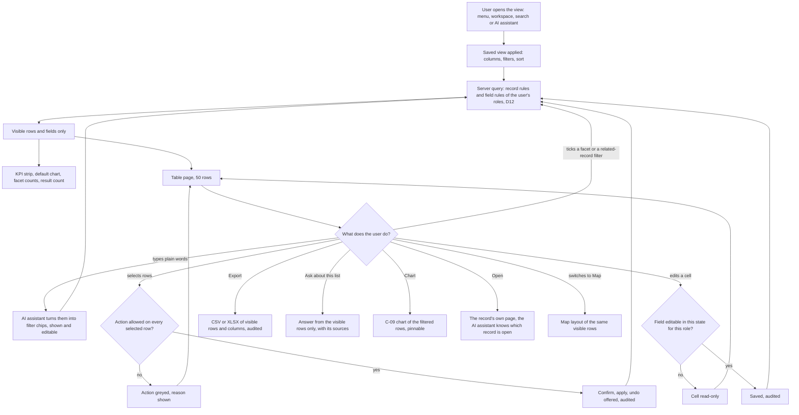
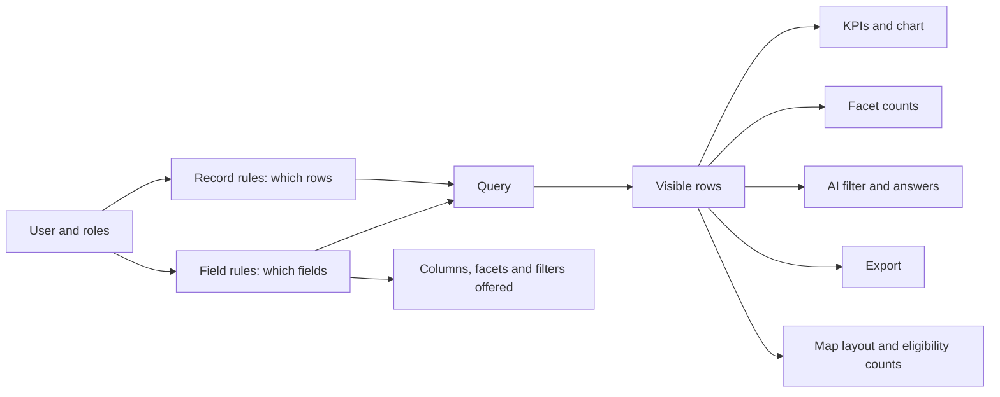
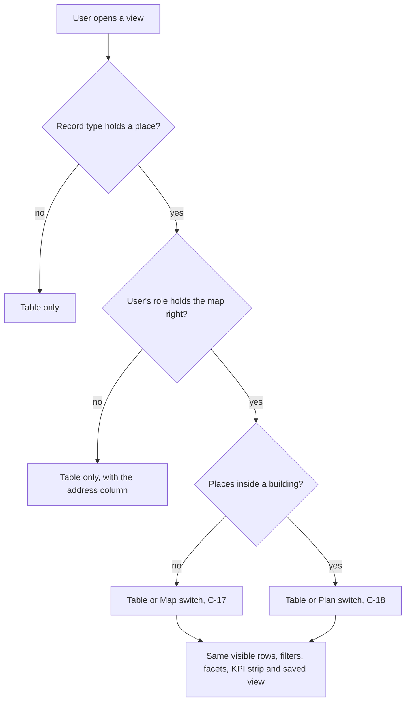
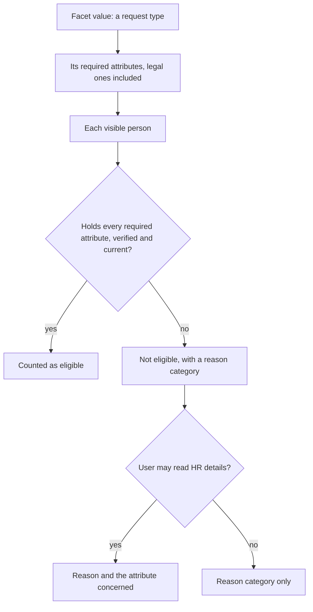
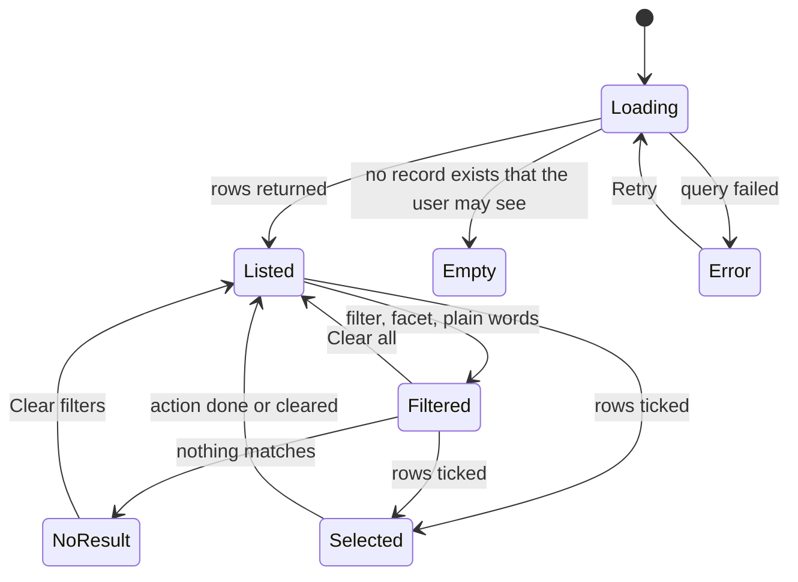

🏠 [Specs](../../../README.md) › 🎨 [UX](../../README.md) › 📐 [Design system](../README.md) › 🧵 [Patterns](README.md) ›
🧵 Aggregated list view

# 🧵 Aggregated list view

**Status:** 🔄 draft (GH-2 step S4 and S4b, from VD-01 to VD-12, VD-18 to VD-20 / D484 to D495, D501, D502)

## Purpose

One page per record type to see, filter, total and act on many records at once, within the user's permissions
[D484](../../../06-decisions/ux/d484-aggregated-list-view-per-record-type-and-persona-workspaces.md),
[D485](../../../06-decisions/ux/d485-every-entity-has-an-aggregated-view.md). The same view is embedded in each persona
workspace that works on that record type, opened on the persona's default saved view
([D493](../../../06-decisions/ux/d493-persona-workspaces-from-the-use-cases.md)). It is the list half of the [list and
detail pattern](list-detail.md).

## When to use

- Every entity of the specs, business records and settings alike
  ([D485](../../../06-decisions/ux/d485-every-entity-has-an-aggregated-view.md)). Settings and technical records are
  admin lists, under the Administration menu, or the hosting menu in the hosted edition
  ([D494](../../../06-decisions/ux/d494-settings-and-technical-records-as-admin-lists.md)).
- Each capability's menu lists its views; the global search and the AI assistant reach any of them
  ([D495](../../../06-decisions/ux/d495-views-listed-under-each-capabilitys-menu.md)).
- Each list page is written from the [list view template](../../../_templates/list-view.md); its content comes from the
  view rules VR-1 to VR-15 and the owner's review
  ([D492](../../../06-decisions/ux/d492-view-content-derived-by-rules-reviewed-per-capability.md), [view
  rules](../../../../tickets/GH-2/resources/flowcharts-screens/PLAN.md#view-rules)).
- Not for a task done in steps (use the [wizard pattern](wizard.md)) or a single settings page.
- A pipeline, a planning or a delivery round stays a table in its aggregated view; a board screen such as [S-F6-01
  Pipeline](../../../02-functional/f06-customers-and-sales/screens/01-lead-to-quote/s-f06-01-pipeline.md) stays the
  record type's own screen
  [D486](../../../06-decisions/ux/d486-plain-words-filter-facets-with-counts-related-record-filters.md).

## Anatomy

```text
+-----------------------------------------------------------------------------------------------+
| Opportunities                                    Customers and sales › Opportunities  [+ New]  |
|-----------------------------------------------------------------------------------------------|
| [42 open] [1,284,300 pipeline] [9 due in 7 days] [6 won this month]   [ chart: count by stage ]  |  KPI strip
|-----------------------------------------------------------------------------------------------|
| FACETS          | [View: Team pipeline v] [* Describe what you want to see...] [Filter][Chart] |  toolbar
| Stage           |   [Export] [Ask about this list]                         [Table | Map]       |
| [x] Proposal 17 | (Stage: Proposal x) (Amount > 20,000 x)                       6 of 42 results |  chips
| [x] Negot.   11 | 2 selected · Change stage · Assign · Tag · Export · Delete                    |  bulk bar
| Owner           | [ ] CUSTOMER     STAGE        AMOUNT     OWNER         NEXT ACTIVITY          |
| [ ] M. Dupont 15|  [x] Durand SA  (Proposal)    48,200.00 Marie Dupont  Fri 14 Nov    Open >   |  rows
| Related records |  [ ] Martin & Co (Negotiation) 12,500.00 Marie Dupont  Mon 17 Nov    Open >   |
| Customer has an |  ...                                                                          |
| overdue invoice | Counts, totals, facets and the chart use only the records you may see.       |
+-----------------------------------------------------------------------------------------------+
```

1. **Header:** the view's plural name (the harmonised entity name,
   [D496](../../../06-decisions/foundations/d496-one-wording-in-charts-and-prose-reviewed-first.md)), its menu path and
   the create action when the user may create.
2. **KPI strip** ([C-16](../components/c-16-kpi-strip.md),
   [D487](../../../06-decisions/ux/d487-kpi-strip-default-chart-and-the-chart-button.md)): a count, the total of the
   main amount, a "needs attention" count and a dated count, from the view card; collapsible; recomputed on the filtered
   visible rows.
3. **Default chart** ([D487](../../../06-decisions/ux/d487-kpi-strip-default-chart-and-the-chart-button.md)): count by
   state, by period or by a facet, from the view card; the **Chart** button turns the filtered list into a [C-09
   Chart](../components/c-09-chart.md) the user can pin to their home screen.
4. **Toolbar:** the saved view ([D109](../../../06-decisions/f02-no-code-configuration/d109-list-views.md)), the
   **plain-words filter**
   [D486](../../../06-decisions/ux/d486-plain-words-filter-facets-with-counts-related-record-filters.md), Filter,
   Chart, Export, **Ask about this list**
   [D489](../../../06-decisions/ux/d489-list-actions-bulk-export-inline-edit-ask-about-the-list-open-the-record.md);
   and the **Table | Map** switch, only on a place-bearing view and only for a role holding the map right ([Map
   layout](#map-layout)).
5. **Filter chips** and the result count ("6 of 42 results", counted on visible rows only).
6. **Facet panel** [C-15](../components/c-15-facet-panel.md),
   [D486](../../../06-decisions/ux/d486-plain-words-filter-facets-with-counts-related-record-filters.md): each facet
   field's values with counts; **related-record filters** below ("Customer has an overdue invoice"); the **"Eligible
   for" facet** on the views where scheduling attributes apply ([Eligible for](#eligible-for-facet)). On a phone, a
   drawer opened by "Facets".
7. **Bulk bar:** appears when rows are selected; only the actions the user's role allows on every selected row ([bulk
   actions pattern](bulk-actions.md)).
8. **Table** ([C-03](../components/c-03-data-table.md)): columns from the view card; inline-editable cells underlined
   [D489](../../../06-decisions/ux/d489-list-actions-bulk-export-inline-edit-ask-about-the-list-open-the-record.md);
   each row's **Open ›** goes to the record's own page.
9. **Permission note:** one fixed sentence, never a count of hidden records
   [D488](../../../06-decisions/ux/d488-totals-facets-charts-ai-answers-and-exports-on-visible-rows-only.md).

**Example images** (drawn with GH-2's mockup kit, light and dark, D120). They show how the same view differs per persona
([D490](../../../06-decisions/ux/d490-example-images-for-every-persona-that-can-open-a-view.md)). (Proposed) They move
next to this page, in `../images/`, in step S8
([D500](../../../06-decisions/ux/d500-images-live-in-the-specs-folders.md)); the map layout and the "Eligible for" facet
are drawn then.

| Shows | Device | Light | Dark |
|---|---|---|---|
| Opportunities, U03 Sales: own records, no Owner column | desktop |  |  |
| Opportunities, U03 Sales | phone |  |  |
| Opportunities, U02 Manager: the team, two rows selected, bulk bar | desktop |  |  |
| Opportunities, U02 Manager | phone |  |  |
| Opportunities, U03 Sales, plain-words filter and the AI assistant's answer | desktop |  |  |
| Opportunities, U03 Sales, plain-words filter | phone |  |  |
| Employee records, U06 Human resources: all employees, pay and contract columns | desktop |  |  |
| Employee records, U06 Human resources | phone |  |  |
| Employee records, U02 Manager: own team only, no pay or contract columns | desktop |  |  |
| Employee records, U02 Manager | phone |  |  |

The figures and names are examples drawn from the example companies, not real data.

## Behaviour



- The first page and the KPI strip show within 1 second on 100,000 records (Proposed); facets are computed on the server
  ([Performance](../../../05-non-functional/performance.md)).
- The plain-words filter is a request to the AI assistant ([F3](../../../02-functional/f03-assistant/README.md)): its
  answer is a set of filter chips the user sees and can edit, never a hidden query.
- Back from a record returns to the list with its view, filters, sort and scroll kept, as in the [list and detail
  pattern](list-detail.md).
- On a phone the table keeps its columns and scrolls sideways, the facet panel becomes a drawer and the KPI strip stays
  ([D491](../../../06-decisions/ux/d491-on-a-phone-the-list-keeps-its-table-and-scrolls-sideways.md)).

### Permissions



- Hidden rows are never counted, totalled, charted, mapped, suggested by the AI or exported
  [D488](../../../06-decisions/ux/d488-totals-facets-charts-ai-answers-and-exports-on-visible-rows-only.md),
  [D12](../../../06-decisions/foundations/d12-permissions-model.md).
- A field the user may not read is not a column, a facet, a filter, a chart axis or a plain-words filter target; the
  plain-words filter refuses it with "You cannot filter on that field".
- Bulk actions and inline edits are offered per row and field from the same rules; the server checks again.

### Map layout

A record type that holds a place (an address, a geocoded location or an outline) offers a **Map** layout beside the
table, for the roles that hold the map right
[D501](../../../06-decisions/ux/d501-maps-planning-list-views-record-pages-dashboards-in-four-domains.md),
[D502](../../../06-decisions/ux/d502-records-on-a-map-for-planners-and-managers-only.md),
[BR-F1-32](../../../02-functional/f01-administration/business-rules/br-f01-32-map-right-for-planners-and-managers.md).
About 40 record types hold a real place, such as stops, care recipients, construction sites, plots, properties and
stores ([maps and eligibility](../../../../tickets/GH-2/resources/flowcharts-screens/maps-and-eligibility.md)). A record
type whose places are inside a building (warehouse bins, hotel rooms, tables, venue areas, work centres) shows a [C-18
Plan](../components/c-18-plan.md) in place of the map.



- **Same rows:** the map shows exactly the rows of the table, filtered by the same chips and facets; the KPI strip and
  the facet counts do not change when the user switches layout
  [D488](../../../06-decisions/ux/d488-totals-facets-charts-ai-answers-and-exports-on-visible-rows-only.md).
- **Pins and clusters:** each row with a place is a pin; close pins group into a cluster with its count; a pin's card
  shows the identifying field, the state and **Open ›** ([C-17 Map](../components/c-17-map.md)).
- **Rows without a place:** "12 of these records have no place on the map", counted on visible rows, with a link that
  filters the table to them.
- **Selection:** pins selected on the map are the rows selected in the table; the bulk bar is the same.
- **(Proposed) Map extent as a filter:** "Only what the map shows" adds a chip that limits the table, the KPI strip and
  the facets to the area on screen.
- **Saved views** keep the layout, the map's area and its layers ([E-F2-04 List
  view](../../../02-functional/f02-no-code-configuration/data/e-f02-04-list-view.md), change note).
- **People's positions** never appear as a layout of a list: they follow
  [D503](../../../06-decisions/f09-hr-and-projects/d503-who-sees-peoples-positions.md) and
  [BR-F9-32](../../../02-functional/f09-hr-and-projects/business-rules/br-f09-32-who-sees-a-position.md), on planning
  screens such as [S-F9-33 Planning
  map](../../../02-functional/f09-hr-and-projects/screens/12-schedule-customer-requests/s-f09-33-planning-map.md).
- **Without the map right** the view shows no Map switch at all; the records stay a table with their address. (Proposed)
  On a field worker's phone an address shows a "Directions" button that opens their own navigation app.
- **Phone:** the switch stays; the map takes the full width and the facet drawer is unchanged.

### Eligible for facet

On the views where scheduling attributes apply, the facet panel adds an **"Eligible for"** facet
[D509](../../../06-decisions/f09-hr-and-projects/d509-four-attribute-families-for-scheduling.md),
[D510](../../../06-decisions/f09-hr-and-projects/d510-attributes-chosen-per-request-type-adjustable-per-request.md),
[D511](../../../06-decisions/f09-hr-and-projects/d511-required-or-preferred-attributes-legal-ones-always-required.md):

- **On the views of people who can be scheduled** (employee records, carers, drivers, crews, trainers): one value per
  request type or operation that has required attributes, such as "Home visit: personal care"; its count is the number
  of people who hold every required attribute, verified and current.
- **(Proposed) On the work requests view**
  [S-F16-14](../../../02-functional/f16-customer-support-agents/screens/06-take-in-every-request/s-f16-14-work-requests.md);
  "Someone eligible" and "Nobody eligible", the requests with at least one, or no, eligible person in their window.

- A person counts as eligible only when every required attribute of that request type is held, verified and current
  [BR-F9-25](../../../02-functional/f09-hr-and-projects/business-rules/br-f09-25-required-attributes-exclude.md),
  [BR-F9-27](../../../02-functional/f09-hr-and-projects/business-rules/br-f09-27-unverified-attributes-do-not-count.md);
  legal requirements are always required
  [BR-F9-26](../../../02-functional/f09-hr-and-projects/business-rules/br-f09-26-legal-requirements-never-relaxed.md).
  Preferred attributes do not change the facet.
- Ticking "Not eligible" under a value shows the reason as a category only: "medical restriction", "under 18", "licence
  expired", "to verify". A planner never sees a birth date or fitness details, which stay with HR
  [BR-F9-29](../../../02-functional/f09-hr-and-projects/business-rules/br-f09-29-planners-see-eligibility-only.md).
- An attribute read by the AI and not yet confirmed counts as "to verify", never as held
  [D508](../../../06-decisions/f09-hr-and-projects/d508-hr-confirms-every-ai-reading-before-it-counts.md).
- The counts use the visible rows only, like every facet; the reasons follow the user's field rules.



### States of the view



Each state gets its images
([D490](../../../06-decisions/ux/d490-example-images-for-every-persona-that-can-open-a-view.md)): Loading, Listed,
Filtered (plain words), No result, Empty, Selected, Error. The map layout has the same states; Listed on a map also
shows the count of rows without a place.

## Accessibility

- The page has one level-1 heading; the KPI strip, the facet panel, the toolbar and the table are landmarks with names.
- The result count and the KPI figures are announced politely when the filters change.
- The plain-words filter's chips are real controls, each with its remove button ("Remove filter Stage: Proposal").
- The Table and Map switch is a pair of toggle buttons; the map is never the only way to reach a record, the table holds
  the same rows ([C-17 Map](../components/c-17-map.md)).
- The facet drawer on a phone is a dialog that returns the focus to its "Facets" button when closed.

## Used in

Every aggregated list view and every persona workspace
[D484](../../../06-decisions/ux/d484-aggregated-list-view-per-record-type-and-persona-workspaces.md), for example
[S-F16-14](../../../02-functional/f16-customer-support-agents/screens/06-take-in-every-request/s-f16-14-work-requests.md),
which has the map layout and the "Eligible for" facet.

---

⬅️ [Error messages](error-messages.md) · ⬆️ [Up](README.md)

