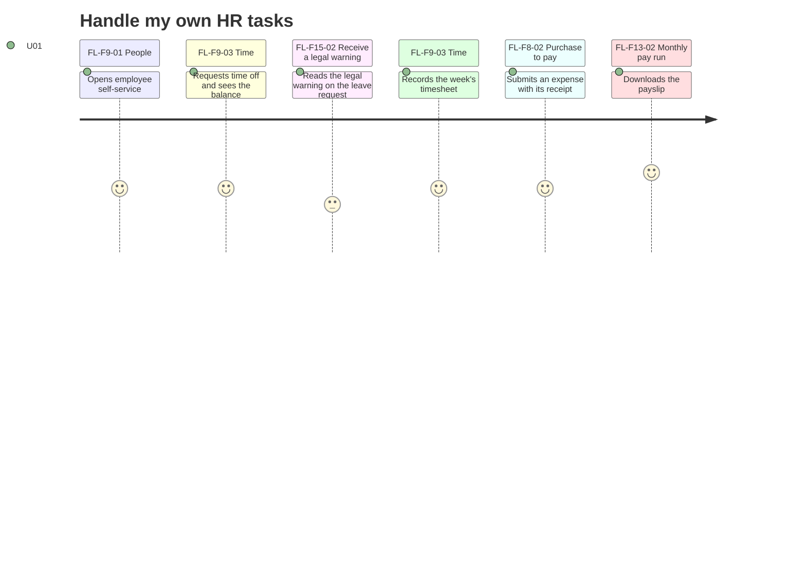
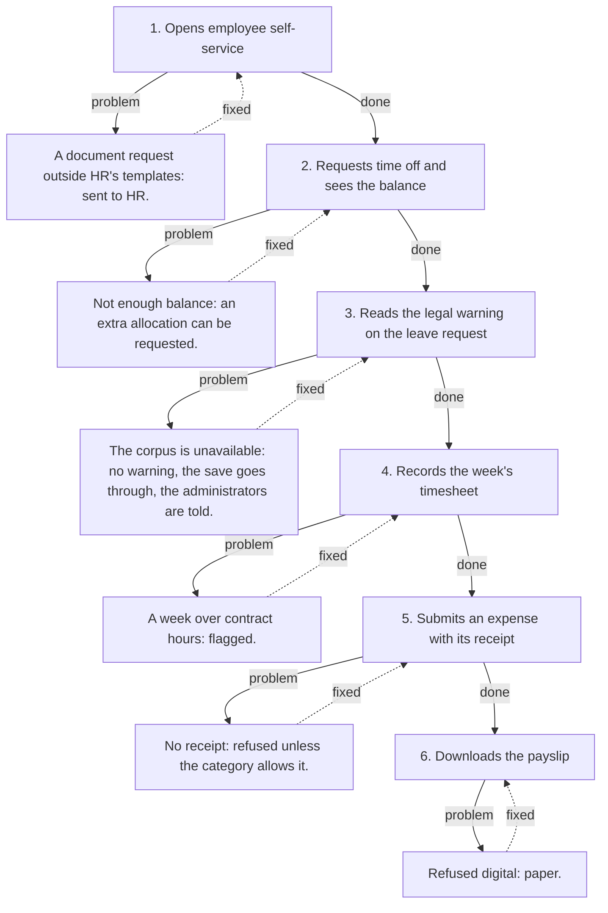

🏠 [Specs](../../../../README.md) › 🎨 [UX](../../../README.md) › 🪟 [Views](../../README.md) ›
👷 [Employee: app shell and home](../README.md) › 🧭 [Journeys](README.md) › 🧭 J-U01-01 Handle my own HR tasks

# 🧭 J-U01-01 Handle my own HR tasks

**Status:** 🔄 waiting for the owner

## Persona

[U01 Employee](../../../../01-users/personas/u01-employee.md)

## Goal

Do their own HR tasks without asking anyone: time off, timesheets, expenses and payslips.

## Journey

Satisfaction at each step, from 1 (painful) to 5 (effortless): these scores are a proposal (Proposed), drawn from the
specs, for the owner to confirm.

## Flowchart

The same steps; each problem is the first error flow of the step's use case (once per use case), shown with the error
message pattern ([D122](../../../../06-decisions/ux/d122-error-message-standard.md)).

## Steps

| Step | Screen | Use case | What the persona does | What the system does |
|---|---|---|---|---|
| 1 | [S-F9-04 My HR](../../../../02-functional/f09-hr-and-projects/screens/01-people/s-f09-04-my-hr.md) | [UC-F9-04 Use employee self-service](../../../../02-functional/f09-hr-and-projects/use-cases/01-people/uc-f09-04-use-employee-self-service.md) | Opens employee self-service | Shows their details, documents, payslips and balances; key changes are validated (BR-F9-01). |
| 2 | [S-F9-09 Time off](../../../../02-functional/f09-hr-and-projects/screens/03-time/s-f09-09-time-off.md) | [UC-F9-09 Request and approve time off](../../../../02-functional/f09-hr-and-projects/use-cases/03-time/uc-f09-09-request-and-approve-time-off.md) | Requests time off and sees the balance | Shows the balance, then sends the request to its approvers (BR-F9-05); planning and payroll see it. |
| 3 | [S-F15-02 Legal warning](../../../../02-functional/f15-legal-assistant/screens/02-receive-a-legal-warning/s-f15-02-legal-warning.md) | [UC-F15-02 Receive a legal warning](../../../../02-functional/f15-legal-assistant/use-cases/02-receive-a-legal-warning/uc-f15-02-receive-a-legal-warning.md) | Reads the legal warning on the leave request | Shows the rule, its article, version and date, and the facts it used (BR-F15-01). |
| 4 | [S-F9-16 Timesheets](../../../../02-functional/f09-hr-and-projects/screens/03-time/s-f09-16-timesheets.md) | [UC-F9-16 Record and validate timesheets](../../../../02-functional/f09-hr-and-projects/use-cases/03-time/uc-f09-16-record-and-validate-timesheets.md) | Records the week's timesheet | Offers drafts from their own activity if turned on (BR-F9-07); sends it to the manager to validate. |
| 5 | [S-F8-12 Expenses](../../../../02-functional/f08-accounting/screens/02-purchase-to-pay/s-f08-12-expenses.md) | [UC-F8-12 Submit and approve expenses](../../../../02-functional/f08-accounting/use-cases/02-purchase-to-pay/uc-f08-12-submit-and-approve-expenses.md) | Submits an expense with its receipt | The AI reads the receipt; the manager approves (BR-F8-05); accounting reimburses. |
| 6 | [S-F13-08 Payslips](../../../../02-functional/f13-payroll/screens/02-monthly-pay-run/s-f13-08-payslips.md) | [UC-F13-08 Issue clarified payslips digitally](../../../../02-functional/f13-payroll/use-cases/02-monthly-pay-run/uc-f13-08-issue-clarified-payslips-digitally.md) | Downloads the payslip | Publishes the payslip; the employee reads it online. |

This persona's images of these flows (D120):
[FL-F9-01 People](../../../../02-functional/f09-hr-and-projects/images/01-people/u01-employee/README.md),
[FL-F9-03 Time](../../../../02-functional/f09-hr-and-projects/images/03-time/u01-employee/README.md),
[FL-F15-02 Receive a legal warning](../../../../02-functional/f15-legal-assistant/images/02-receive-a-legal-warning/u01-employee/README.md),
[FL-F8-02 Purchase to pay](../../../../02-functional/f08-accounting/images/02-purchase-to-pay/u01-employee/README.md),
[FL-F13-02 Monthly pay run](../../../../02-functional/f13-payroll/images/02-monthly-pay-run/u01-employee/README.md).

## Open questions

None.

---

⬆️ [Up](README.md)
