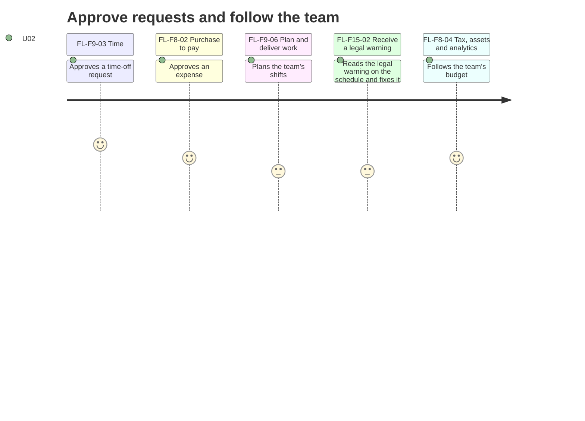
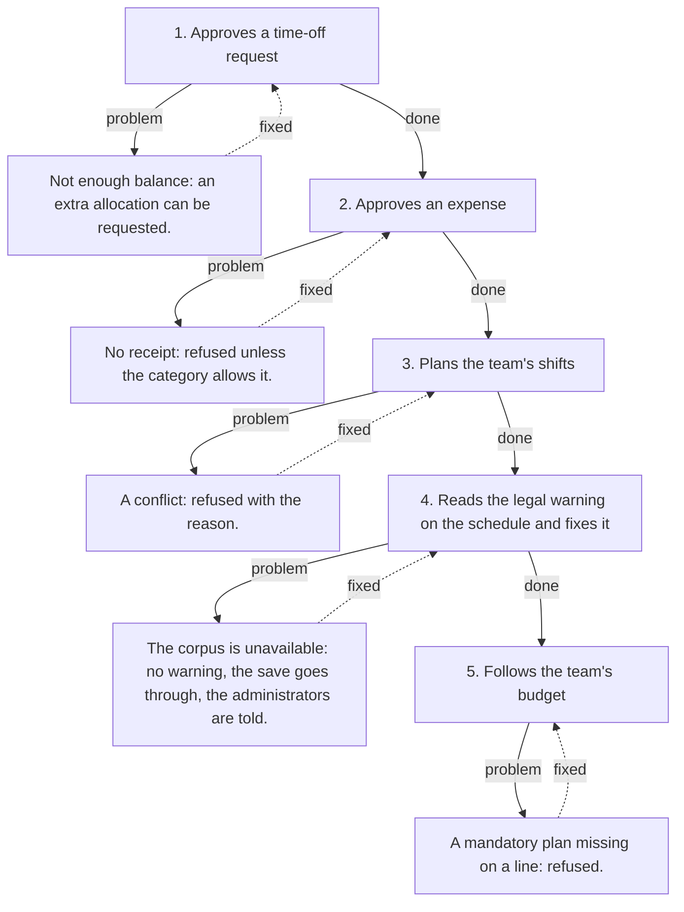

🏠 [Specs](../../../../README.md) › 🎨 [UX](../../../README.md) › 🪟 [Views](../../README.md) ›
🧑‍💼 [Manager: app shell and home](../README.md) › 🧭 [Journeys](README.md) ›
🧭 J-U02-01 Approve requests and follow the team

# 🧭 J-U02-01 Approve requests and follow the team

**Status:** ✅ specified

## Persona

[U02 Manager](../../../../01-users/personas/u02-manager.md)

## Goal

Approve requests quickly, from anywhere, and see how the team and site are doing.

## Journey

Satisfaction at each step, from 1 (painful) to 5 (effortless): these scores are drawn from the
specs and confirmed by the owner (D572).

## Flowchart

The same steps; each problem is the first error flow of the step's use case (once per use case), shown with the error
message pattern ([D122](../../../../06-decisions/ux/d122-error-message-standard.md)).

## Steps

| Step | Screen | Use case | What the persona does | What the system does |
|---|---|---|---|---|
| 1 | [S-F9-09 Time off](../../../../02-functional/f09-hr-and-projects/screens/03-time/s-f09-09-time-off.md) | [UC-F9-09 Request and approve time off](../../../../02-functional/f09-hr-and-projects/use-cases/03-time/uc-f09-09-request-and-approve-time-off.md) | Approves a time-off request | Records the approval in one or several steps (BR-F9-05); planning and payroll see it. |
| 2 | [S-F8-12 Expenses](../../../../02-functional/f08-accounting/screens/02-purchase-to-pay/s-f08-12-expenses.md) | [UC-F8-12 Submit and approve expenses](../../../../02-functional/f08-accounting/use-cases/02-purchase-to-pay/uc-f08-12-submit-and-approve-expenses.md) | Approves an expense | Records the approval (BR-F8-05); accounting reimburses by transfer or payslip. |
| 3 | [S-F9-15 Planning](../../../../02-functional/f09-hr-and-projects/screens/06-plan-and-deliver-work/s-f09-15-planning.md) | [UC-F9-15 Plan shifts](../../../../02-functional/f09-hr-and-projects/use-cases/06-plan-and-deliver-work/uc-f09-15-plan-shifts.md) | Plans the team's shifts | Fills open shifts by auto-plan (BR-F9-09); publishes the drafts and notifies employees. |
| 4 | [S-F15-02 Legal warning](../../../../02-functional/f15-legal-assistant/screens/02-receive-a-legal-warning/s-f15-02-legal-warning.md) | [UC-F15-02 Receive a legal warning](../../../../02-functional/f15-legal-assistant/use-cases/02-receive-a-legal-warning/uc-f15-02-receive-a-legal-warning.md) | Reads the legal warning on the schedule and fixes it | Shows the rule, its article, version and date, and the facts it used (BR-F15-01). |
| 5 | [S-F8-09 Analytics and budgets](../../../../02-functional/f08-accounting/screens/04-tax-assets-and-analytics/s-f08-09-analytics-and-budgets.md) | [UC-F8-09 Track analytics and budgets](../../../../02-functional/f08-accounting/use-cases/04-tax-assets-and-analytics/uc-f08-09-track-analytics-and-budgets.md) | Follows the team's budget | Shows budget against actual, committed and forecast; overspends alert. |

This persona's images of these flows (D120):
[FL-F9-03 Time](../../../../02-functional/f09-hr-and-projects/images/03-time/u02-manager/README.md),
[FL-F8-02 Purchase to pay](../../../../02-functional/f08-accounting/images/02-purchase-to-pay/u02-manager/README.md),
[FL-F9-06 Plan and deliver work](../../../../02-functional/f09-hr-and-projects/images/06-plan-and-deliver-work/u02-manager/README.md),
[FL-F15-02 Receive a legal warning](../../../../02-functional/f15-legal-assistant/images/02-receive-a-legal-warning/u02-manager/README.md),
[FL-F8-04 Tax, assets and analytics](../../../../02-functional/f08-accounting/images/04-tax-assets-and-analytics/u02-manager/README.md).

## Open questions

None.

---

⬆️ [Up](README.md)
