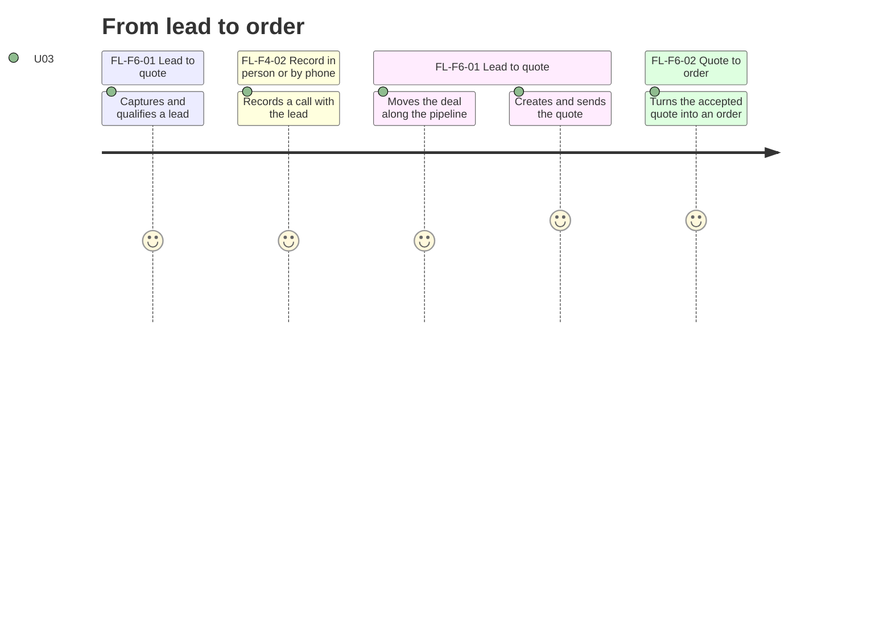
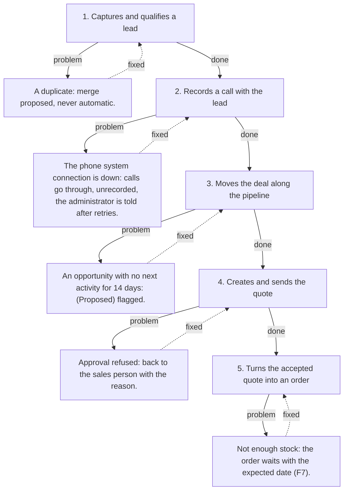

🏠 [Specs](../../../../README.md) › 🎨 [UX](../../../README.md) › 🪟 [Views](../../README.md) ›
🤝 [Sales: app shell and home](../README.md) › 🧭 [Journeys](README.md) › 🧭 J-U03-01 From lead to order

# 🧭 J-U03-01 From lead to order

**Status:** 🔄 waiting for the owner

## Persona

[U03 Sales](../../../../01-users/personas/u03-sales.md)

## Goal

Send a correct quote fast, even at the customer's site, and know the customer's whole history.

## Journey

Satisfaction at each step, from 1 (painful) to 5 (effortless): these scores are a proposal (Proposed), drawn from the
specs, for the owner to confirm.

## Flowchart

The same steps; each problem is the first error flow of the step's use case (once per use case), shown with the error
message pattern ([D122](../../../../06-decisions/ux/d122-error-message-standard.md)).

## Steps

| Step | Screen | Use case | What the persona does | What the system does |
|---|---|---|---|---|
| 1 | [S-F6-02 Lead](../../../../02-functional/f06-customers-and-sales/screens/01-lead-to-quote/s-f06-02-lead.md) | [UC-F6-01 Capture and qualify a lead](../../../../02-functional/f06-customers-and-sales/use-cases/01-lead-to-quote/uc-f06-01-capture-and-qualify-a-lead.md) | Captures and qualifies a lead | Matches it against existing contacts and companies; proposes duplicates for merge. |
| 2 | [S-F4-04 Call](../../../../02-functional/f04-meetings/screens/02-record-in-person-or-by-phone/s-f04-04-call.md) | [UC-F4-04 Record a phone call](../../../../02-functional/f04-meetings/use-cases/02-record-in-person-or-by-phone/uc-f04-04-record-a-phone-call.md) | Records a call with the lead | Plays the spoken message (BR-F4-01), records, transcribes and suggests the contact (BR-F4-12). |
| 3 | [S-F6-01 Pipeline](../../../../02-functional/f06-customers-and-sales/screens/01-lead-to-quote/s-f06-01-pipeline.md) | [UC-F6-02 Manage the pipeline and forecast](../../../../02-functional/f06-customers-and-sales/use-cases/01-lead-to-quote/uc-f06-02-manage-the-pipeline-and-forecast.md) | Moves the deal along the pipeline | Sums the forecast weighted by each stage's probability, per person and month. |
| 4 | [S-F6-03 Quote editor](../../../../02-functional/f06-customers-and-sales/screens/01-lead-to-quote/s-f06-03-quote-editor.md) | [UC-F6-03 Create and send a quote](../../../../02-functional/f06-customers-and-sales/use-cases/01-lead-to-quote/uc-f06-03-create-and-send-a-quote.md) | Creates and sends the quote | Computes margins and totals live; a discount above the threshold goes to approval. |
| 5 | [S-F6-05 Order](../../../../02-functional/f06-customers-and-sales/screens/02-quote-to-order/s-f06-05-order.md) | [UC-F6-05 Turn a quote into an order and follow it](../../../../02-functional/f06-customers-and-sales/use-cases/02-quote-to-order/uc-f06-05-turn-a-quote-into-an-order-and-follow-it.md) | Turns the accepted quote into an order | Plans delivery (F7) or work (F9); shows progress to the customer in the portal. |

This persona's images of these flows (D120):
[FL-F6-01 Lead to quote](../../../../02-functional/f06-customers-and-sales/images/01-lead-to-quote/u03-sales/README.md),
[FL-F4-02 Record in person or by phone](../../../../02-functional/f04-meetings/images/02-record-in-person-or-by-phone/u03-sales/README.md),
[FL-F6-02 Quote to order](../../../../02-functional/f06-customers-and-sales/images/02-quote-to-order/u03-sales/README.md).

## Open questions

None.

---

⬆️ [Up](README.md)
