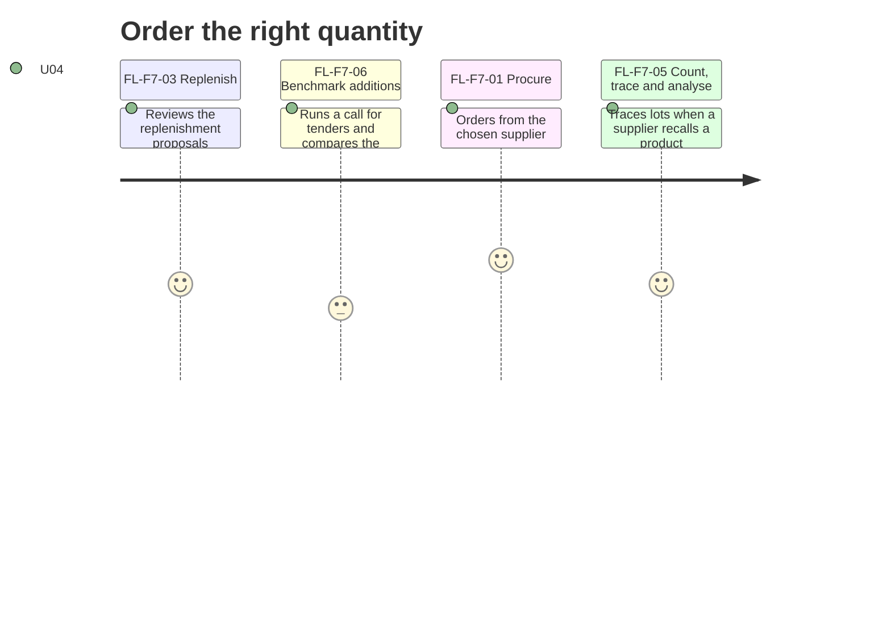
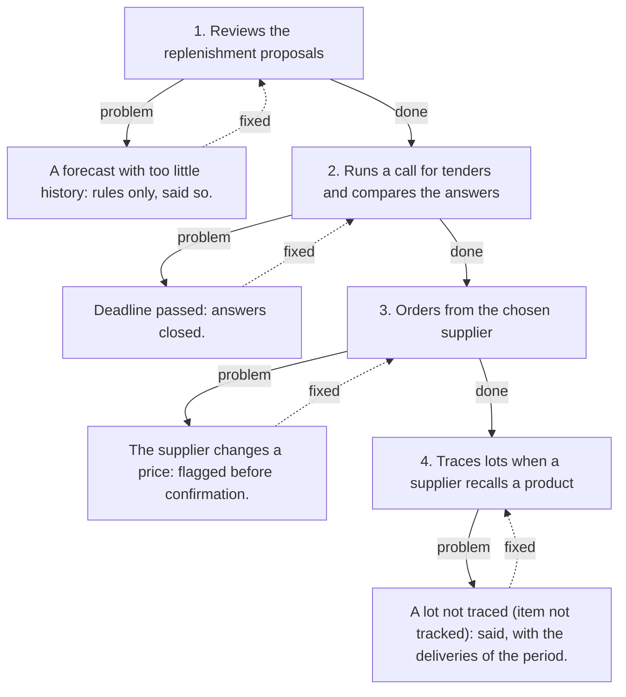

🏠 [Specs](../../../../README.md) › 🎨 [UX](../../../README.md) › 🪟 [Views](../../README.md) ›
🛍️ [Purchasing and stock: app shell and home](../README.md) › 🧭 [Journeys](README.md) ›
🧭 J-U04-01 Order the right quantity

# 🧭 J-U04-01 Order the right quantity

**Status:** ✅ specified

## Persona

[U04 Purchasing and stock](../../../../01-users/personas/u04-purchasing.md)

## Goal

Order the right quantity at the right time, from the best supplier.

## Journey

Satisfaction at each step, from 1 (painful) to 5 (effortless): these scores are drawn from the
specs and confirmed by the owner (D572).

## Flowchart

The same steps; each problem is the first error flow of the step's use case (once per use case), shown with the error
message pattern ([D122](../../../../06-decisions/ux/d122-error-message-standard.md)).

## Steps

| Step | Screen | Use case | What the persona does | What the system does |
|---|---|---|---|---|
| 1 | [S-F7-05 Replenishment](../../../../02-functional/f07-purchasing-and-stock/screens/03-replenish/s-f07-05-replenishment.md) | [UC-F7-05 Replenish stock](../../../../02-functional/f07-purchasing-and-stock/use-cases/03-replenish/uc-f07-05-replenish-stock.md) | Reviews the replenishment proposals | Gives the forecasted stock by date and lists suggested orders per supplier. |
| 2 | [S-F7-14 Tenders](../../../../02-functional/f07-purchasing-and-stock/screens/06-benchmark-additions/s-f07-14-tenders.md) | [UC-F7-14 Run a call for tenders and rate suppliers](../../../../02-functional/f07-purchasing-and-stock/use-cases/06-benchmark-additions/uc-f07-14-run-a-call-for-tenders-and-rate-suppliers.md) | Runs a call for tenders and compares the answers | Sends the call; collects and compares the answers; cancels or keeps the others. |
| 3 | [S-F7-02 Purchase order](../../../../02-functional/f07-purchasing-and-stock/screens/01-procure/s-f07-02-purchase-order.md) | [UC-F7-02 Order from a supplier](../../../../02-functional/f07-purchasing-and-stock/use-cases/01-procure/uc-f07-02-order-from-a-supplier.md) | Orders from the chosen supplier | Uses the supplier's price list and lead time; alerts on late confirmations or deliveries. |
| 4 | [S-F7-08 Traceability](../../../../02-functional/f07-purchasing-and-stock/screens/05-count-trace-and-analyse/s-f07-08-traceability.md) | [UC-F7-08 Trace lots and serials, recall](../../../../02-functional/f07-purchasing-and-stock/use-cases/05-count-trace-and-analyse/uc-f07-08-trace-lots-and-serials-recall.md) | Traces lots when a supplier recalls a product | Shows upstream and downstream; lists every customer and stock holding the lot and blocks it. |

This persona's images of these flows (D120):
[FL-F7-03 Replenish](../../../../02-functional/f07-purchasing-and-stock/images/03-replenish/u04-purchasing/README.md),
[FL-F7-06 Benchmark additions](../../../../02-functional/f07-purchasing-and-stock/images/06-benchmark-additions/u04-purchasing/README.md),
[FL-F7-01 Procure](../../../../02-functional/f07-purchasing-and-stock/images/01-procure/u04-purchasing/README.md),
[FL-F7-05 Count, trace and analyse](../../../../02-functional/f07-purchasing-and-stock/images/05-count-trace-and-analyse/u04-purchasing/README.md).

## Open questions

None.

---

⬆️ [Up](README.md)
