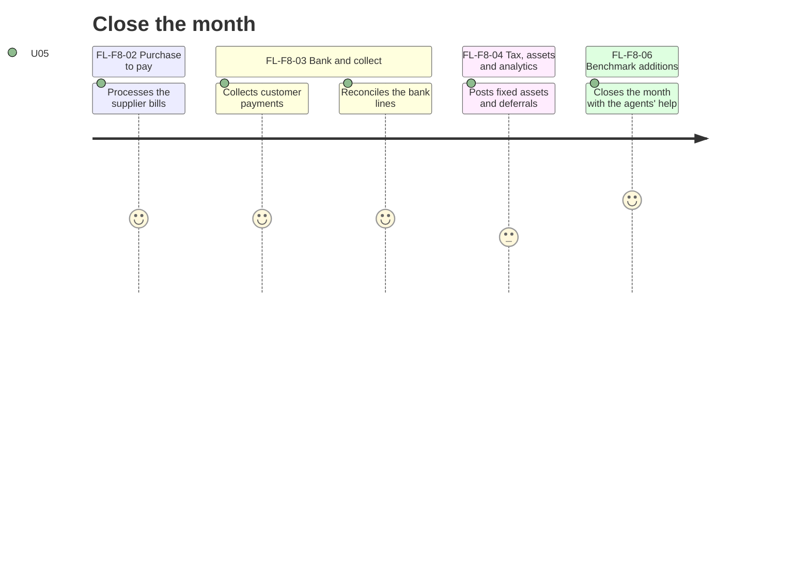
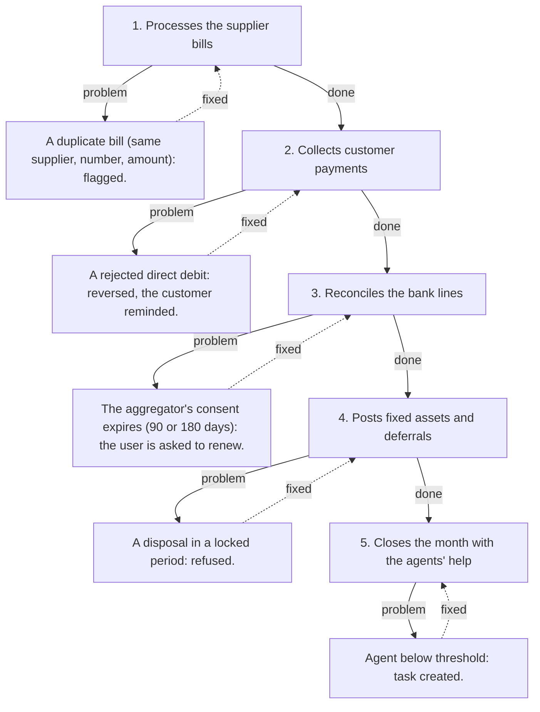

🏠 [Specs](../../../../README.md) › 🎨 [UX](../../../README.md) › 🪟 [Views](../../README.md) ›
🧮 [Accounting: app shell and home](../README.md) › 🧭 [Journeys](README.md) › 🧭 J-U05-01 Close the month

# 🧭 J-U05-01 Close the month

**Status:** ✅ specified

## Persona

[U05 Accounting](../../../../01-users/personas/u05-accounting.md)

## Goal

Close each month without retyping and give the external accountant clean exports.

## Journey

Satisfaction at each step, from 1 (painful) to 5 (effortless): these scores are drawn from the
specs and confirmed by the owner (D572).

## Flowchart

The same steps; each problem is the first error flow of the step's use case (once per use case), shown with the error
message pattern ([D122](../../../../06-decisions/ux/d122-error-message-standard.md)).

## Steps

| Step | Screen | Use case | What the persona does | What the system does |
|---|---|---|---|---|
| 1 | [S-F8-03 Supplier bills](../../../../02-functional/f08-accounting/screens/02-purchase-to-pay/s-f08-03-supplier-bills.md) | [UC-F8-03 Process supplier bills](../../../../02-functional/f08-accounting/use-cases/02-purchase-to-pay/uc-f08-03-process-supplier-bills.md) | Processes the supplier bills | The AI reads each bill; matches it to its order and receipt (F7); posts it. |
| 2 | [S-F8-05 Customer payments](../../../../02-functional/f08-accounting/screens/03-bank-and-collect/s-f08-05-customer-payments.md) | [UC-F8-05 Collect customer payments](../../../../02-functional/f08-accounting/use-cases/03-bank-and-collect/uc-f08-05-collect-customer-payments.md) | Collects customer payments | Matches payments to invoices (BR-F8-03); reminders run as F6's (BR-F6-05). |
| 3 | [S-F8-06 Bank reconciliation](../../../../02-functional/f08-accounting/screens/03-bank-and-collect/s-f08-06-bank-reconciliation.md) | [UC-F8-06 Connect banks and reconcile](../../../../02-functional/f08-accounting/use-cases/03-bank-and-collect/uc-f08-06-connect-banks-and-reconcile.md) | Reconciles the bank lines | Brings new lines daily; models and the AI match them (BR-F8-03). |
| 4 | [S-F8-08 Fixed assets](../../../../02-functional/f08-accounting/screens/04-tax-assets-and-analytics/s-f08-08-fixed-assets.md) | [UC-F8-08 Manage fixed assets and deferrals](../../../../02-functional/f08-accounting/use-cases/04-tax-assets-and-analytics/uc-f08-08-manage-fixed-assets-and-deferrals.md) | Posts fixed assets and deferrals | Posts depreciation monthly; spreads deferred revenues and expenses over their months. |
| 5 | [S-F8-17 Continuous close](../../../../02-functional/f08-accounting/screens/06-benchmark-additions/s-f08-17-continuous-close.md) | [UC-F8-17 Close continuously with agents](../../../../02-functional/f08-accounting/use-cases/06-benchmark-additions/uc-f08-17-close-continuously-with-agents.md) | Closes the month with the agents' help | Agents run (UC-F3-10); the checklist shows what is left. |

This persona's images of these flows (D120):
[FL-F8-02 Purchase to pay](../../../../02-functional/f08-accounting/images/02-purchase-to-pay/u05-accounting/README.md),
[FL-F8-03 Bank and collect](../../../../02-functional/f08-accounting/images/03-bank-and-collect/u05-accounting/README.md),
[FL-F8-04 Tax, assets and analytics](../../../../02-functional/f08-accounting/images/04-tax-assets-and-analytics/u05-accounting/README.md),
[FL-F8-06 Benchmark additions](../../../../02-functional/f08-accounting/images/06-benchmark-additions/u05-accounting/README.md).

## Open questions

None.

---

⬆️ [Up](README.md)
