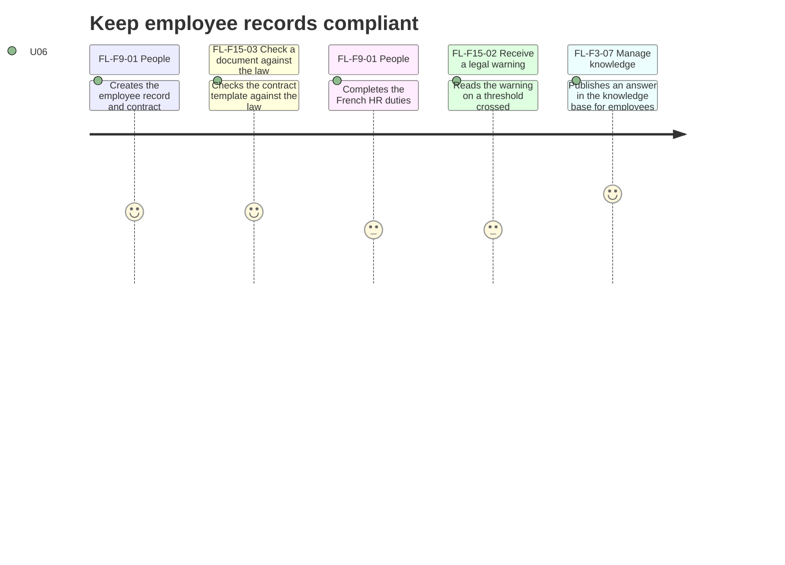
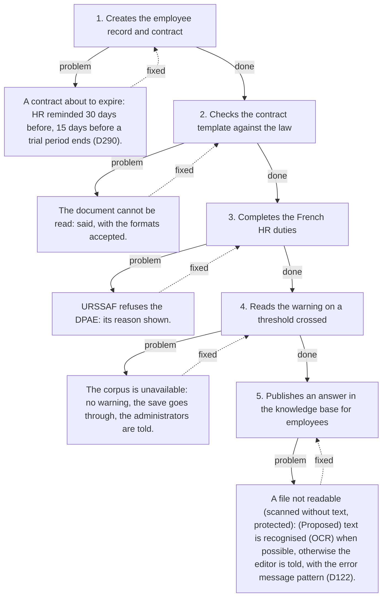

🏠 [Specs](../../../../README.md) › 🎨 [UX](../../../README.md) › 🪟 [Views](../../README.md) ›
🧑‍🤝‍🧑 [Human resources: app shell and home](../README.md) › 🧭 [Journeys](README.md) ›
🧭 J-U06-01 Keep employee records compliant

# 🧭 J-U06-01 Keep employee records compliant

**Status:** 🔄 waiting for the owner

## Persona

[U06 Human resources](../../../../01-users/personas/u06-hr.md)

## Goal

Keep every employee record complete and compliant, and answer employees' questions about their rights.

## Journey

Satisfaction at each step, from 1 (painful) to 5 (effortless): these scores are a proposal (Proposed), drawn from the
specs, for the owner to confirm.

## Flowchart

The same steps; each problem is the first error flow of the step's use case (once per use case), shown with the error
message pattern ([D122](../../../../06-decisions/ux/d122-error-message-standard.md)).

## Steps

| Step | Screen | Use case | What the persona does | What the system does |
|---|---|---|---|---|
| 1 | [S-F9-01 Employee](../../../../02-functional/f09-hr-and-projects/screens/01-people/s-f09-01-employee.md) | [UC-F9-01 Manage employee records and contracts](../../../../02-functional/f09-hr-and-projects/use-cases/01-people/uc-f09-01-manage-employee-records-and-contracts.md) | Creates the employee record and contract | Builds the org chart from managers; fills contracts from templates, with status and expiry. |
| 2 | [S-F15-03 Document check](../../../../02-functional/f15-legal-assistant/screens/03-check-a-document-against-the-law/s-f15-03-document-check.md) | [UC-F15-03 Check a document against the law](../../../../02-functional/f15-legal-assistant/use-cases/03-check-a-document-against-the-law/uc-f15-03-check-a-document-against-the-law.md) | Checks the contract template against the law | Reads it against the law in force (BR-F15-05); lists missing clauses with their article. |
| 3 | [S-F9-03 HR duties](../../../../02-functional/f09-hr-and-projects/screens/01-people/s-f09-03-hr-duties.md) | [UC-F9-03 Comply with French HR duties](../../../../02-functional/f09-hr-and-projects/use-cases/01-people/uc-f09-03-comply-with-french-hr-duties.md) | Completes the French HR duties | Sends the DPAE to URSSAF before the first day (BR-F9-03); updates the personnel register. |
| 4 | [S-F15-02 Legal warning](../../../../02-functional/f15-legal-assistant/screens/02-receive-a-legal-warning/s-f15-02-legal-warning.md) | [UC-F15-02 Receive a legal warning](../../../../02-functional/f15-legal-assistant/use-cases/02-receive-a-legal-warning/uc-f15-02-receive-a-legal-warning.md) | Reads the warning on a threshold crossed | Shows the rule, its article, version and date, and the facts it used (BR-F15-01). |
| 5 | [S-F3-08 Knowledge item editor](../../../../02-functional/f03-assistant/screens/07-manage-knowledge/s-f03-08-knowledge-item-editor.md) | [UC-F3-07 Manage the company knowledge base](../../../../02-functional/f03-assistant/use-cases/07-manage-knowledge/uc-f03-07-manage-the-company-knowledge-base.md) | Publishes an answer in the knowledge base for employees | Indexes the items for their audience (BR-F3-21) and asks for a review at its period (BR-F3-22). |

This persona's images of these flows (D120):
[FL-F9-01 People](../../../../02-functional/f09-hr-and-projects/images/01-people/u06-hr/README.md),
[FL-F15-03 Check a document against the law](../../../../02-functional/f15-legal-assistant/images/03-check-a-document-against-the-law/u06-hr/README.md),
[FL-F15-02 Receive a legal warning](../../../../02-functional/f15-legal-assistant/images/02-receive-a-legal-warning/u06-hr/README.md),
[FL-F3-07 Manage knowledge](../../../../02-functional/f03-assistant/images/07-manage-knowledge/u06-hr/README.md).

## Open questions

None.

---

⬆️ [Up](README.md)
