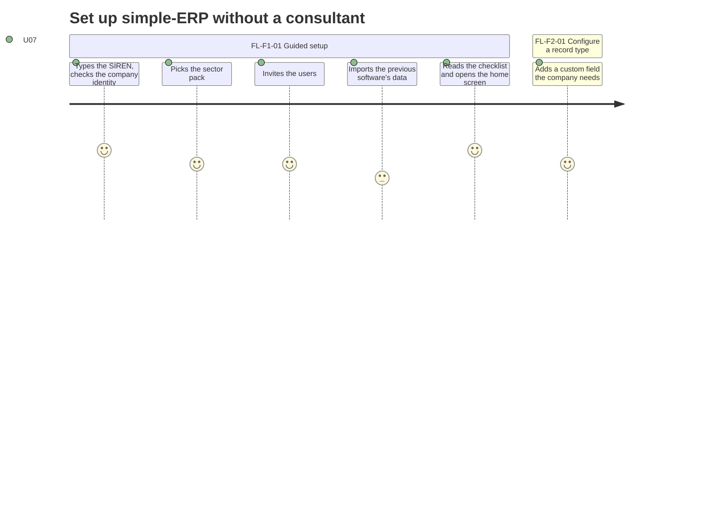
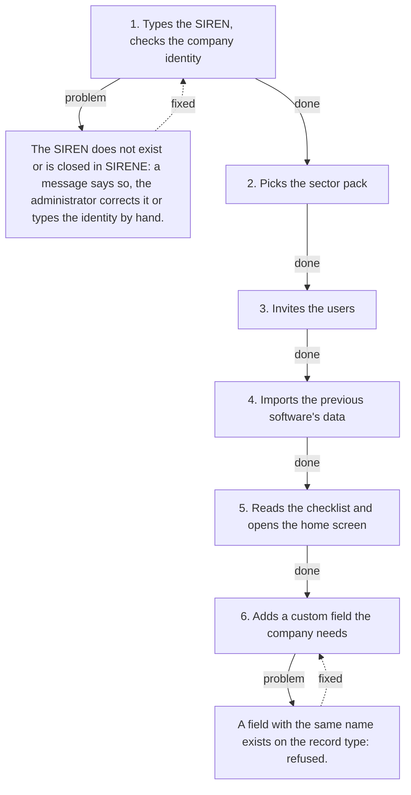

🏠 [Specs](../../../../README.md) › 🎨 [UX](../../../README.md) › 🪟 [Views](../../README.md) ›
🛡️ [Administrator: app shell and home](../README.md) › 🧭 [Journeys](README.md) ›
🧭 J-U07-01 Set up simple-ERP without a consultant

# 🧭 J-U07-01 Set up simple-ERP without a consultant

**Status:** 🔄 waiting for the owner

## Persona

[U07 Administrator](../../../../01-users/personas/u07-administrator.md)

## Goal

Set simple-ERP up without a consultant and adapt it to the company's field without a developer.

## Journey

Satisfaction at each step, from 1 (painful) to 5 (effortless): these scores are a proposal (Proposed), drawn from the
specs, for the owner to confirm.

## Flowchart

The same steps; each problem is the first error flow of the step's use case (once per use case), shown with the error
message pattern ([D122](../../../../06-decisions/ux/d122-error-message-standard.md)).

## Steps

| Step | Screen | Use case | What the persona does | What the system does |
|---|---|---|---|---|
| 1 | [S-F1-01 Setup wizard](../../../../02-functional/f01-administration/screens/01-guided-setup/s-f01-01-setup-wizard.md) | [UC-F1-01 Set up a new company](../../../../02-functional/f01-administration/use-cases/01-guided-setup/uc-f01-01-set-up-a-new-company.md) | Types the SIREN; checks the company identity | Fills the name, legal form, address and establishments from SIRENE (D60). |
| 2 | [S-F1-01 Setup wizard](../../../../02-functional/f01-administration/screens/01-guided-setup/s-f01-01-setup-wizard.md) | [UC-F1-01 Set up a new company](../../../../02-functional/f01-administration/use-cases/01-guided-setup/uc-f01-01-set-up-a-new-company.md) | Picks the sector pack | Offers the eight sector packs, or none. |
| 3 | [S-F1-01 Setup wizard](../../../../02-functional/f01-administration/screens/01-guided-setup/s-f01-01-setup-wizard.md) | [UC-F1-01 Set up a new company](../../../../02-functional/f01-administration/use-cases/01-guided-setup/uc-f01-01-set-up-a-new-company.md) | Invites the users | Sends the invitations by email, or turns single sign-on on (D55). |
| 4 | [S-F1-01 Setup wizard](../../../../02-functional/f01-administration/screens/01-guided-setup/s-f01-01-setup-wizard.md) | [UC-F1-01 Set up a new company](../../../../02-functional/f01-administration/use-cases/01-guided-setup/uc-f01-01-set-up-a-new-company.md) | Imports the previous software's data | Imports spreadsheet templates, the FEC or another ERP's data (D61). |
| 5 | [S-F1-01 Setup wizard](../../../../02-functional/f01-administration/screens/01-guided-setup/s-f01-01-setup-wizard.md) | [UC-F1-01 Set up a new company](../../../../02-functional/f01-administration/use-cases/01-guided-setup/uc-f01-01-set-up-a-new-company.md) | Reads the checklist and opens the home screen | Shows the checklist, all done, and opens the home screen. |
| 6 | [S-F2-01 Record type editor](../../../../02-functional/f02-no-code-configuration/screens/01-configure-a-record-type/s-f02-01-record-type-editor.md) | [UC-F2-01 Add a custom field to a record type](../../../../02-functional/f02-no-code-configuration/use-cases/01-configure-a-record-type/uc-f02-01-add-a-custom-field-to-a-record-type.md) | Adds a custom field the company needs | Adds the field to the record type with its type and rules (D101). |

This persona's images of these flows (D120):
[FL-F1-01 Guided setup](../../../../02-functional/f01-administration/images/01-guided-setup/u07-administrator/README.md),
[FL-F2-01 Configure a record type](../../../../02-functional/f02-no-code-configuration/images/01-configure-a-record-type/u07-administrator/README.md).

## Open questions

None.

---

⬆️ [Up](README.md)
