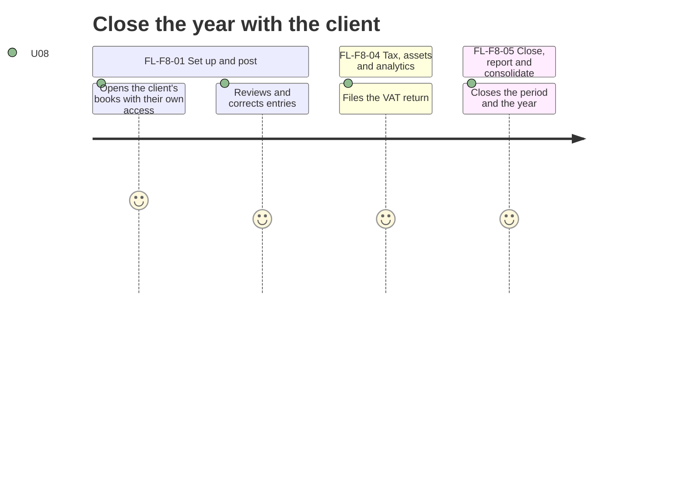
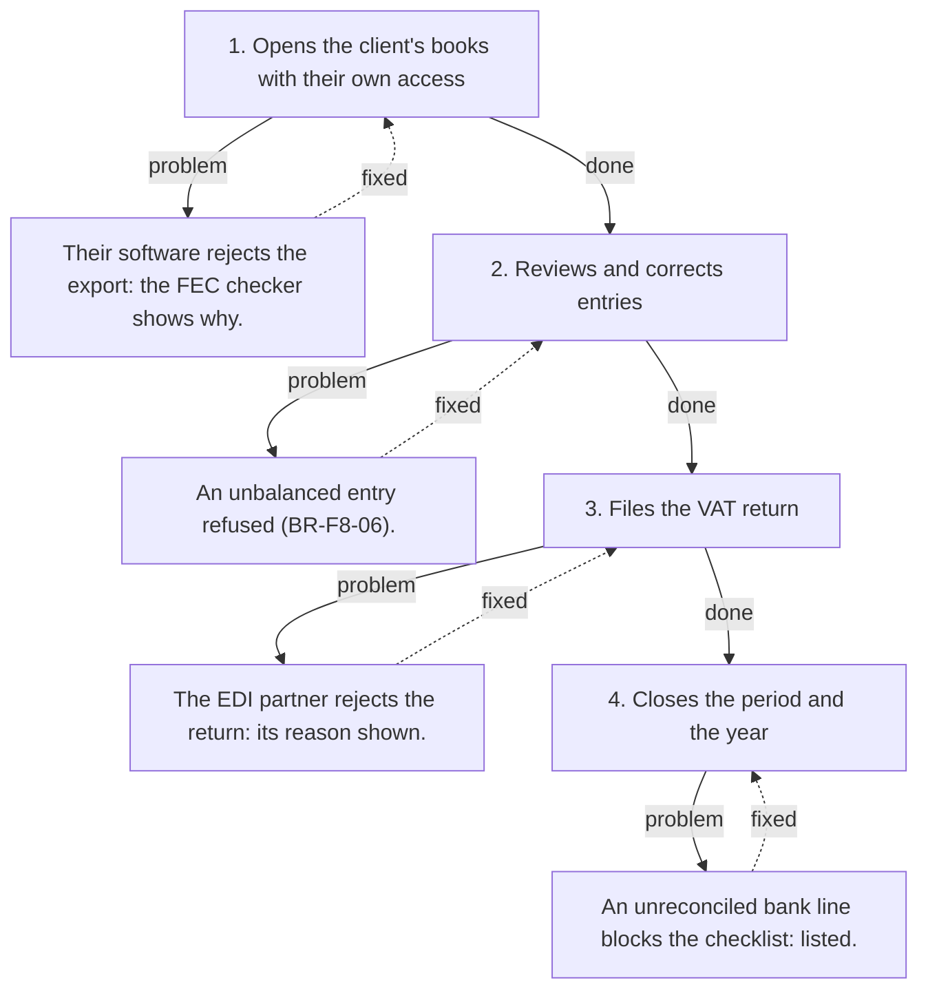

🏠 [Specs](../../../../README.md) › 🎨 [UX](../../../README.md) › 🪟 [Views](../../README.md) ›
📊 [External accountant: app shell and home](../README.md) › 🧭 [Journeys](README.md) ›
🧭 J-U08-01 Close the year with the client

# 🧭 J-U08-01 Close the year with the client

**Status:** 🔄 waiting for the owner

## Persona

[U08 External accountant](../../../../01-users/personas/u08-external-accountant.md)

## Goal

Get the books and exports without asking for them, and close the client's year.

## Journey

Satisfaction at each step, from 1 (painful) to 5 (effortless): these scores are a proposal (Proposed), drawn from the
specs, for the owner to confirm.

## Flowchart

The same steps; each problem is the first error flow of the step's use case (once per use case), shown with the error
message pattern ([D122](../../../../06-decisions/ux/d122-error-message-standard.md)).

## Steps

| Step | Screen | Use case | What the persona does | What the system does |
|---|---|---|---|---|
| 1 | [S-F8-14 Accountant workspace](../../../../02-functional/f08-accounting/screens/01-set-up-and-post/s-f08-14-accountant-workspace.md) | [UC-F8-14 Work with the external accountant](../../../../02-functional/f08-accounting/use-cases/01-set-up-and-post/uc-f08-14-work-with-the-external-accountant.md) | Opens the client's books with their own access | Gives their own access (D11) to one or several client companies. |
| 2 | [S-F8-02 Journal entries](../../../../02-functional/f08-accounting/screens/01-set-up-and-post/s-f08-02-journal-entries.md) | [UC-F8-02 Post and review entries](../../../../02-functional/f08-accounting/use-cases/01-set-up-and-post/uc-f08-02-post-and-review-entries.md) | Reviews and corrects entries | Links each answer to its question on the entry. |
| 3 | [S-F8-07 VAT returns](../../../../02-functional/f08-accounting/screens/04-tax-assets-and-analytics/s-f08-07-vat-returns.md) | [UC-F8-07 Manage VAT and file returns](../../../../02-functional/f08-accounting/use-cases/04-tax-assets-and-analytics/uc-f08-07-manage-vat-and-file-returns.md) | Files the VAT return | Computes VAT per rate and regime; prepares the CA3 or CA12. |
| 4 | [S-F8-10 Closing](../../../../02-functional/f08-accounting/screens/05-close-report-and-consolidate/s-f08-10-closing.md) | [UC-F8-10 Close the period and the year](../../../../02-functional/f08-accounting/use-cases/05-close-report-and-consolidate/uc-f08-10-close-the-period-and-the-year.md) | Closes the period and the year | Runs the closing checklist; sets lock dates (BR-F8-02); produces the FEC and the liasse fiscale. |

This persona's images of these flows (D120):
[FL-F8-01 Set up and post](../../../../02-functional/f08-accounting/images/01-set-up-and-post/u08-external-accountant/README.md),
[FL-F8-04 Tax, assets and analytics](../../../../02-functional/f08-accounting/images/04-tax-assets-and-analytics/u08-external-accountant/README.md),
[FL-F8-05 Close, report and consolidate](../../../../02-functional/f08-accounting/images/05-close-report-and-consolidate/u08-external-accountant/README.md).

## Open questions

None.

---

⬆️ [Up](README.md)
