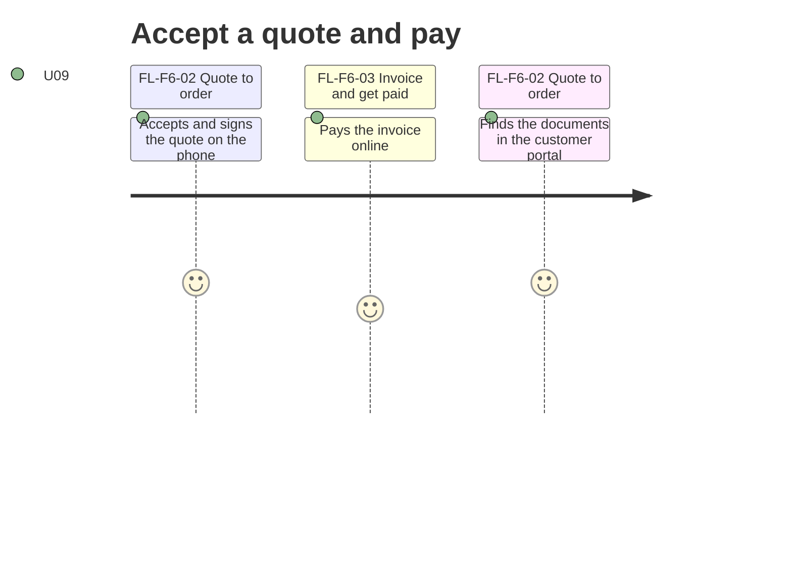
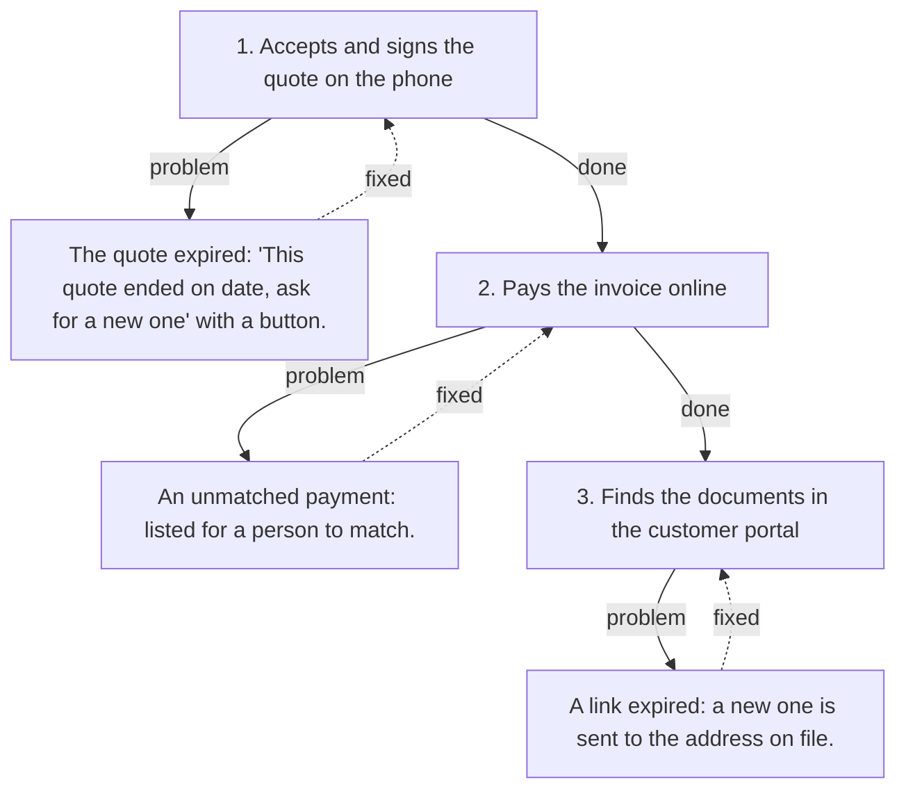

🏠 [Specs](../../../../README.md) › 🎨 [UX](../../../README.md) › 🪟 [Views](../../README.md) ›
🙋 [Customer: app shell and home](../README.md) › 🧭 [Journeys](README.md) › 🧭 J-U09-01 Accept a quote and pay

# 🧭 J-U09-01 Accept a quote and pay

**Status:** ✅ specified

## Persona

[U09 Customer](../../../../01-users/personas/u09-customer.md)

## Goal

Accept a quote and pay in a few taps, then find the documents again.

## Journey

Satisfaction at each step, from 1 (painful) to 5 (effortless): these scores are drawn from the
specs and confirmed by the owner (D572).

## Flowchart

The same steps; each problem is the first error flow of the step's use case (once per use case), shown with the error
message pattern ([D122](../../../../06-decisions/ux/d122-error-message-standard.md)).

## Steps

| Step | Screen | Use case | What the persona does | What the system does |
|---|---|---|---|---|
| 1 | [S-F6-04 Customer portal](../../../../02-functional/f06-customers-and-sales/screens/02-quote-to-order/s-f06-04-customer-portal.md) | [UC-F6-04 Accept or sign a quote](../../../../02-functional/f06-customers-and-sales/use-cases/02-quote-to-order/uc-f06-04-accept-or-sign-a-quote.md) | Accepts and signs the quote on the phone | Opens the quote from its link or account (BR-F6-03); asks a deposit if the quote says so. |
| 2 | [S-F6-07 Payments and reconciliation](../../../../02-functional/f06-customers-and-sales/screens/03-invoice-and-get-paid/s-f06-07-payments-and-reconciliation.md) | [UC-F6-07 Get paid online and reconcile](../../../../02-functional/f06-customers-and-sales/use-cases/03-invoice-and-get-paid/uc-f06-07-get-paid-online-and-reconcile.md) | Pays the invoice online | Takes card, wallet or SEPA direct debit (BR-F6-02); matches the payment to the invoice. |
| 3 | [S-F6-04 Customer portal](../../../../02-functional/f06-customers-and-sales/screens/02-quote-to-order/s-f06-04-customer-portal.md) | [UC-F6-11 Use the customer portal](../../../../02-functional/f06-customers-and-sales/use-cases/02-quote-to-order/uc-f06-11-use-the-customer-portal.md) | Finds the documents in the customer portal | Shows quotes, orders, invoices, subscriptions and requests to download. |

This persona's images of these flows (D120):
[FL-F6-02 Quote to order](../../../../02-functional/f06-customers-and-sales/images/02-quote-to-order/u09-customer/README.md).

## Open questions

None.

---

⬆️ [Up](README.md)
