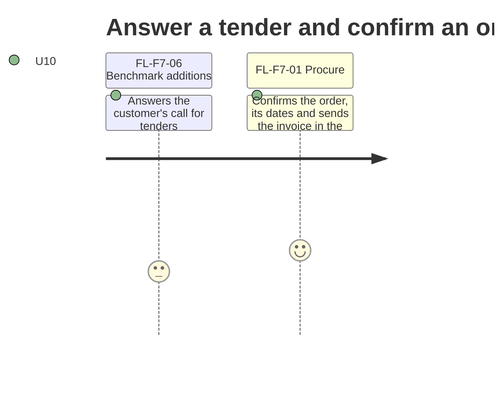
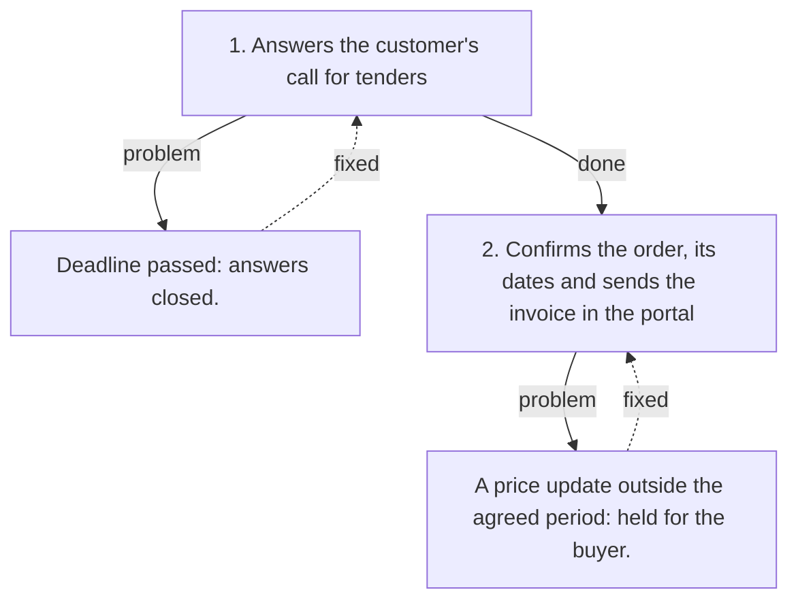

🏠 [Specs](../../../../README.md) › 🎨 [UX](../../../README.md) › 🪟 [Views](../../README.md) ›
🚚 [Supplier: app shell and home](../README.md) › 🧭 [Journeys](README.md) ›
🧭 J-U10-01 Answer a tender and confirm an order

# 🧭 J-U10-01 Answer a tender and confirm an order

**Status:** 🔄 waiting for the owner

## Persona

[U10 Supplier](../../../../01-users/personas/u10-supplier.md)

## Goal

Confirm orders and delivery dates quickly and get paid on time.

## Journey

Satisfaction at each step, from 1 (painful) to 5 (effortless): these scores are a proposal (Proposed), drawn from the
specs, for the owner to confirm.

## Flowchart

The same steps; each problem is the first error flow of the step's use case (once per use case), shown with the error
message pattern ([D122](../../../../06-decisions/ux/d122-error-message-standard.md)).

## Steps

| Step | Screen | Use case | What the persona does | What the system does |
|---|---|---|---|---|
| 1 | [S-F7-14 Tenders](../../../../02-functional/f07-purchasing-and-stock/screens/06-benchmark-additions/s-f07-14-tenders.md) | [UC-F7-14 Run a call for tenders and rate suppliers](../../../../02-functional/f07-purchasing-and-stock/use-cases/06-benchmark-additions/uc-f07-14-run-a-call-for-tenders-and-rate-suppliers.md) | Answers the customer's call for tenders | Collects the answers for the buyer to compare and choose. |
| 2 | [S-F7-12 Supplier portal](../../../../02-functional/f07-purchasing-and-stock/screens/01-procure/s-f07-12-supplier-portal.md) | [UC-F7-12 Use the supplier portal](../../../../02-functional/f07-purchasing-and-stock/use-cases/01-procure/uc-f07-12-use-the-supplier-portal.md) | Confirms the order, its dates and sends the invoice in the portal | Opens the order by its link or account (D17); holds the changes for the buyer's approval. |

This persona's images of these flows (D120):
[FL-F7-06 Benchmark additions](../../../../02-functional/f07-purchasing-and-stock/images/06-benchmark-additions/u10-supplier/README.md),
[FL-F7-01 Procure](../../../../02-functional/f07-purchasing-and-stock/images/01-procure/u10-supplier/README.md).

## Open questions

None.

---

⬆️ [Up](README.md)
