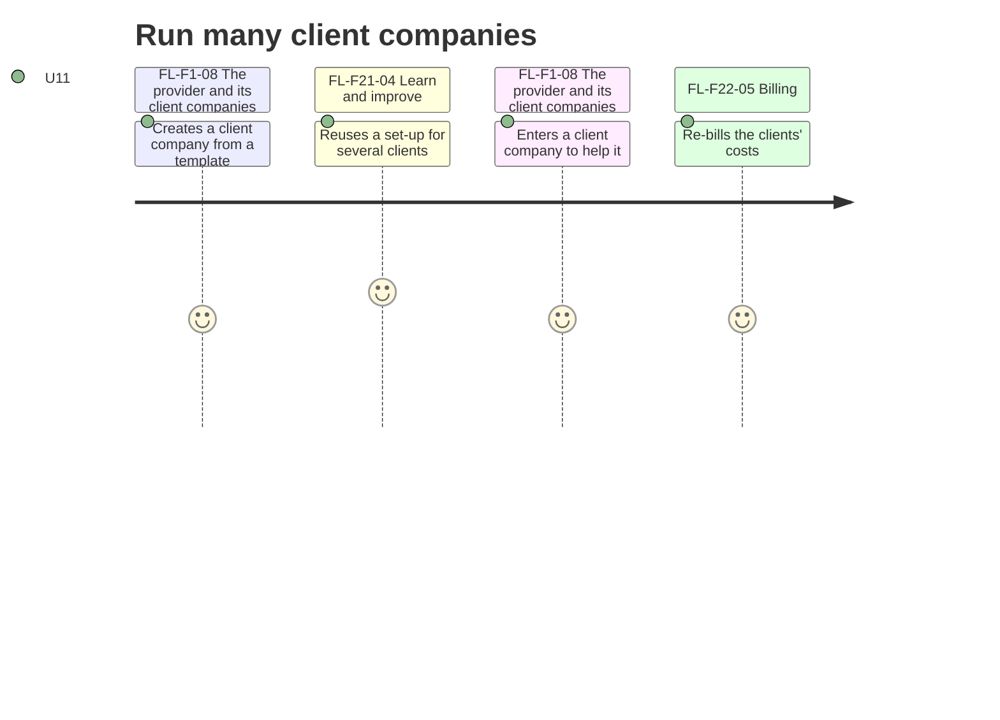
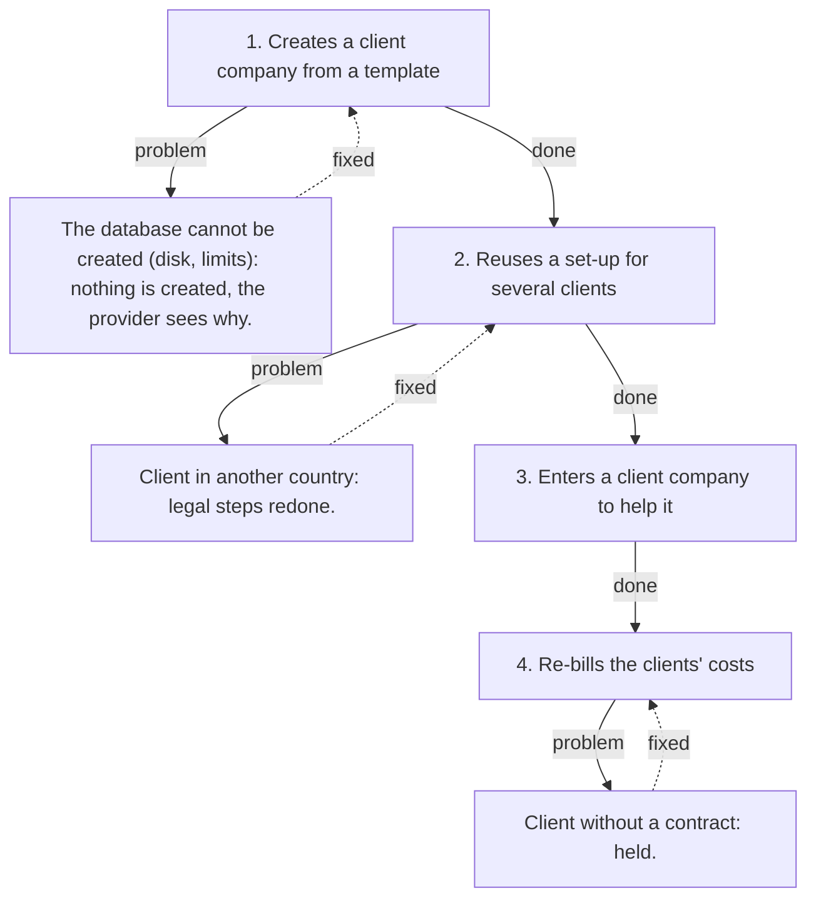

🏠 [Specs](../../../../README.md) › 🎨 [UX](../../../README.md) › 🪟 [Views](../../README.md) ›
🖧 [IT provider administrator: app shell and home](../README.md) › 🧭 [Journeys](README.md) ›
🧭 J-U11-01 Run many client companies

# 🧭 J-U11-01 Run many client companies

**Status:** ✅ specified

## Persona

[U11 IT provider administrator](../../../../01-users/personas/u11-provider-admin.md)

## Goal

Run many client companies from one place and update them safely.

## Journey

Satisfaction at each step, from 1 (painful) to 5 (effortless): these scores are drawn from the
specs and confirmed by the owner (D572).

## Flowchart

The same steps; each problem is the first error flow of the step's use case (once per use case), shown with the error
message pattern ([D122](../../../../06-decisions/ux/d122-error-message-standard.md)).

## Steps

| Step | Screen | Use case | What the persona does | What the system does |
|---|---|---|---|---|
| 1 | [S-F1-10 Client companies](../../../../02-functional/f01-administration/screens/08-provider-and-client-companies/s-f01-10-client-companies.md) | [UC-F1-10 Create a client company on the platform](../../../../02-functional/f01-administration/use-cases/08-provider-and-client-companies/uc-f01-10-create-a-client-company-on-the-platform.md) | Creates a client company from a template | Creates the company's database and copies the template's configuration (D88). |
| 2 | [S-F21-19 Provider templates](../../../../02-functional/f21-onboarding-and-modules/screens/04-learn-and-improve/s-f21-19-provider-templates.md) | [UC-F21-19 Reuse a set-up for several clients](../../../../02-functional/f21-onboarding-and-modules/use-cases/04-learn-and-improve/uc-f21-19-reuse-a-set-up-for-several-clients.md) | Reuses a set-up for several clients | Applies the saved set-up to the client; legal steps redone for another country. |
| 3 | [S-F1-10 Client companies](../../../../02-functional/f01-administration/screens/08-provider-and-client-companies/s-f01-10-client-companies.md) | [UC-F1-11 Enter a client company to support it](../../../../02-functional/f01-administration/use-cases/08-provider-and-client-companies/uc-f01-11-enter-a-client-company-to-support-it.md) | Enters a client company to help it | Opens a session, logs it in the client's provider access log and tells its administrators (D89). |
| 4 | [S-F22-16 Client re-billing](../../../../02-functional/f22-unified-cost-management/screens/05-billing/s-f22-16-client-re-billing.md) | [UC-F22-16 Re-bill clients as an IT provider](../../../../02-functional/f22-unified-cost-management/use-cases/05-billing/uc-f22-16-re-bill-clients-as-an-it-provider.md) | Re-bills the clients' costs | Prepares the re-billing per client for the chosen period. |

This persona's images of these flows (D120):
[FL-F1-08 The provider and its client companies](../../../../02-functional/f01-administration/images/08-provider-and-client-companies/u11-provider-admin/README.md),
[FL-F21-04 Learn and improve](../../../../02-functional/f21-onboarding-and-modules/images/04-learn-and-improve/u11-provider-admin/README.md),
[FL-F22-05 Billing](../../../../02-functional/f22-unified-cost-management/images/05-billing/u11-provider-admin/README.md).

## Open questions

None.

---

⬆️ [Up](README.md)
