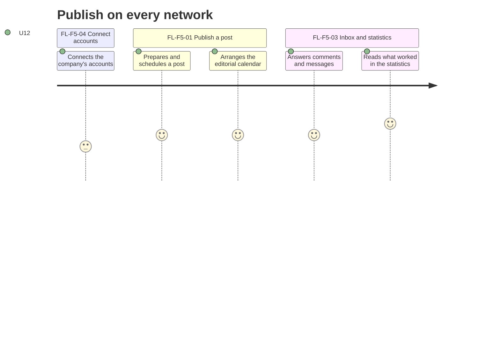
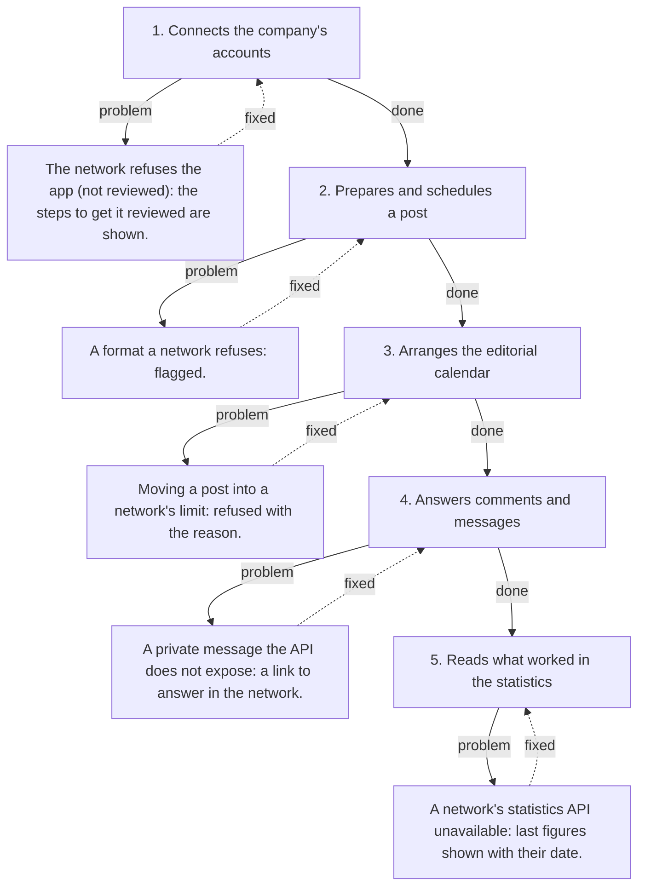

🏠 [Specs](../../../../README.md) › 🎨 [UX](../../../README.md) › 🪟 [Views](../../README.md) ›
📣 [Marketing and communication: app shell and home](../README.md) › 🧭 [Journeys](README.md) ›
🧭 J-U12-01 Publish on every network

# 🧭 J-U12-01 Publish on every network

**Status:** ✅ specified

## Persona

[U12 Marketing and communication](../../../../01-users/personas/u12-marketing.md)

## Goal

Publish consistent posts on every network from one place and know what works.

## Journey

Satisfaction at each step, from 1 (painful) to 5 (effortless): these scores are drawn from the
specs and confirmed by the owner (D572).

## Flowchart

The same steps; each problem is the first error flow of the step's use case (once per use case), shown with the error
message pattern ([D122](../../../../06-decisions/ux/d122-error-message-standard.md)).

## Steps

| Step | Screen | Use case | What the persona does | What the system does |
|---|---|---|---|---|
| 1 | [S-F5-07 Social accounts](../../../../02-functional/f05-social-media/screens/04-connect-accounts/s-f05-07-social-accounts.md) | [UC-F5-07 Connect the company's accounts](../../../../02-functional/f05-social-media/use-cases/04-connect-accounts/uc-f05-07-connect-the-company-s-accounts.md) | Connects the company's accounts | Keeps the app's keys in the vault (BR-F5-07). |
| 2 | [S-F5-01 Post composer](../../../../02-functional/f05-social-media/screens/01-publish-a-post/s-f05-01-post-composer.md) | [UC-F5-01 Prepare and schedule a post](../../../../02-functional/f05-social-media/use-cases/01-publish-a-post/uc-f05-01-prepare-and-schedule-a-post.md) | Prepares and schedules a post | Adapts the post per network (BR-F5-03) and suggests times. |
| 3 | [S-F5-04 Automatic post rules](../../../../02-functional/f05-social-media/screens/01-publish-a-post/s-f05-04-automatic-post-rules.md) | [UC-F5-04 Manage the editorial calendar](../../../../02-functional/f05-social-media/use-cases/01-publish-a-post/uc-f05-04-manage-the-editorial-calendar.md) | Arranges the editorial calendar | Shows every post by day and network, with gaps and suggested times. |
| 4 | [S-F5-05 Social inbox](../../../../02-functional/f05-social-media/screens/03-inbox-and-statistics/s-f05-05-social-inbox.md) | [UC-F5-05 Answer comments and messages](../../../../02-functional/f05-social-media/use-cases/03-inbox-and-statistics/uc-f05-05-answer-comments-and-messages.md) | Answers comments and messages | Lists comments and messages (BR-F5-05); the AI suggests a reply; links known customers. |
| 5 | [S-F5-06 Social statistics](../../../../02-functional/f05-social-media/screens/03-inbox-and-statistics/s-f05-06-social-statistics.md) | [UC-F5-06 Read statistics](../../../../02-functional/f05-social-media/use-cases/03-inbox-and-statistics/uc-f05-06-read-statistics.md) | Reads what worked in the statistics | Shows reach, engagement, clicks and the leads and orders traced (BR-F5-06). |

This persona's images of these flows (D120):
[FL-F5-01 Publish a post](../../../../02-functional/f05-social-media/images/01-publish-a-post/u12-marketing/README.md),
[FL-F5-03 Inbox and statistics](../../../../02-functional/f05-social-media/images/03-inbox-and-statistics/u12-marketing/README.md).

## Open questions

None.

---

⬆️ [Up](README.md)
