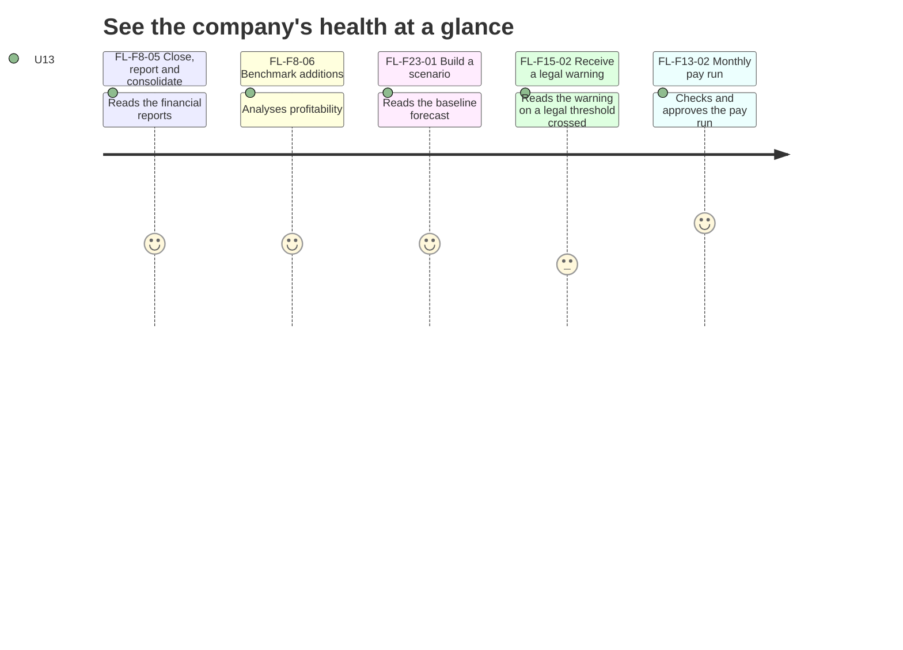
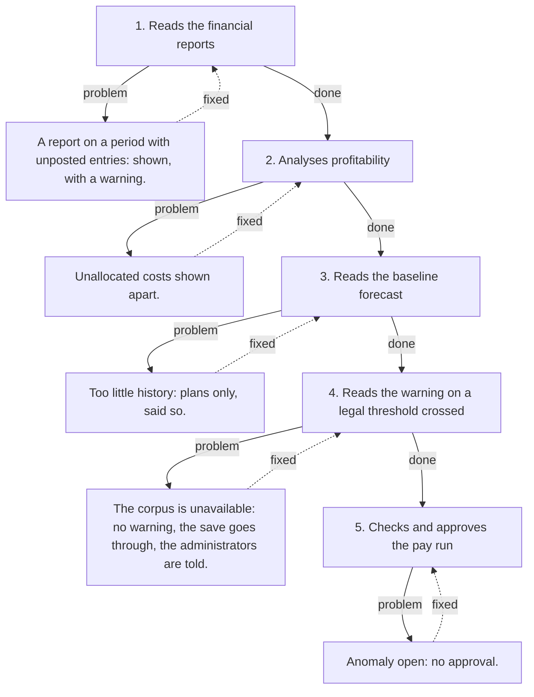

🏠 [Specs](../../../../README.md) › 🎨 [UX](../../../README.md) › 🪟 [Views](../../README.md) ›
👑 [Owner: app shell and home](../README.md) › 🧭 [Journeys](README.md) ›
🧭 J-U13-01 See the company's health at a glance

# 🧭 J-U13-01 See the company's health at a glance

**Status:** ✅ specified

## Persona

[U13 Owner](../../../../01-users/personas/u13-owner.md)

## Goal

See the company's health at a glance and know the company's legal obligations.

## Journey

Satisfaction at each step, from 1 (painful) to 5 (effortless): these scores are drawn from the
specs and confirmed by the owner (D572).

## Flowchart

The same steps; each problem is the first error flow of the step's use case (once per use case), shown with the error
message pattern ([D122](../../../../06-decisions/ux/d122-error-message-standard.md)).

## Steps

| Step | Screen | Use case | What the persona does | What the system does |
|---|---|---|---|---|
| 1 | [S-F8-11 Financial reports](../../../../02-functional/f08-accounting/screens/05-close-report-and-consolidate/s-f08-11-financial-reports.md) | [UC-F8-11 Read financial reports](../../../../02-functional/f08-accounting/use-cases/05-close-report-and-consolidate/uc-f08-11-read-financial-reports.md) | Reads the financial reports | Opens each report with drill-down to entries, compared by period, budget and company. |
| 2 | [S-F8-20 Profitability](../../../../02-functional/f08-accounting/screens/06-benchmark-additions/s-f08-20-profitability.md) | [UC-F8-20 Analyse profitability](../../../../02-functional/f08-accounting/use-cases/06-benchmark-additions/uc-f08-20-analyse-profitability.md) | Analyses profitability | Drills down by the chosen dimensions to the entries. |
| 3 | [S-F23-01 Baseline](../../../../02-functional/f23-what-if-simulation/screens/01-build-a-scenario/s-f23-01-baseline.md) | [UC-F23-01 See the baseline forecast](../../../../02-functional/f23-what-if-simulation/use-cases/01-build-a-scenario/uc-f23-01-see-the-baseline-forecast.md) | Reads the baseline forecast | Shows the forecast over the chosen horizon. |
| 4 | [S-F15-02 Legal warning](../../../../02-functional/f15-legal-assistant/screens/02-receive-a-legal-warning/s-f15-02-legal-warning.md) | [UC-F15-02 Receive a legal warning](../../../../02-functional/f15-legal-assistant/use-cases/02-receive-a-legal-warning/uc-f15-02-receive-a-legal-warning.md) | Reads the warning on a legal threshold crossed | Shows the rule, its article, version and date, and the facts it used (BR-F15-01). |
| 5 | [S-F13-07 Pay run](../../../../02-functional/f13-payroll/screens/02-monthly-pay-run/s-f13-07-pay-run.md) | [UC-F13-07 Check and approve the pay run](../../../../02-functional/f13-payroll/use-cases/02-monthly-pay-run/uc-f13-07-check-and-approve-the-pay-run.md) | Checks and approves the pay run | Lists the anomalies; no approval while one is open. |

This persona's images of these flows (D120):
[FL-F8-05 Close, report and consolidate](../../../../02-functional/f08-accounting/images/05-close-report-and-consolidate/u13-owner/README.md),
[FL-F8-06 Benchmark additions](../../../../02-functional/f08-accounting/images/06-benchmark-additions/u13-owner/README.md),
[FL-F23-01 Build a scenario](../../../../02-functional/f23-what-if-simulation/images/01-build-a-scenario/u13-owner/README.md),
[FL-F15-02 Receive a legal warning](../../../../02-functional/f15-legal-assistant/images/02-receive-a-legal-warning/u13-owner/README.md),
[FL-F13-02 Monthly pay run](../../../../02-functional/f13-payroll/images/02-monthly-pay-run/u13-owner/README.md).

## Open questions

None.

---

⬆️ [Up](README.md)
