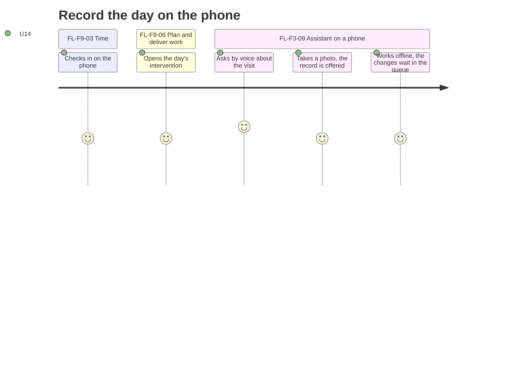
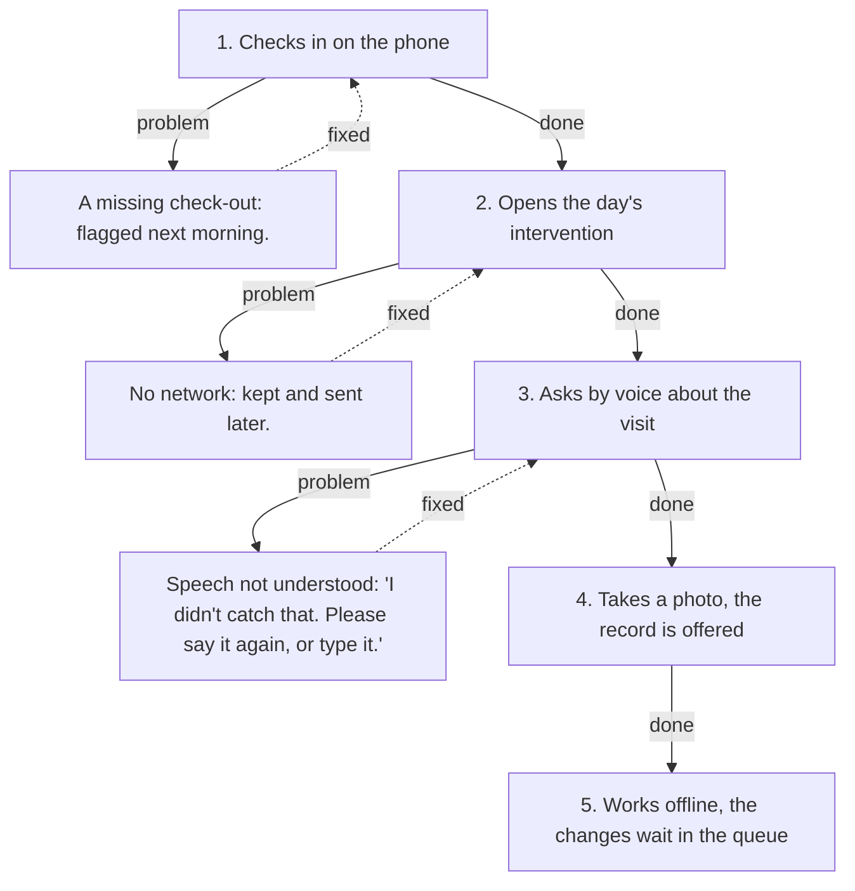

🏠 [Specs](../../../../README.md) › 🎨 [UX](../../../README.md) › 🪟 [Views](../../README.md) ›
🦺 [Field worker: app shell and home](../README.md) › 🧭 [Journeys](README.md) › 🧭 J-U14-01 Record the day on the phone

# 🧭 J-U14-01 Record the day on the phone

**Status:** 🔄 waiting for the owner

## Persona

[U14 Field worker](../../../../01-users/personas/u14-field-worker.md)

## Goal

See the schedule and tasks on the phone and record the time without effort, even offline.

## Journey

Satisfaction at each step, from 1 (painful) to 5 (effortless): these scores are a proposal (Proposed), drawn from the
specs, for the owner to confirm.

## Flowchart

The same steps; each problem is the first error flow of the step's use case (once per use case), shown with the error
message pattern ([D122](../../../../06-decisions/ux/d122-error-message-standard.md)).

## Steps

| Step | Screen | Use case | What the persona does | What the system does |
|---|---|---|---|---|
| 1 | [S-F9-10 Attendance](../../../../02-functional/f09-hr-and-projects/screens/03-time/s-f09-10-attendance.md) | [UC-F9-10 Record attendance and overtime](../../../../02-functional/f09-hr-and-projects/use-cases/03-time/uc-f09-10-record-attendance-and-overtime.md) | Checks in on the phone | Records the check-in, with the location where turned on (BR-F9-06). |
| 2 | [S-F9-18 Field service](../../../../02-functional/f09-hr-and-projects/screens/06-plan-and-deliver-work/s-f09-18-field-service.md) | [UC-F9-18 Run field service](../../../../02-functional/f09-hr-and-projects/use-cases/06-plan-and-deliver-work/uc-f09-18-run-field-service.md) | Opens the day's intervention | Shows the planned task; keeps the worksheet offline if needed (D38). |
| 3 | [S-F3-11 Phone assistant](../../../../02-functional/f03-assistant/screens/09-assistant-on-a-phone/s-f03-11-phone-assistant.md) | [UC-F3-09 Use the AI assistant on a phone](../../../../02-functional/f03-assistant/use-cases/09-assistant-on-a-phone/uc-f03-09-use-the-assistant-on-a-phone.md) | Asks by voice about the visit | Shows the task and the day on the AI assistant's chip (BR-F3-31); reads the answer aloud. |
| 4 | [S-F3-11 Phone assistant](../../../../02-functional/f03-assistant/screens/09-assistant-on-a-phone/s-f03-11-phone-assistant.md) | [UC-F3-09 Use the AI assistant on a phone](../../../../02-functional/f03-assistant/use-cases/09-assistant-on-a-phone/uc-f03-09-use-the-assistant-on-a-phone.md) | Takes a photo; the record is offered | Reads the photo and offers the record to confirm by voice or by the card. |
| 5 | [S-F3-11 Phone assistant](../../../../02-functional/f03-assistant/screens/09-assistant-on-a-phone/s-f03-11-phone-assistant.md) | [UC-F3-09 Use the AI assistant on a phone](../../../../02-functional/f03-assistant/use-cases/09-assistant-on-a-phone/uc-f03-09-use-the-assistant-on-a-phone.md) | Works offline; the changes wait in the queue | Queues the change and sends it when the network is back (D38). |

This persona's images of these flows (D120):
[FL-F9-03 Time](../../../../02-functional/f09-hr-and-projects/images/03-time/u14-field-worker/README.md),
[FL-F9-06 Plan and deliver work](../../../../02-functional/f09-hr-and-projects/images/06-plan-and-deliver-work/u14-field-worker/README.md),
[FL-F3-09 Assistant on a phone](../../../../02-functional/f03-assistant/images/09-assistant-on-a-phone/u14-field-worker/README.md).

## Open questions

None.

---

⬆️ [Up](README.md)
