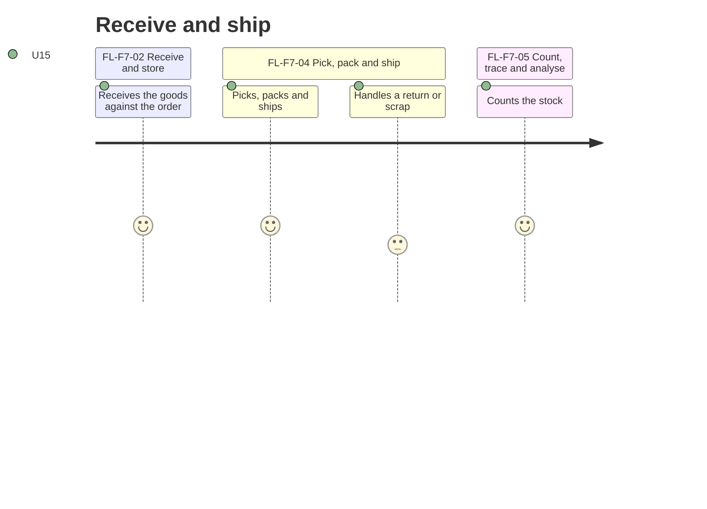
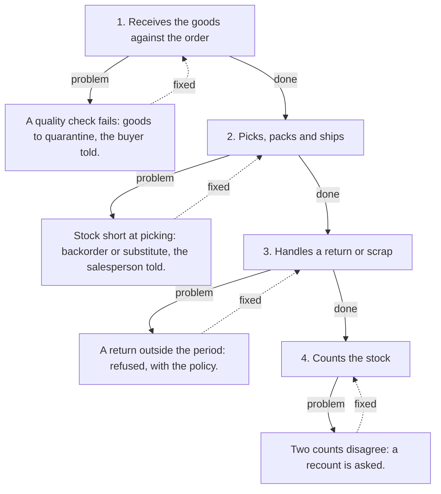

🏠 [Specs](../../../../README.md) › 🎨 [UX](../../../README.md) › 🪟 [Views](../../README.md) ›
🏷️ [Warehouse operator: app shell and home](../README.md) › 🧭 [Journeys](README.md) › 🧭 J-U15-01 Receive and ship

# 🧭 J-U15-01 Receive and ship

**Status:** ✅ specified

## Persona

[U15 Warehouse operator](../../../../01-users/personas/u15-warehouse-operator.md)

## Goal

Know what to receive and what to pick, in order.

## Journey

Satisfaction at each step, from 1 (painful) to 5 (effortless): these scores are drawn from the
specs and confirmed by the owner (D572).

## Flowchart

The same steps; each problem is the first error flow of the step's use case (once per use case), shown with the error
message pattern ([D122](../../../../06-decisions/ux/d122-error-message-standard.md)).

## Steps

| Step | Screen | Use case | What the persona does | What the system does |
|---|---|---|---|---|
| 1 | [S-F7-03 Receipt](../../../../02-functional/f07-purchasing-and-stock/screens/02-receive-and-store/s-f07-03-receipt.md) | [UC-F7-03 Receive goods](../../../../02-functional/f07-purchasing-and-stock/use-cases/02-receive-and-store/uc-f07-03-receive-goods.md) | Receives the goods against the order | Records quantities, lots, serials and expiry dates (BR-F7-05); gives the putaway location. |
| 2 | [S-F7-06 Pick, pack and ship](../../../../02-functional/f07-purchasing-and-stock/screens/04-pick-pack-and-ship/s-f07-06-pick-pack-and-ship.md) | [UC-F7-06 Pick, pack and ship](../../../../02-functional/f07-purchasing-and-stock/use-cases/04-pick-pack-and-ship/uc-f07-06-pick-pack-and-ship.md) | Picks, packs and ships | Reserves the stock, applies the removal strategy (BR-F7-04) and groups pickings. |
| 3 | [S-F7-10 Returns and scrap](../../../../02-functional/f07-purchasing-and-stock/screens/04-pick-pack-and-ship/s-f07-10-returns-and-scrap.md) | [UC-F7-10 Handle returns and scrap](../../../../02-functional/f07-purchasing-and-stock/use-cases/04-pick-pack-and-ship/uc-f07-10-handle-returns-and-scrap.md) | Handles a return or scrap | Values refurbished, restocked or scrapped goods for accounting. |
| 4 | [S-F7-07 Stock count](../../../../02-functional/f07-purchasing-and-stock/screens/05-count-trace-and-analyse/s-f07-07-stock-count.md) | [UC-F7-07 Count stock](../../../../02-functional/f07-purchasing-and-stock/use-cases/05-count-trace-and-analyse/uc-f07-07-count-stock.md) | Counts the stock | Adjusts and values the stock; differences above a threshold need a manager (BR-F7-06). |

This persona's images of these flows (D120):
[FL-F7-02 Receive and store](../../../../02-functional/f07-purchasing-and-stock/images/02-receive-and-store/u15-warehouse-operator/README.md),
[FL-F7-04 Pick, pack and ship](../../../../02-functional/f07-purchasing-and-stock/images/04-pick-pack-and-ship/u15-warehouse-operator/README.md),
[FL-F7-05 Count, trace and analyse](../../../../02-functional/f07-purchasing-and-stock/images/05-count-trace-and-analyse/u15-warehouse-operator/README.md).

## Open questions

None.

---

⬆️ [Up](README.md)
