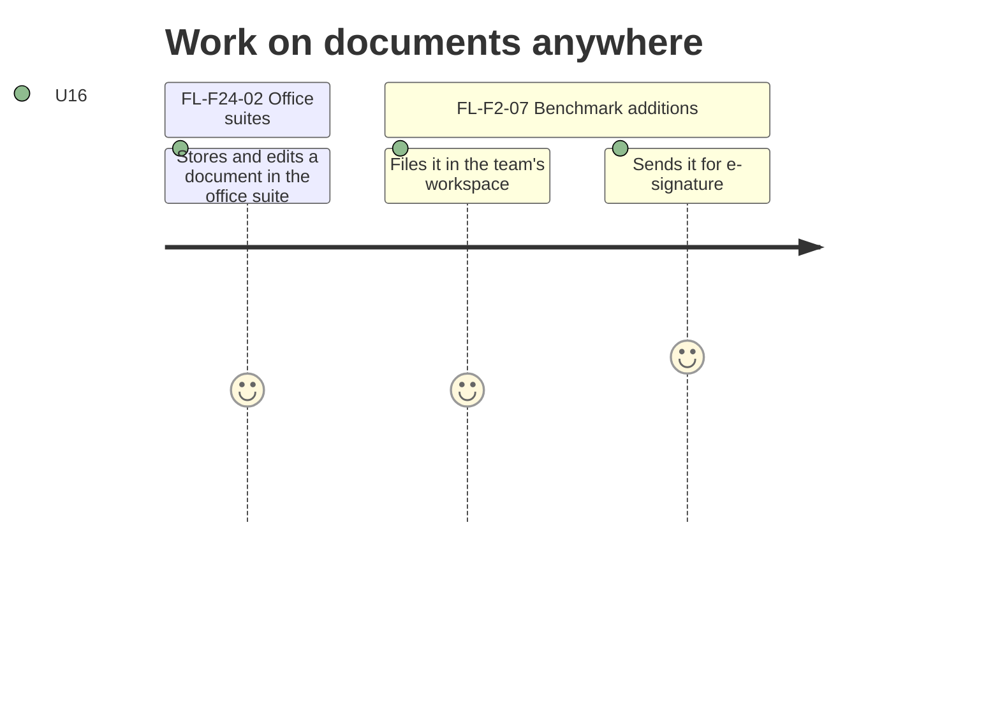
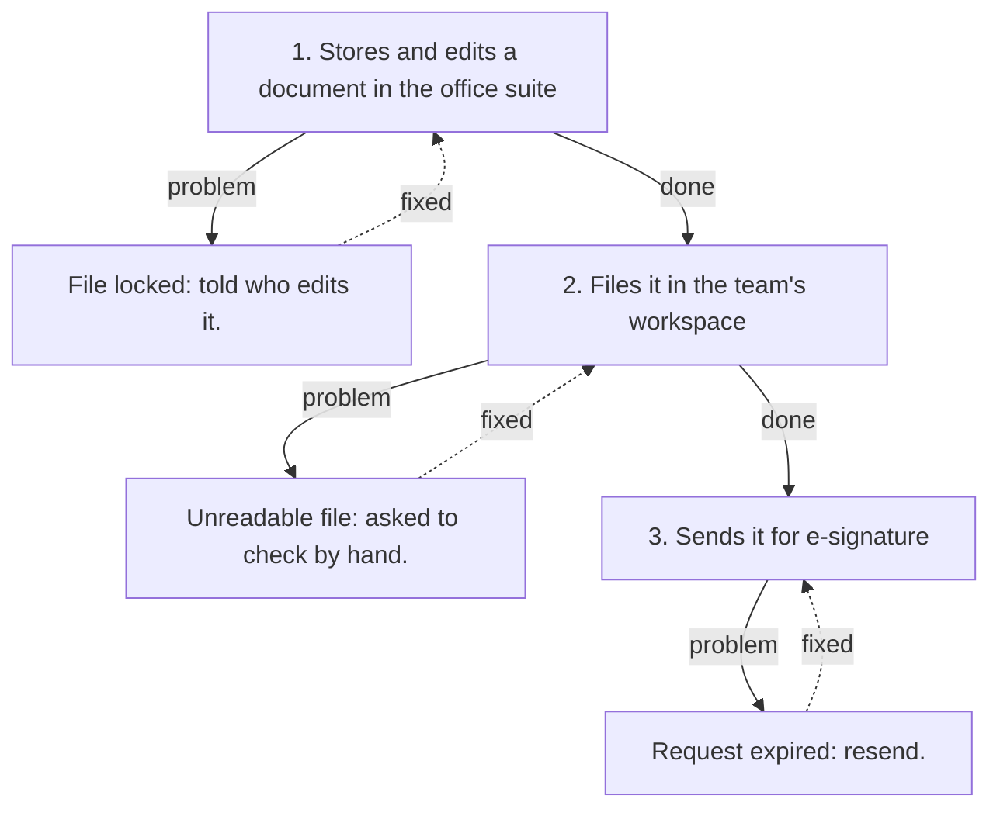

🏠 [Specs](../../../../README.md) › 🎨 [UX](../../../README.md) › 🪟 [Views](../../README.md) ›
💻 [Office worker: app shell and home](../README.md) › 🧭 [Journeys](README.md) › 🧭 J-U16-01 Work on documents anywhere

# 🧭 J-U16-01 Work on documents anywhere

**Status:** ✅ specified

## Persona

[U16 Office worker](../../../../01-users/personas/u16-office-worker.md)

## Goal

Work the same way at the office and at home.

## Journey

Satisfaction at each step, from 1 (painful) to 5 (effortless): these scores are drawn from the
specs and confirmed by the owner (D572).

## Flowchart

The same steps; each problem is the first error flow of the step's use case (once per use case), shown with the error
message pattern ([D122](../../../../06-decisions/ux/d122-error-message-standard.md)).

## Steps

| Step | Screen | Use case | What the persona does | What the system does |
|---|---|---|---|---|
| 1 | [S-F24-04 Suite files](../../../../02-functional/f24-integrations-hub/screens/02-office-suites/s-f24-04-suite-files.md) | [UC-F24-04 Store and edit documents in the suite](../../../../02-functional/f24-integrations-hub/use-cases/02-office-suites/uc-f24-04-store-and-edit-documents-in-the-suite.md) | Stores and edits a document in the office suite | Saves it in the chosen folder and lets the team edit together. |
| 2 | [S-F2-13 Documents workspace](../../../../02-functional/f02-no-code-configuration/screens/07-benchmark-additions/s-f02-13-documents-workspace.md) | [UC-F2-13 Manage documents in a workspace](../../../../02-functional/f02-no-code-configuration/use-cases/07-benchmark-additions/uc-f02-13-manage-documents-in-a-workspace.md) | Files it in the team's workspace | The AI reads and files it; rules tag and route it for a person to validate. |
| 3 | [S-F2-14 Signature requests](../../../../02-functional/f02-no-code-configuration/screens/07-benchmark-additions/s-f02-14-signature-requests.md) | [UC-F2-14 Send documents for e-signature](../../../../02-functional/f02-no-code-configuration/use-cases/07-benchmark-additions/uc-f02-14-send-documents-for-e-signature.md) | Sends it for e-signature | Sends it to the signers in order with reminders; files the signed copy and the proof. |

This persona's images of these flows (D120):
[FL-F24-02 Office suites](../../../../02-functional/f24-integrations-hub/images/02-office-suites/u16-office-worker/README.md),
[FL-F2-07 Benchmark additions](../../../../02-functional/f02-no-code-configuration/images/07-benchmark-additions/u16-office-worker/README.md).

## Open questions

None.

---

⬆️ [Up](README.md)
