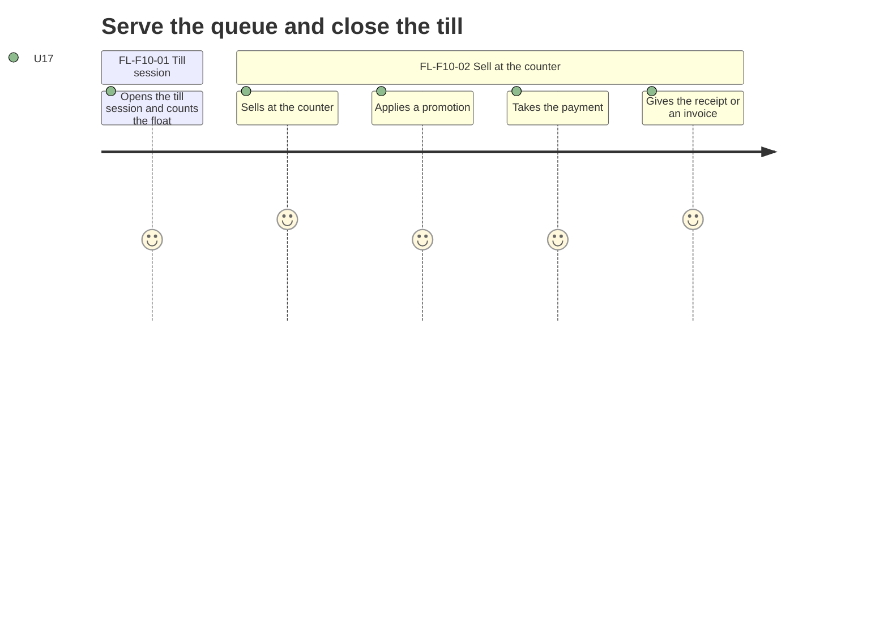
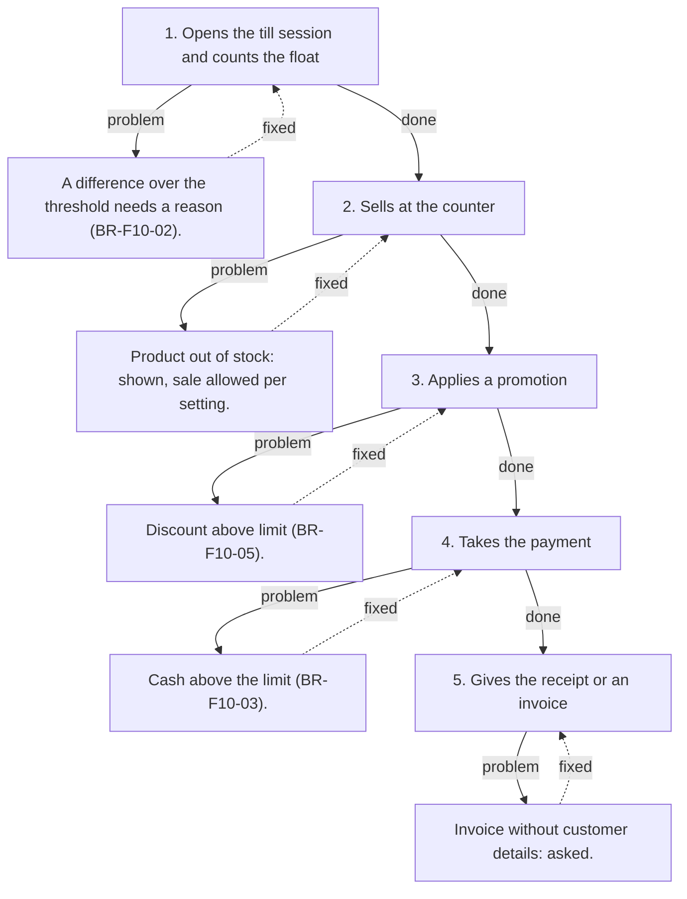

🏠 [Specs](../../../../README.md) › 🎨 [UX](../../../README.md) › 🪟 [Views](../../README.md) ›
🧾 [Cashier: app shell and home](../README.md) › 🧭 [Journeys](README.md) ›
🧭 J-U17-01 Serve the queue and close the till

# 🧭 J-U17-01 Serve the queue and close the till

**Status:** 🔄 waiting for the owner

## Persona

[U17 Cashier](../../../../01-users/personas/u17-cashier.md)

## Goal

Serve the queue fast, with no mistake in the till, and close the till with no difference.

## Journey

Satisfaction at each step, from 1 (painful) to 5 (effortless): these scores are a proposal (Proposed), drawn from the
specs, for the owner to confirm.

## Flowchart

The same steps; each problem is the first error flow of the step's use case (once per use case), shown with the error
message pattern ([D122](../../../../06-decisions/ux/d122-error-message-standard.md)).

## Steps

| Step | Screen | Use case | What the persona does | What the system does |
|---|---|---|---|---|
| 1 | [S-F10-01 Till session](../../../../02-functional/f10-point-of-sale/screens/01-till-session/s-f10-01-till-session.md) | [UC-F10-01 Open and close a till session](../../../../02-functional/f10-point-of-sale/use-cases/01-till-session/uc-f10-01-open-and-close-a-till-session.md) | Opens the till session and counts the float | Opens the session and records cash in and out with reasons. |
| 2 | [S-F10-02 Till](../../../../02-functional/f10-point-of-sale/screens/02-sell-at-the-counter/s-f10-02-till.md) | [UC-F10-02 Sell at the counter](../../../../02-functional/f10-point-of-sale/use-cases/02-sell-at-the-counter/uc-f10-02-sell-at-the-counter.md) | Sells at the counter | Finds products by scan or search; parks an order to serve the next customer. |
| 3 | [S-F10-06 Prices and promotions](../../../../02-functional/f10-point-of-sale/screens/02-sell-at-the-counter/s-f10-06-prices-and-promotions.md) | [UC-F10-06 Apply prices, promotions and combos](../../../../02-functional/f10-point-of-sale/use-cases/02-sell-at-the-counter/uc-f10-06-apply-prices-promotions-and-combos.md) | Applies a promotion | Applies the pricelist, promotions and combos; discounts within limits (BR-F10-05). |
| 4 | [S-F10-03 Payment](../../../../02-functional/f10-point-of-sale/screens/02-sell-at-the-counter/s-f10-03-payment.md) | [UC-F10-03 Take payment](../../../../02-functional/f10-point-of-sale/use-cases/02-sell-at-the-counter/uc-f10-03-take-payment.md) | Takes the payment | Confirms the card terminal or gives change; records the paid order (BR-F10-01). |
| 5 | [S-F10-05 Receipt](../../../../02-functional/f10-point-of-sale/screens/02-sell-at-the-counter/s-f10-05-receipt.md) | [UC-F10-05 Give the receipt or an invoice](../../../../02-functional/f10-point-of-sale/use-cases/02-sell-at-the-counter/uc-f10-05-give-the-receipt-or-an-invoice.md) | Gives the receipt or an invoice | Prints, emails, texts or shows a QR code; makes the invoice with the company's details. |

This persona's images of these flows (D120):
[FL-F10-01 Till session](../../../../02-functional/f10-point-of-sale/images/01-till-session/u17-cashier/README.md),
[FL-F10-02 Sell at the counter](../../../../02-functional/f10-point-of-sale/images/02-sell-at-the-counter/u17-cashier/README.md).

## Open questions

None.

---

⬆️ [Up](README.md)
