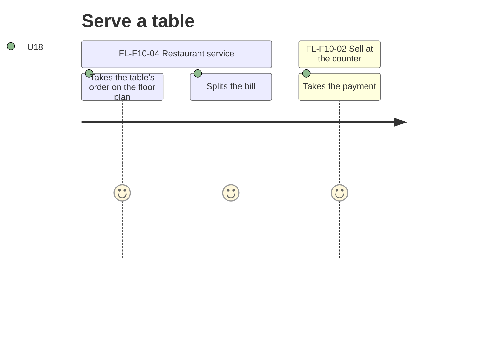
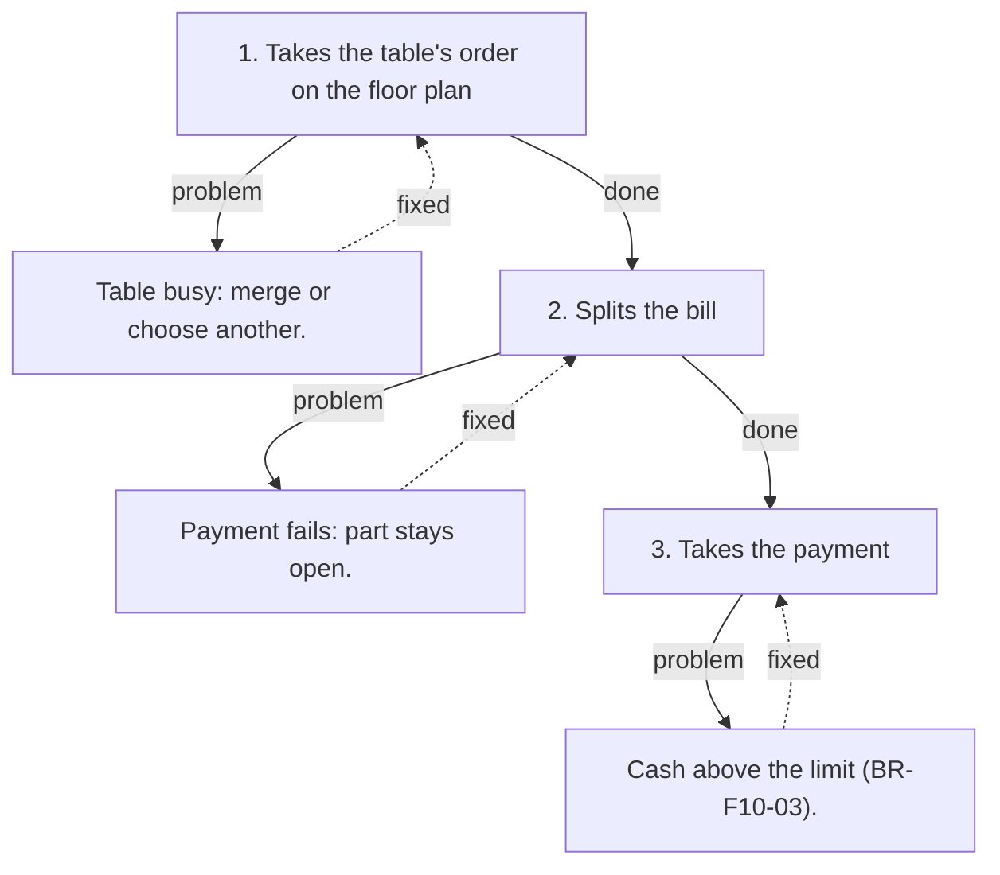

🏠 [Specs](../../../../README.md) › 🎨 [UX](../../../README.md) › 🪟 [Views](../../README.md) ›
🍽️ [Waiter: app shell and home](../README.md) › 🧭 [Journeys](README.md) › 🧭 J-U18-01 Serve a table

# 🧭 J-U18-01 Serve a table

**Status:** 🔄 waiting for the owner

## Persona

[U18 Waiter](../../../../01-users/personas/u18-waiter.md)

## Goal

Take orders quickly, send them to the right station and know which table waits.

## Journey

Satisfaction at each step, from 1 (painful) to 5 (effortless): these scores are a proposal (Proposed), drawn from the
specs, for the owner to confirm.

## Flowchart

The same steps; each problem is the first error flow of the step's use case (once per use case), shown with the error
message pattern ([D122](../../../../06-decisions/ux/d122-error-message-standard.md)).

## Steps

| Step | Screen | Use case | What the persona does | What the system does |
|---|---|---|---|---|
| 1 | [S-F10-09 Floor](../../../../02-functional/f10-point-of-sale/screens/04-restaurant-service/s-f10-09-floor.md) | [UC-F10-09 Run the restaurant floor and bookings](../../../../02-functional/f10-point-of-sale/use-cases/04-restaurant-service/uc-f10-09-run-the-restaurant-floor-and-bookings.md) | Takes the table's order on the floor plan | Sends the order with its notes to the right station (BR-F10-10). |
| 2 | [S-F10-11 Bill split](../../../../02-functional/f10-point-of-sale/screens/04-restaurant-service/s-f10-11-bill-split.md) | [UC-F10-11 Split the bill in a restaurant](../../../../02-functional/f10-point-of-sale/use-cases/04-restaurant-service/uc-f10-11-split-the-bill-in-a-restaurant.md) | Splits the bill | Prints the pre-bill and splits it by items or equal shares. |
| 3 | [S-F10-03 Payment](../../../../02-functional/f10-point-of-sale/screens/02-sell-at-the-counter/s-f10-03-payment.md) | [UC-F10-03 Take payment](../../../../02-functional/f10-point-of-sale/use-cases/02-sell-at-the-counter/uc-f10-03-take-payment.md) | Takes the payment | Confirms the card terminal or gives change; records the paid order (BR-F10-01). |

This persona's images of these flows (D120):
[FL-F10-04 Restaurant service](../../../../02-functional/f10-point-of-sale/images/04-restaurant-service/u18-waiter/README.md),
[FL-F10-02 Sell at the counter](../../../../02-functional/f10-point-of-sale/images/02-sell-at-the-counter/u18-waiter/README.md).

## Open questions

None.

---

⬆️ [Up](README.md)
