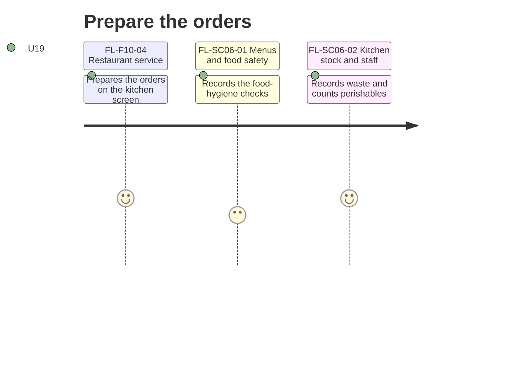
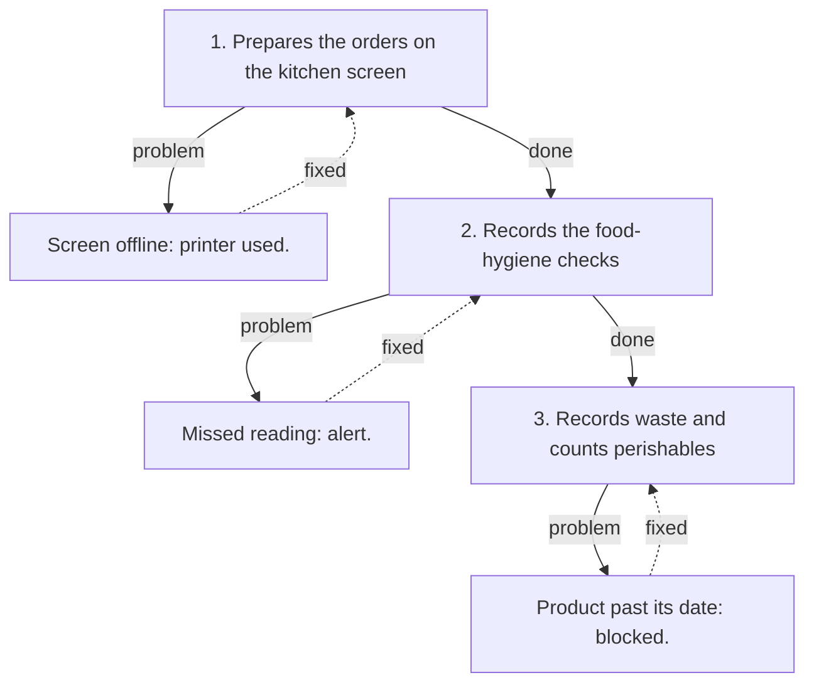

🏠 [Specs](../../../../README.md) › 🎨 [UX](../../../README.md) › 🪟 [Views](../../README.md) ›
👩‍🍳 [Kitchen staff: app shell and home](../README.md) › 🧭 [Journeys](README.md) › 🧭 J-U19-01 Prepare the orders

# 🧭 J-U19-01 Prepare the orders

**Status:** ✅ specified

## Persona

[U19 Kitchen staff](../../../../01-users/personas/u19-kitchen-staff.md)

## Goal

See every order in the right order, with its notes, and know what is late.

## Journey

Satisfaction at each step, from 1 (painful) to 5 (effortless): these scores are drawn from the
specs and confirmed by the owner (D572).

## Flowchart

The same steps; each problem is the first error flow of the step's use case (once per use case), shown with the error
message pattern ([D122](../../../../06-decisions/ux/d122-error-message-standard.md)).

## Steps

| Step | Screen | Use case | What the persona does | What the system does |
|---|---|---|---|---|
| 1 | [S-F10-10 Preparation screen](../../../../02-functional/f10-point-of-sale/screens/04-restaurant-service/s-f10-10-preparation-screen.md) | [UC-F10-10 Prepare orders on kitchen screens](../../../../02-functional/f10-point-of-sale/use-cases/04-restaurant-service/uc-f10-10-prepare-orders-on-kitchen-screens.md) | Prepares the orders on the kitchen screen | Shows the order on its station (BR-F10-10); tells the waiter or customer when it is ready. |
| 2 | [S-SC06-03 Hygiene records](../../../../08-sectors/sc06-hospitality/screens/01-menus-and-food-safety/s-sc06-03-hygiene-records.md) | [UC-SC06-03 Keep food-hygiene records](../../../../08-sectors/sc06-hospitality/use-cases/01-menus-and-food-safety/uc-sc06-03-keep-food-hygiene-records.md) | Records the food-hygiene checks | Records the reading; asks for action if it is out of range. |
| 3 | [S-SC06-04 Perishables](../../../../08-sectors/sc06-hospitality/screens/02-kitchen-stock-and-staff/s-sc06-04-perishables.md) | [UC-SC06-04 Manage perishables, waste and counts](../../../../08-sectors/sc06-hospitality/use-cases/02-kitchen-stock-and-staff/uc-sc06-04-manage-perishables-waste-and-counts.md) | Records waste and counts perishables | Blocks a product past its date; records waste and counts. |

This persona's images of these flows (D120):
[FL-F10-04 Restaurant service](../../../../02-functional/f10-point-of-sale/images/04-restaurant-service/u19-kitchen-staff/README.md),
[FL-SC06-01 Menus and food safety](../../../../08-sectors/sc06-hospitality/images/01-menus-and-food-safety/u19-kitchen-staff/README.md),
[FL-SC06-02 Kitchen stock and staff](../../../../08-sectors/sc06-hospitality/images/02-kitchen-stock-and-staff/u19-kitchen-staff/README.md).

## Open questions

None.

---

⬆️ [Up](README.md)
