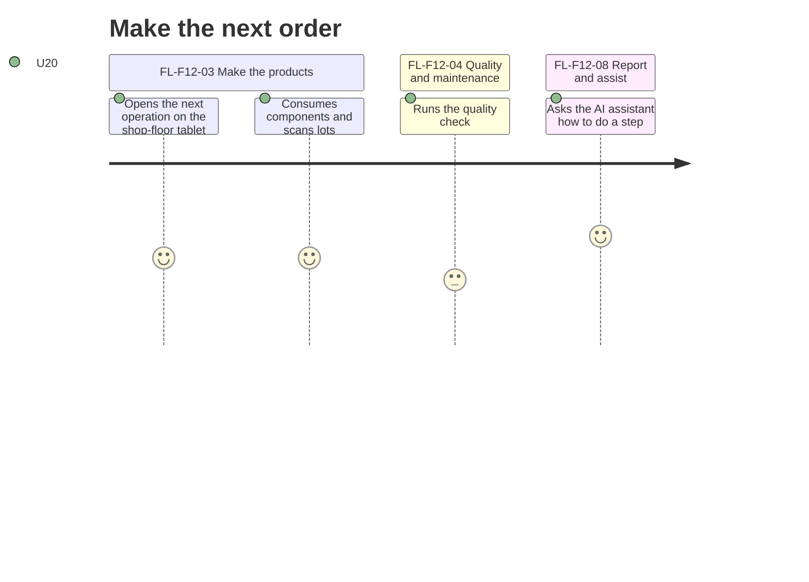
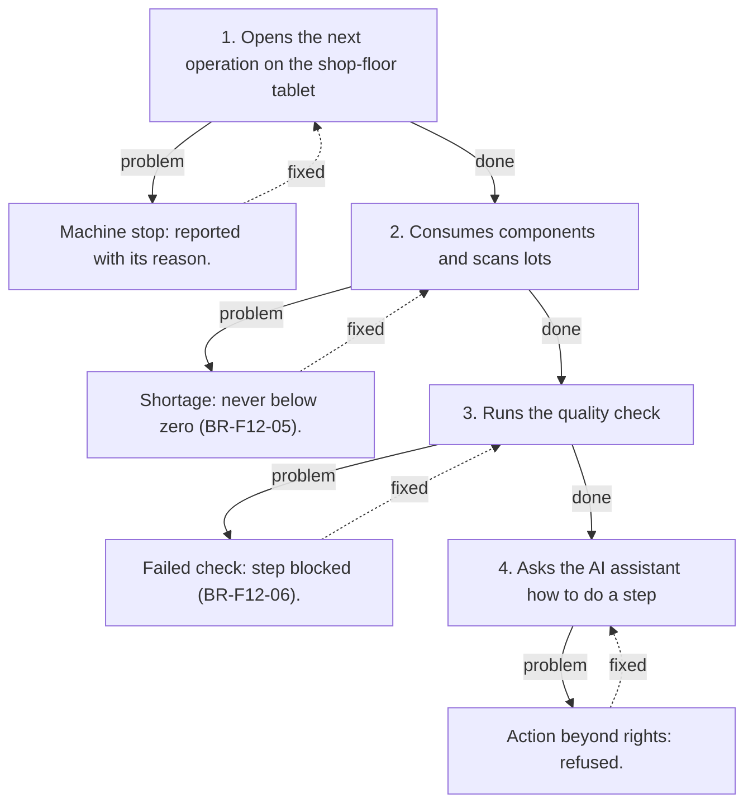

🏠 [Specs](../../../../README.md) › 🎨 [UX](../../../README.md) › 🪟 [Views](../../README.md) ›
🧑‍🏭 [Production operator: app shell and home](../README.md) › 🧭 [Journeys](README.md) › 🧭 J-U20-01 Make the next order

# 🧭 J-U20-01 Make the next order

**Status:** ✅ specified

## Persona

[U20 Production operator](../../../../01-users/personas/u20-production-operator.md)

## Goal

Know what to make next and how, and record the work without leaving the machine.

## Journey

Satisfaction at each step, from 1 (painful) to 5 (effortless): these scores are drawn from the
specs and confirmed by the owner (D572).

## Flowchart

The same steps; each problem is the first error flow of the step's use case (once per use case), shown with the error
message pattern ([D122](../../../../06-decisions/ux/d122-error-message-standard.md)).

## Steps

| Step | Screen | Use case | What the persona does | What the system does |
|---|---|---|---|---|
| 1 | [S-F12-05 Shop-floor tablet](../../../../02-functional/f12-manufacturing/screens/03-make-the-products/s-f12-05-shop-floor-tablet.md) | [UC-F12-05 Work on the shop-floor tablet](../../../../02-functional/f12-manufacturing/use-cases/03-make-the-products/uc-f12-05-work-on-the-shop-floor-tablet.md) | Opens the next operation on the shop-floor tablet | Shows the next operation and its instructions; records quantities. |
| 2 | [S-F12-06 Consumption](../../../../02-functional/f12-manufacturing/screens/03-make-the-products/s-f12-06-consumption.md) | [UC-F12-06 Consume components, trace lots and serials](../../../../02-functional/f12-manufacturing/use-cases/03-make-the-products/uc-f12-06-consume-components-trace-lots-and-serials.md) | Consumes components and scans lots | Records the component lots and the finished lot; traces both ways. |
| 3 | [S-F12-07 Quality checks](../../../../02-functional/f12-manufacturing/screens/04-quality-and-maintenance/s-f12-07-quality-checks.md) | [UC-F12-07 Run quality checks and handle non-conformities](../../../../02-functional/f12-manufacturing/use-cases/04-quality-and-maintenance/uc-f12-07-run-quality-checks-and-handle-non-conformities.md) | Runs the quality check | Records pass or fail at the control point; a failed check blocks the step (BR-F12-06). |
| 4 | [S-F12-20 Production assistant](../../../../02-functional/f12-manufacturing/screens/08-report-and-assist/s-f12-20-production-assistant.md) | [UC-F12-20 Ask the AI assistant about production](../../../../02-functional/f12-manufacturing/use-cases/08-report-and-assist/uc-f12-20-ask-the-assistant-about-production.md) | Asks the AI assistant how to do a step | Answers from data or prepares an action to confirm (BR-F3-07). |

This persona's images of these flows (D120):
[FL-F12-03 Make the products](../../../../02-functional/f12-manufacturing/images/03-make-the-products/u20-production-operator/README.md),
[FL-F12-04 Quality and maintenance](../../../../02-functional/f12-manufacturing/images/04-quality-and-maintenance/u20-production-operator/README.md),
[FL-F12-08 Report and assist](../../../../02-functional/f12-manufacturing/images/08-report-and-assist/u20-production-operator/README.md).

## Open questions

None.

---

⬆️ [Up](README.md)
