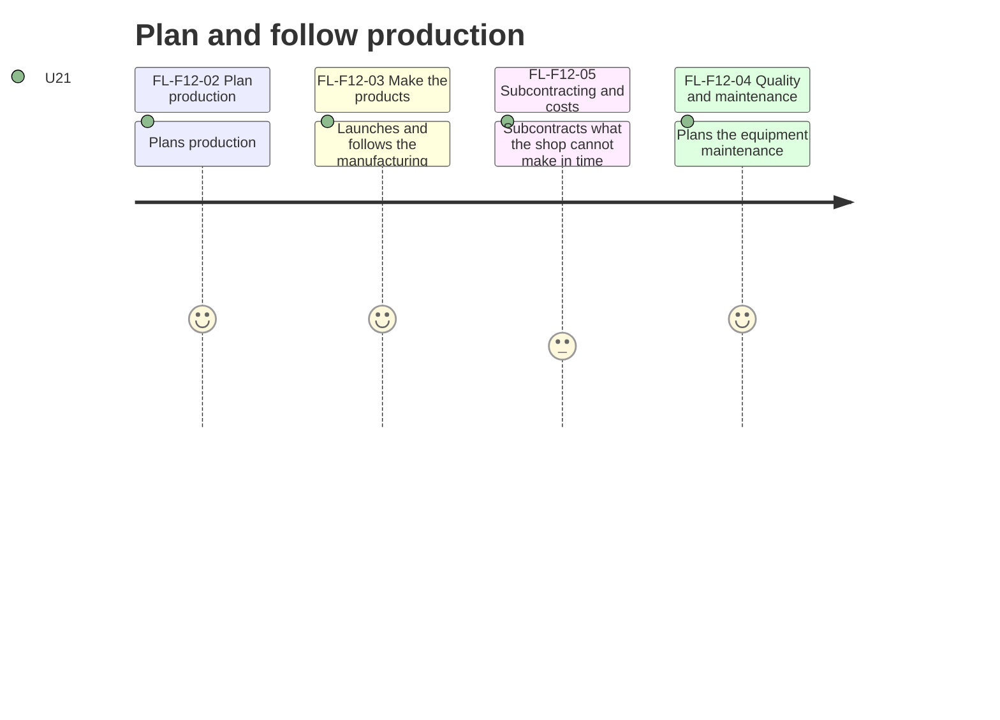
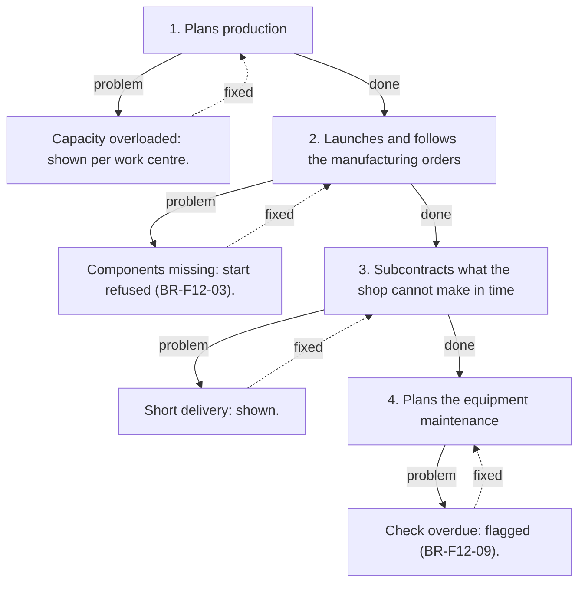

🏠 [Specs](../../../../README.md) › 🎨 [UX](../../../README.md) › 🪟 [Views](../../README.md) ›
🗓️ [Production planner: app shell and home](../README.md) › 🧭 [Journeys](README.md) ›
🧭 J-U21-01 Plan and follow production

# 🧭 J-U21-01 Plan and follow production

**Status:** ✅ specified

## Persona

[U21 Production planner](../../../../01-users/personas/u21-production-planner.md)

## Goal

Deliver on time with the least stock, and keep machines and people busy.

## Journey

Satisfaction at each step, from 1 (painful) to 5 (effortless): these scores are drawn from the
specs and confirmed by the owner (D572).

## Flowchart

The same steps; each problem is the first error flow of the step's use case (once per use case), shown with the error
message pattern ([D122](../../../../06-decisions/ux/d122-error-message-standard.md)).

## Steps

| Step | Screen | Use case | What the persona does | What the system does |
|---|---|---|---|---|
| 1 | [S-F12-03 Master plan](../../../../02-functional/f12-manufacturing/screens/02-plan-production/s-f12-03-master-plan.md) | [UC-F12-03 Plan production](../../../../02-functional/f12-manufacturing/use-cases/02-plan-production/uc-f12-03-plan-production.md) | Plans production | Runs the plan from forecasts and orders; shows overloads per work centre. |
| 2 | [S-F12-04 Manufacturing order](../../../../02-functional/f12-manufacturing/screens/03-make-the-products/s-f12-04-manufacturing-order.md) | [UC-F12-04 Launch and follow manufacturing orders](../../../../02-functional/f12-manufacturing/use-cases/03-make-the-products/uc-f12-04-launch-and-follow-manufacturing-orders.md) | Launches and follows the manufacturing orders | Checks components before the start (BR-F12-03); follows operations to done. |
| 3 | [S-F12-09 Subcontracting](../../../../02-functional/f12-manufacturing/screens/05-subcontracting-and-costs/s-f12-09-subcontracting.md) | [UC-F12-09 Subcontract manufacturing](../../../../02-functional/f12-manufacturing/use-cases/05-subcontracting-and-costs/uc-f12-09-subcontract-manufacturing.md) | Subcontracts what the shop cannot make in time | Orders the service, sends components, checks what comes back. |
| 4 | [S-F12-08 Maintenance](../../../../02-functional/f12-manufacturing/screens/04-quality-and-maintenance/s-f12-08-maintenance.md) | [UC-F12-08 Maintain equipment](../../../../02-functional/f12-manufacturing/use-cases/04-quality-and-maintenance/uc-f12-08-maintain-equipment.md) | Plans the equipment maintenance | Plans preventive maintenance; flags overdue checks (BR-F12-09). |

This persona's images of these flows (D120):
[FL-F12-02 Plan production](../../../../02-functional/f12-manufacturing/images/02-plan-production/u21-production-planner/README.md),
[FL-F12-03 Make the products](../../../../02-functional/f12-manufacturing/images/03-make-the-products/u21-production-planner/README.md),
[FL-F12-05 Subcontracting and costs](../../../../02-functional/f12-manufacturing/images/05-subcontracting-and-costs/u21-production-planner/README.md),
[FL-F12-04 Quality and maintenance](../../../../02-functional/f12-manufacturing/images/04-quality-and-maintenance/u21-production-planner/README.md).

## Open questions

None.

---

⬆️ [Up](README.md)
