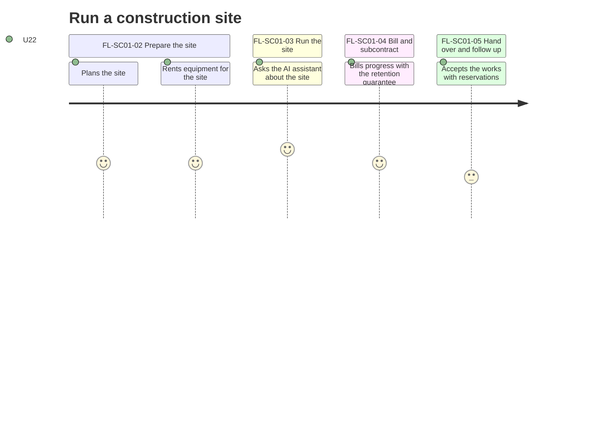
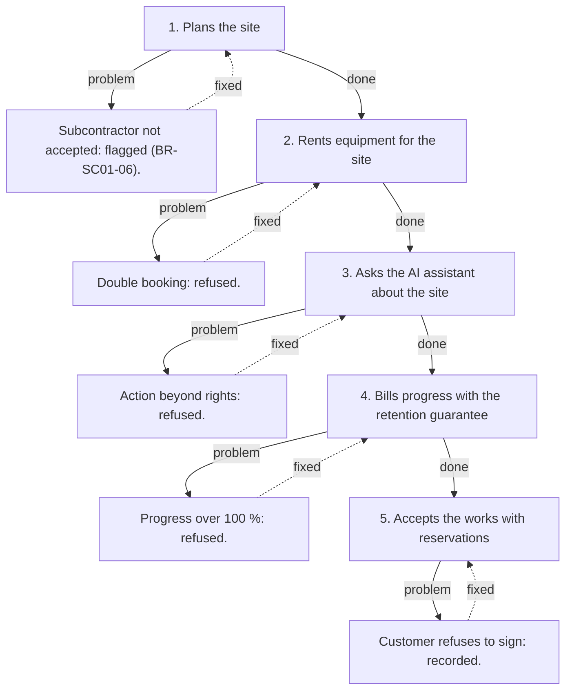

🏠 [Specs](../../../../README.md) › 🎨 [UX](../../../README.md) › 🪟 [Views](../../README.md) ›
👷 [Site manager: app shell and home](../README.md) › 🧭 [Journeys](README.md) › 🧭 J-U22-01 Run a construction site

# 🧭 J-U22-01 Run a construction site

**Status:** ✅ specified

## Persona

[U22 Site manager](../../../../01-users/personas/u22-site-manager.md)

## Goal

Finish each site on time and within budget, and know each site's state.

## Journey

Satisfaction at each step, from 1 (painful) to 5 (effortless): these scores are drawn from the
specs and confirmed by the owner (D572).

## Flowchart

The same steps; each problem is the first error flow of the step's use case (once per use case), shown with the error
message pattern ([D122](../../../../06-decisions/ux/d122-error-message-standard.md)).

## Steps

| Step | Screen | Use case | What the persona does | What the system does |
|---|---|---|---|---|
| 1 | [S-SC01-03 Site planning](../../../../08-sectors/sc01-construction/screens/02-prepare-the-site/s-sc01-03-site-planning.md) | [UC-SC01-03 Plan the site](../../../../08-sectors/sc01-construction/use-cases/02-prepare-the-site/uc-sc01-03-plan-the-site.md) | Plans the site | Assigns crews, equipment and subcontractors per phase; publishes to the team. |
| 2 | [S-SC01-08 Equipment](../../../../08-sectors/sc01-construction/screens/02-prepare-the-site/s-sc01-08-equipment.md) | [UC-SC01-08 Rent and track equipment on sites](../../../../08-sectors/sc01-construction/use-cases/02-prepare-the-site/uc-sc01-08-rent-and-track-equipment-on-sites.md) | Rents equipment for the site | Books the equipment per phase; refuses double bookings. |
| 3 | [S-SC01-15 Site assistant](../../../../08-sectors/sc01-construction/screens/03-run-the-site/s-sc01-15-site-assistant.md) | [UC-SC01-15 Ask the AI assistant about a site](../../../../08-sectors/sc01-construction/use-cases/03-run-the-site/uc-sc01-15-ask-the-assistant-about-a-site.md) | Asks the AI assistant about the site | Answers from data or prepares an action to confirm (BR-F3-07). |
| 4 | [S-SC01-06 Progress bill](../../../../08-sectors/sc01-construction/screens/04-bill-and-subcontract/s-sc01-06-progress-bill.md) | [UC-SC01-06 Bill progress with the retention guarantee](../../../../08-sectors/sc01-construction/use-cases/04-bill-and-subcontract/uc-sc01-06-bill-progress-with-the-retention-guarantee.md) | Bills progress with the retention guarantee | Checks the bill per lot with the retention guarantee; sends it. |
| 5 | [S-SC01-10 Acceptance](../../../../08-sectors/sc01-construction/screens/05-hand-over-and-follow-up/s-sc01-10-acceptance.md) | [UC-SC01-10 Accept the works with reservations and lift them](../../../../08-sectors/sc01-construction/use-cases/05-hand-over-and-follow-up/uc-sc01-10-accept-the-works-with-reservations-and-lift-them.md) | Accepts the works with reservations | Records reservations with photos and the signature; follows each lift. |

This persona's images of these flows (D120):
[FL-SC01-02 Prepare the site](../../../../08-sectors/sc01-construction/images/02-prepare-the-site/u22-site-manager/README.md),
[FL-SC01-03 Run the site](../../../../08-sectors/sc01-construction/images/03-run-the-site/u22-site-manager/README.md),
[FL-SC01-04 Bill and subcontract](../../../../08-sectors/sc01-construction/images/04-bill-and-subcontract/u22-site-manager/README.md),
[FL-SC01-05 Hand over and follow up](../../../../08-sectors/sc01-construction/images/05-hand-over-and-follow-up/u22-site-manager/README.md).

## Open questions

None.

---

⬆️ [Up](README.md)
