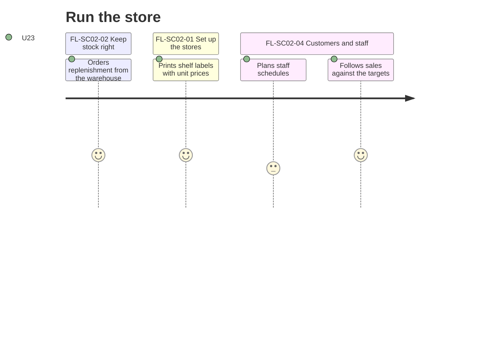
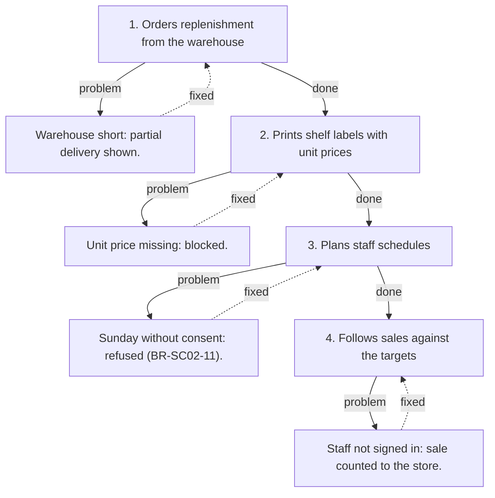

🏠 [Specs](../../../../README.md) › 🎨 [UX](../../../README.md) › 🪟 [Views](../../README.md) ›
🏬 [Store manager: app shell and home](../README.md) › 🧭 [Journeys](README.md) › 🧭 J-U23-01 Run the store

# 🧭 J-U23-01 Run the store

**Status:** 🔄 waiting for the owner

## Persona

[U23 Store manager](../../../../01-users/personas/u23-store-manager.md)

## Goal

Have the right product on the shelf at the right price and hit the store's targets.

## Journey

Satisfaction at each step, from 1 (painful) to 5 (effortless): these scores are a proposal (Proposed), drawn from the
specs, for the owner to confirm.

## Flowchart

The same steps; each problem is the first error flow of the step's use case (once per use case), shown with the error
message pattern ([D122](../../../../06-decisions/ux/d122-error-message-standard.md)).

## Steps

| Step | Screen | Use case | What the persona does | What the system does |
|---|---|---|---|---|
| 1 | [S-SC02-03 Replenishment](../../../../08-sectors/sc02-retail/screens/02-keep-stock-right/s-sc02-03-replenishment.md) | [UC-SC02-03 Replenish stores from the warehouse](../../../../08-sectors/sc02-retail/use-cases/02-keep-stock-right/uc-sc02-03-replenish-stores-from-the-warehouse.md) | Orders replenishment from the warehouse | Proposes the replenishment; shows partial deliveries. |
| 2 | [S-SC02-05 Labels](../../../../08-sectors/sc02-retail/screens/01-set-up-the-stores/s-sc02-05-labels.md) | [UC-SC02-05 Print shelf labels with unit prices](../../../../08-sectors/sc02-retail/use-cases/01-set-up-the-stores/uc-sc02-05-print-shelf-labels-with-unit-prices.md) | Prints shelf labels with unit prices | Prints or updates electronic labels; blocks a label without unit price. |
| 3 | [S-SC02-12 Schedules](../../../../08-sectors/sc02-retail/screens/04-customers-and-staff/s-sc02-12-schedules.md) | [UC-SC02-12 Plan staff schedules and Sunday openings](../../../../08-sectors/sc02-retail/use-cases/04-customers-and-staff/uc-sc02-12-plan-staff-schedules-and-sunday-openings.md) | Plans staff schedules | Checks the rules before publishing; refuses Sunday work without consent (BR-SC02-11). |
| 4 | [S-SC02-11 Targets](../../../../08-sectors/sc02-retail/screens/04-customers-and-staff/s-sc02-11-targets.md) | [UC-SC02-11 Set store targets and follow sales per staff](../../../../08-sectors/sc02-retail/use-cases/04-customers-and-staff/uc-sc02-11-set-store-targets-and-follow-sales-per-staff.md) | Follows sales against the targets | Shows sales live per staff against the targets. |

This persona's images of these flows (D120):
[FL-SC02-02 Keep stock right](../../../../08-sectors/sc02-retail/images/02-keep-stock-right/u23-store-manager/README.md),
[FL-SC02-01 Set up the stores](../../../../08-sectors/sc02-retail/images/01-set-up-the-stores/u23-store-manager/README.md),
[FL-SC02-04 Customers and staff](../../../../08-sectors/sc02-retail/images/04-customers-and-staff/u23-store-manager/README.md).

## Open questions

None.

---

⬆️ [Up](README.md)
