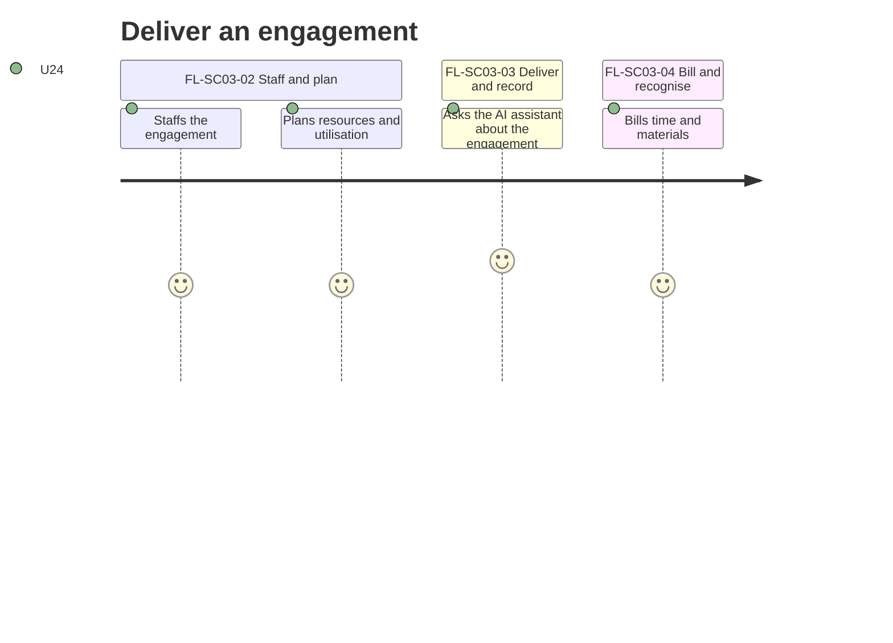
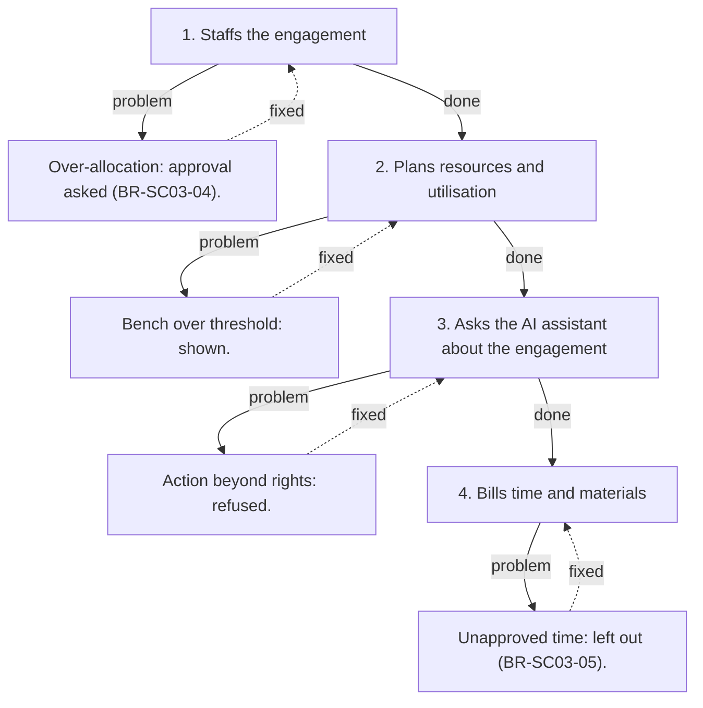

🏠 [Specs](../../../../README.md) › 🎨 [UX](../../../README.md) › 🪟 [Views](../../README.md) ›
🧭 [Engagement manager: app shell and home](../README.md) › 🧭 [Journeys](README.md) › 🧭 J-U24-01 Deliver an engagement

# 🧭 J-U24-01 Deliver an engagement

**Status:** 🔄 waiting for the owner

## Persona

[U24 Engagement manager](../../../../01-users/personas/u24-engagement-manager.md)

## Goal

Deliver what was sold, on time and within budget, and keep consultants busy on the right work.

## Journey

Satisfaction at each step, from 1 (painful) to 5 (effortless): these scores are a proposal (Proposed), drawn from the
specs, for the owner to confirm.

## Flowchart

The same steps; each problem is the first error flow of the step's use case (once per use case), shown with the error
message pattern ([D122](../../../../06-decisions/ux/d122-error-message-standard.md)).

## Steps

| Step | Screen | Use case | What the persona does | What the system does |
|---|---|---|---|---|
| 1 | [S-SC03-03 Staffing](../../../../08-sectors/sc03-services/screens/02-staff-and-plan/s-sc03-03-staffing.md) | [UC-SC03-03 Staff the engagement](../../../../08-sectors/sc03-services/use-cases/02-staff-and-plan/uc-sc03-03-staff-the-engagement.md) | Staffs the engagement | Searches consultants by skills and dates; asks approval for over-allocation (BR-SC03-04). |
| 2 | [S-SC03-04 Resource plan](../../../../08-sectors/sc03-services/screens/02-staff-and-plan/s-sc03-04-resource-plan.md) | [UC-SC03-04 Plan resources and utilisation](../../../../08-sectors/sc03-services/use-cases/02-staff-and-plan/uc-sc03-04-plan-resources-and-utilisation.md) | Plans resources and utilisation | Shows the plan and utilisation; flags a bench over its threshold. |
| 3 | [S-SC03-15 Engagement assistant](../../../../08-sectors/sc03-services/screens/03-deliver-and-record/s-sc03-15-engagement-assistant.md) | [UC-SC03-15 Ask the AI assistant about an engagement](../../../../08-sectors/sc03-services/use-cases/03-deliver-and-record/uc-sc03-15-ask-the-assistant-about-an-engagement.md) | Asks the AI assistant about the engagement | Answers from data or prepares an action to confirm (BR-F3-07). |
| 4 | [S-SC03-06 T&M billing](../../../../08-sectors/sc03-services/screens/04-bill-and-recognise/s-sc03-06-t-m-billing.md) | [UC-SC03-06 Bill time and materials](../../../../08-sectors/sc03-services/use-cases/04-bill-and-recognise/uc-sc03-06-bill-time-and-materials.md) | Bills time and materials | Prepares the billing proposal from approved time only (BR-SC03-05). |

This persona's images of these flows (D120):
[FL-SC03-02 Staff and plan](../../../../08-sectors/sc03-services/images/02-staff-and-plan/u24-engagement-manager/README.md),
[FL-SC03-03 Deliver and record](../../../../08-sectors/sc03-services/images/03-deliver-and-record/u24-engagement-manager/README.md),
[FL-SC03-04 Bill and recognise](../../../../08-sectors/sc03-services/images/04-bill-and-recognise/u24-engagement-manager/README.md).

## Open questions

None.

---

⬆️ [Up](README.md)
