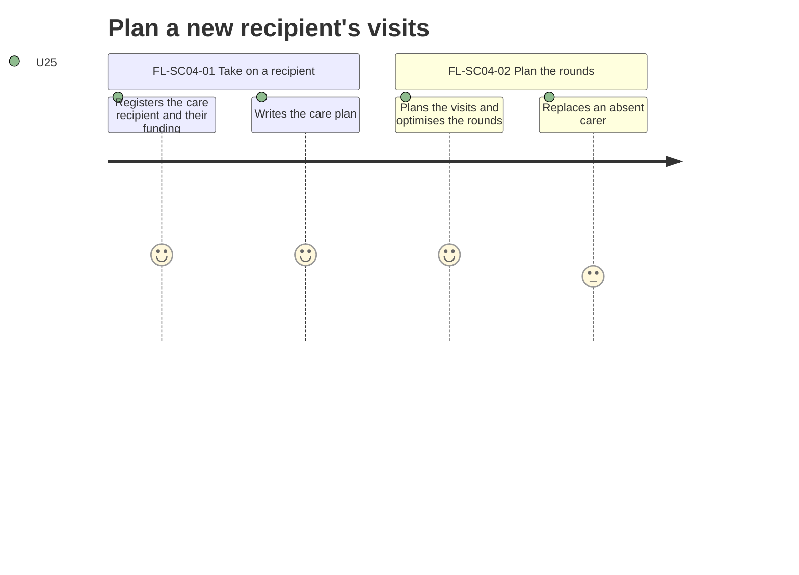
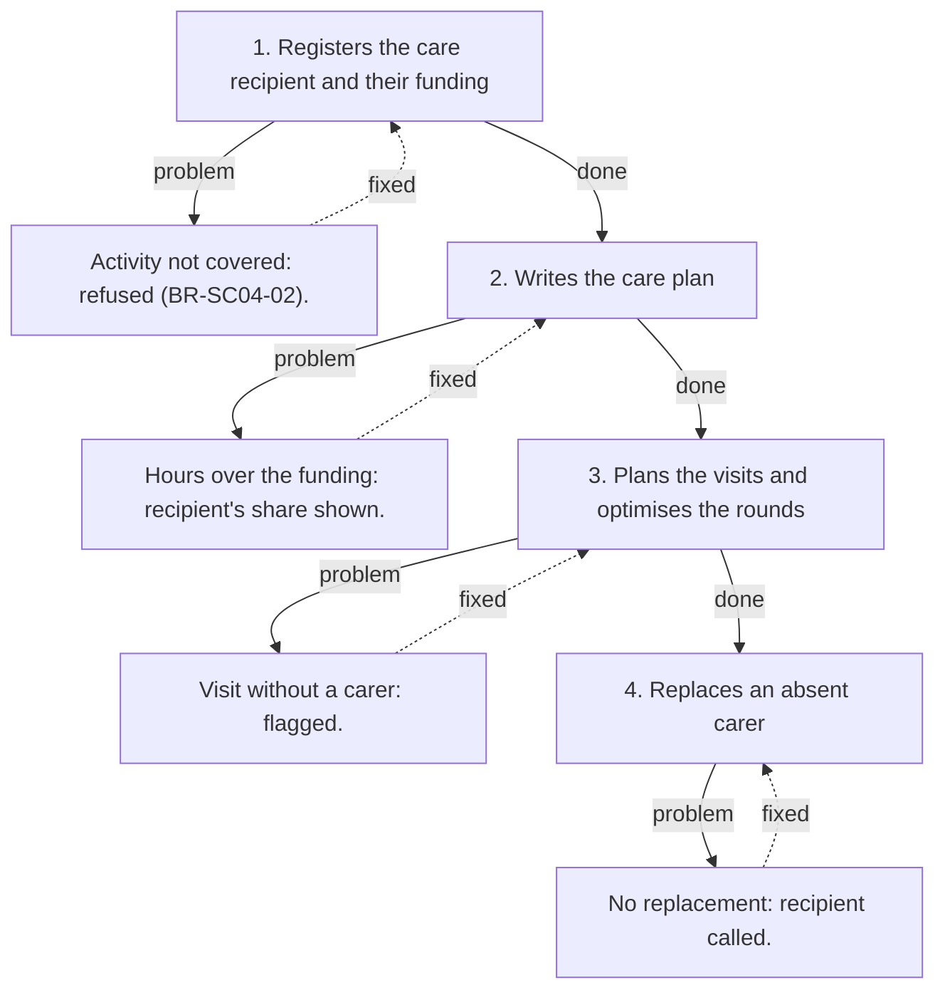

🏠 [Specs](../../../../README.md) › 🎨 [UX](../../../README.md) › 🪟 [Views](../../README.md) ›
🗂️ [Care coordinator: app shell and home](../README.md) › 🧭 [Journeys](README.md) ›
🧭 J-U25-01 Plan a new recipient's visits

# 🧭 J-U25-01 Plan a new recipient's visits

**Status:** 🔄 waiting for the owner

## Persona

[U25 Care coordinator](../../../../01-users/personas/u25-care-coordinator.md)

## Goal

Every planned visit done by a suitable carer, on rounds that waste no time on the road.

## Journey

Satisfaction at each step, from 1 (painful) to 5 (effortless): these scores are a proposal (Proposed), drawn from the
specs, for the owner to confirm.

## Flowchart

The same steps; each problem is the first error flow of the step's use case (once per use case), shown with the error
message pattern ([D122](../../../../06-decisions/ux/d122-error-message-standard.md)).

## Steps

| Step | Screen | Use case | What the persona does | What the system does |
|---|---|---|---|---|
| 1 | [S-SC04-01 Recipient](../../../../08-sectors/sc04-home-care/screens/01-take-on-a-recipient/s-sc04-01-recipient.md) | [UC-SC04-01 Register a care recipient and their funding](../../../../08-sectors/sc04-home-care/use-cases/01-take-on-a-recipient/uc-sc04-01-register-a-care-recipient-and-their-funding.md) | Registers the care recipient and their funding | Records the recipient, funding and consents; refuses an activity not covered (BR-SC04-02). |
| 2 | [S-SC04-02 Care plan](../../../../08-sectors/sc04-home-care/screens/01-take-on-a-recipient/s-sc04-02-care-plan.md) | [UC-SC04-02 Assess needs and write the care plan](../../../../08-sectors/sc04-home-care/use-cases/01-take-on-a-recipient/uc-sc04-02-assess-needs-and-write-the-care-plan.md) | Writes the care plan | Shows the recipient's share when hours exceed the funding; collects the signature. |
| 3 | [S-SC04-03 Rounds](../../../../08-sectors/sc04-home-care/screens/02-plan-the-rounds/s-sc04-03-rounds.md) | [UC-SC04-03 Plan visits and optimise rounds](../../../../08-sectors/sc04-home-care/use-cases/02-plan-the-rounds/uc-sc04-03-plan-visits-and-optimise-rounds.md) | Plans the visits and optimises the rounds | Generates the visits, optimises rounds and publishes them. |
| 4 | [S-SC04-06 Replacements](../../../../08-sectors/sc04-home-care/screens/02-plan-the-rounds/s-sc04-06-replacements.md) | [UC-SC04-06 Replace an absent carer](../../../../08-sectors/sc04-home-care/use-cases/02-plan-the-rounds/uc-sc04-06-replace-an-absent-carer.md) | Replaces an absent carer | Proposes replacements and tells the recipients. |

This persona's images of these flows (D120):
[FL-SC04-01 Take on a recipient](../../../../08-sectors/sc04-home-care/images/01-take-on-a-recipient/u25-care-coordinator/README.md),
[FL-SC04-02 Plan the rounds](../../../../08-sectors/sc04-home-care/images/02-plan-the-rounds/u25-care-coordinator/README.md).

## Open questions

None.

---

⬆️ [Up](README.md)
