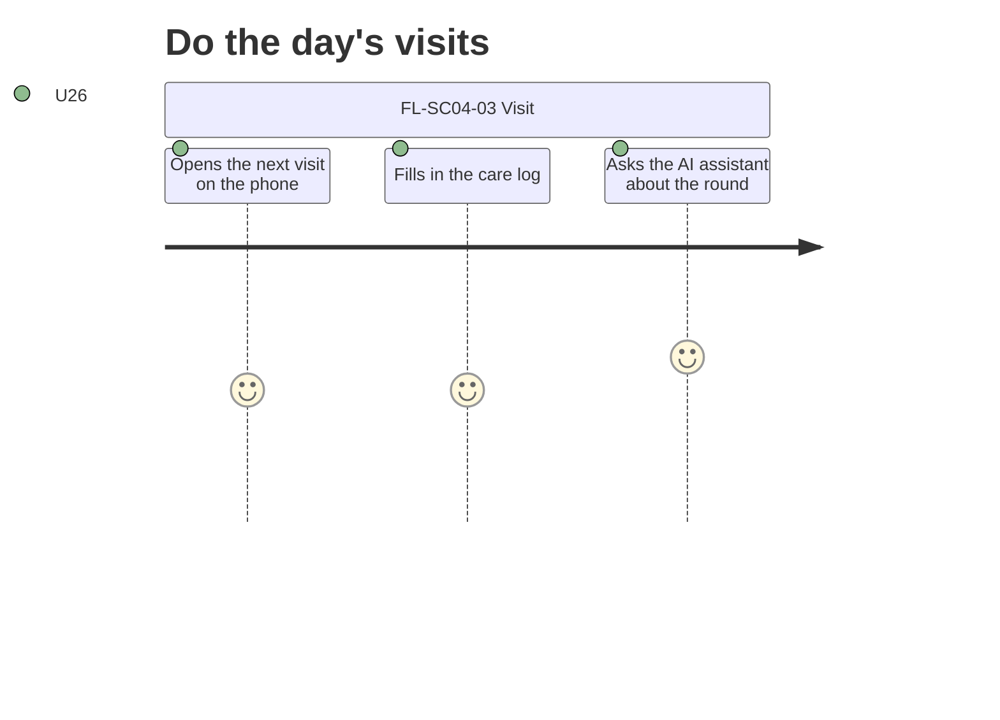
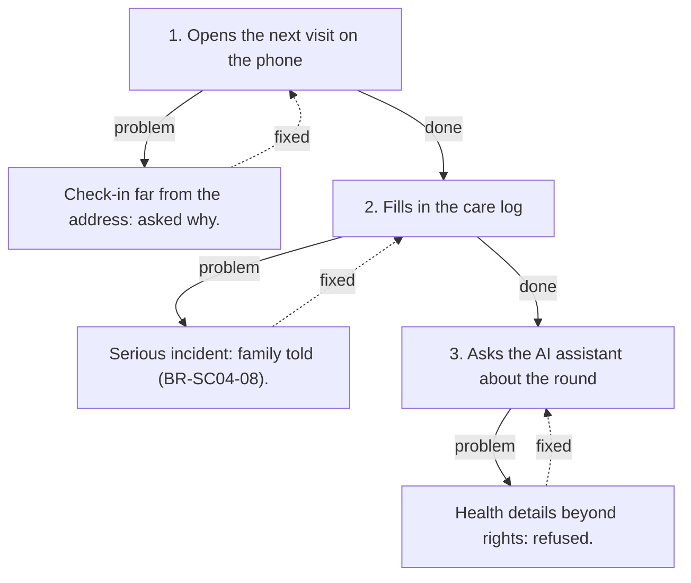

🏠 [Specs](../../../../README.md) › 🎨 [UX](../../../README.md) › 🪟 [Views](../../README.md) ›
🤝 [Carer: app shell and home](../README.md) › 🧭 [Journeys](README.md) › 🧭 J-U26-01 Do the day's visits

# 🧭 J-U26-01 Do the day's visits

**Status:** ✅ specified

## Persona

[U26 Carer](../../../../01-users/personas/u26-carer.md)

## Goal

Know where to go, when and what to do, and be paid for the time on the road.

## Journey

Satisfaction at each step, from 1 (painful) to 5 (effortless): these scores are drawn from the
specs and confirmed by the owner (D572).

## Flowchart

The same steps; each problem is the first error flow of the step's use case (once per use case), shown with the error
message pattern ([D122](../../../../06-decisions/ux/d122-error-message-standard.md)).

## Steps

| Step | Screen | Use case | What the persona does | What the system does |
|---|---|---|---|---|
| 1 | [S-SC04-04 Visit](../../../../08-sectors/sc04-home-care/screens/02-plan-the-rounds/s-sc04-04-visit.md) | [UC-SC04-04 Visit on the carer's phone](../../../../08-sectors/sc04-home-care/use-cases/03-visit/uc-sc04-04-visit-on-the-carer-s-phone.md) | Opens the next visit on the phone | Shows the next visit; records check-in and check-out. |
| 2 | [S-SC04-05 Care log](../../../../08-sectors/sc04-home-care/screens/03-visit/s-sc04-05-care-log.md) | [UC-SC04-05 Keep the care log and report incidents](../../../../08-sectors/sc04-home-care/use-cases/03-visit/uc-sc04-05-keep-the-care-log-and-report-incidents.md) | Fills in the care log | Sends the log to the coordinator; tells the family of a serious incident (BR-SC04-08). |
| 3 | [S-SC04-15 Rounds assistant](../../../../08-sectors/sc04-home-care/screens/03-visit/s-sc04-15-rounds-assistant.md) | [UC-SC04-15 Ask the AI assistant about the rounds](../../../../08-sectors/sc04-home-care/use-cases/03-visit/uc-sc04-15-ask-the-assistant-about-the-rounds.md) | Asks the AI assistant about the round | Answers within the carer's rights (BR-F3-07). |

This persona's images of these flows (D120):
[FL-SC04-03 Visit](../../../../08-sectors/sc04-home-care/images/03-visit/u26-carer/README.md).

## Open questions

None.

---

⬆️ [Up](README.md)
