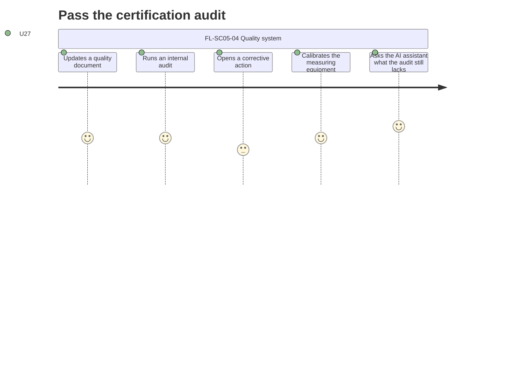
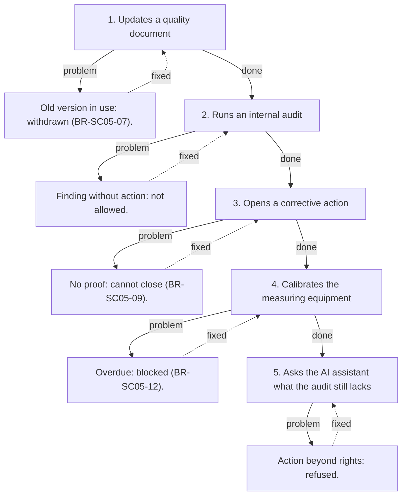

🏠 [Specs](../../../../README.md) › 🎨 [UX](../../../README.md) › 🪟 [Views](../../README.md) ›
✅ [Quality manager: app shell and home](../README.md) › 🧭 [Journeys](README.md) ›
🧭 J-U27-01 Pass the certification audit

# 🧭 J-U27-01 Pass the certification audit

**Status:** ✅ specified

## Persona

[U27 Quality manager](../../../../01-users/personas/u27-quality-manager.md)

## Goal

Pass the certification audit and fix causes, not symptoms.

## Journey

Satisfaction at each step, from 1 (painful) to 5 (effortless): these scores are drawn from the
specs and confirmed by the owner (D572).

## Flowchart

The same steps; each problem is the first error flow of the step's use case (once per use case), shown with the error
message pattern ([D122](../../../../06-decisions/ux/d122-error-message-standard.md)).

## Steps

| Step | Screen | Use case | What the persona does | What the system does |
|---|---|---|---|---|
| 1 | [S-SC05-07 Documents](../../../../08-sectors/sc05-manufacturing/screens/04-quality-system/s-sc05-07-documents.md) | [UC-SC05-07 Control quality documents](../../../../08-sectors/sc05-manufacturing/use-cases/04-quality-system/uc-sc05-07-control-quality-documents.md) | Updates a quality document | Publishes the approved version and withdraws the old one (BR-SC05-07). |
| 2 | [S-SC05-08 Audits](../../../../08-sectors/sc05-manufacturing/screens/04-quality-system/s-sc05-08-audits.md) | [UC-SC05-08 Run internal audits](../../../../08-sectors/sc05-manufacturing/use-cases/04-quality-system/uc-sc05-08-run-internal-audits.md) | Runs an internal audit | Records the findings from the tablet; each finding needs an action. |
| 3 | [S-SC05-09 Actions](../../../../08-sectors/sc05-manufacturing/screens/04-quality-system/s-sc05-09-actions.md) | [UC-SC05-09 Handle corrective and preventive actions](../../../../08-sectors/sc05-manufacturing/use-cases/04-quality-system/uc-sc05-09-handle-corrective-and-preventive-actions.md) | Opens a corrective action | Follows cause analysis to the check; no closing without proof (BR-SC05-09). |
| 4 | [S-SC05-12 Calibration](../../../../08-sectors/sc05-manufacturing/screens/04-quality-system/s-sc05-12-calibration.md) | [UC-SC05-12 Calibrate measuring equipment](../../../../08-sectors/sc05-manufacturing/use-cases/04-quality-system/uc-sc05-12-calibrate-measuring-equipment.md) | Calibrates the measuring equipment | Records the result; blocks overdue equipment (BR-SC05-12). |
| 5 | [S-SC05-15 Quality assistant](../../../../08-sectors/sc05-manufacturing/screens/04-quality-system/s-sc05-15-quality-assistant.md) | [UC-SC05-15 Ask the AI assistant about quality](../../../../08-sectors/sc05-manufacturing/use-cases/04-quality-system/uc-sc05-15-ask-the-assistant-about-quality.md) | Asks the AI assistant what the audit still lacks | Answers from data or prepares an action to confirm (BR-F3-07). |

This persona's images of these flows (D120):
[FL-SC05-04 Quality system](../../../../08-sectors/sc05-manufacturing/images/04-quality-system/u27-quality-manager/README.md).

## Open questions

None.

---

⬆️ [Up](README.md)
