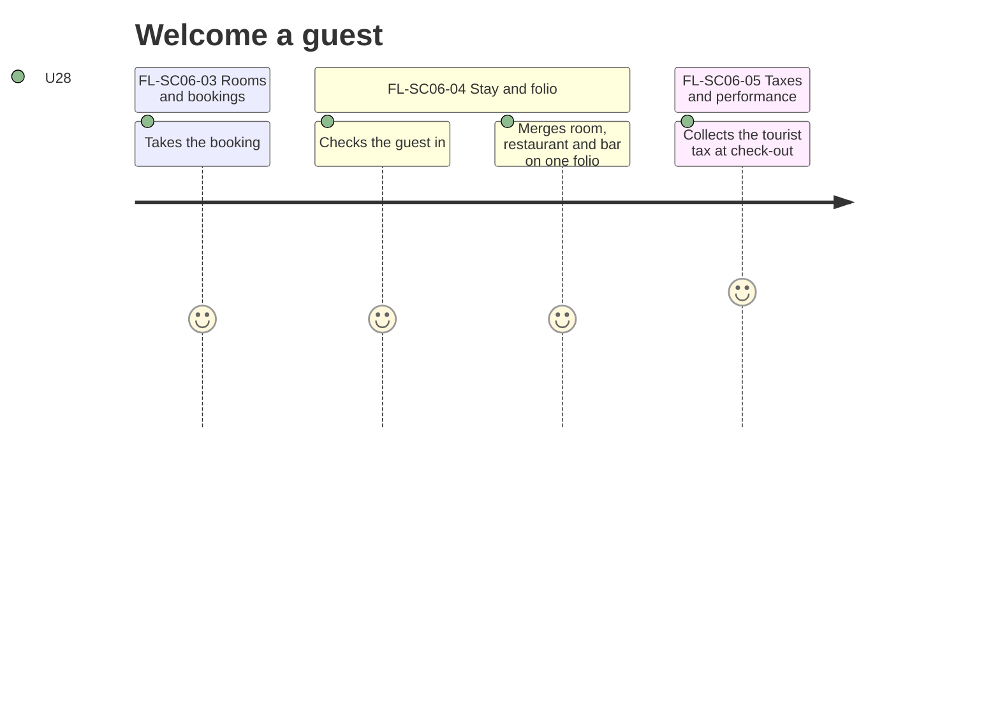
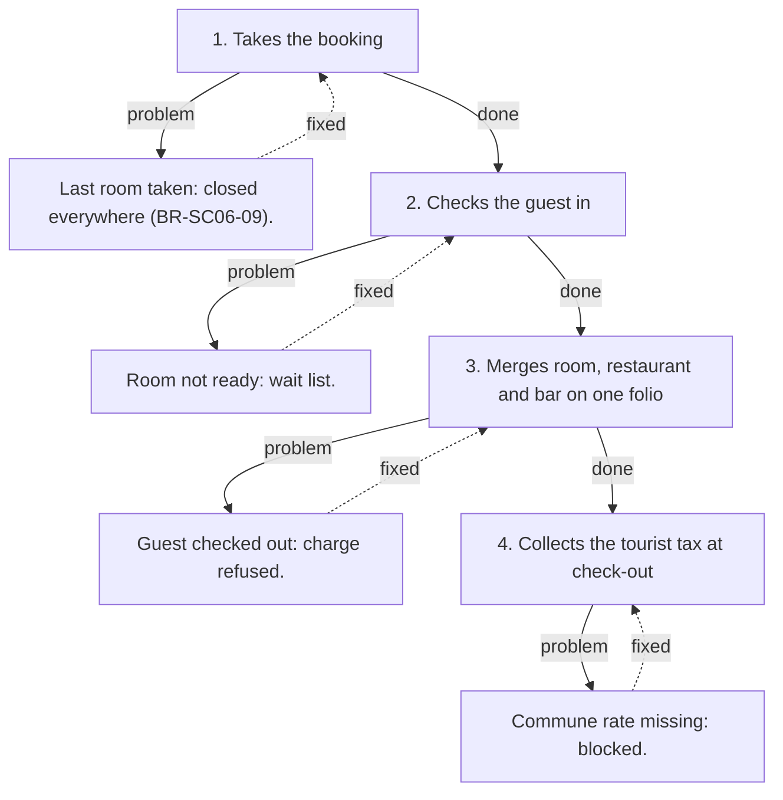

🏠 [Specs](../../../../README.md) › 🎨 [UX](../../../README.md) › 🪟 [Views](../../README.md) ›
🛎️ [Hotel receptionist: app shell and home](../README.md) › 🧭 [Journeys](README.md) › 🧭 J-U28-01 Welcome a guest

# 🧭 J-U28-01 Welcome a guest

**Status:** ✅ specified

## Persona

[U28 Hotel receptionist](../../../../01-users/personas/u28-hotel-receptionist.md)

## Goal

Check guests in and out without queues, with every night and extra billed.

## Journey

Satisfaction at each step, from 1 (painful) to 5 (effortless): these scores are drawn from the
specs and confirmed by the owner (D572).

## Flowchart

The same steps; each problem is the first error flow of the step's use case (once per use case), shown with the error
message pattern ([D122](../../../../06-decisions/ux/d122-error-message-standard.md)).

## Steps

| Step | Screen | Use case | What the persona does | What the system does |
|---|---|---|---|---|
| 1 | [S-SC06-08 Bookings](../../../../08-sectors/sc06-hospitality/screens/03-rooms-and-bookings/s-sc06-08-bookings.md) | [UC-SC06-08 Take bookings directly and through channel managers](../../../../08-sectors/sc06-hospitality/use-cases/03-rooms-and-bookings/uc-sc06-08-take-bookings-directly-and-through-channel-managers.md) | Takes the booking | Closes availability on every channel (BR-SC06-09) and confirms. |
| 2 | [S-SC06-09 Check-in](../../../../08-sectors/sc06-hospitality/screens/04-stay-and-folio/s-sc06-09-check-in.md) | [UC-SC06-09 Check guests in and out](../../../../08-sectors/sc06-hospitality/use-cases/04-stay-and-folio/uc-sc06-09-check-guests-in-and-out.md) | Checks the guest in | Records the arrival; keeps a wait list when the room is not ready. |
| 3 | [S-SC06-11 Folio](../../../../08-sectors/sc06-hospitality/screens/04-stay-and-folio/s-sc06-11-folio.md) | [UC-SC06-11 Merge room, restaurant and bar on one folio](../../../../08-sectors/sc06-hospitality/use-cases/04-stay-and-folio/uc-sc06-11-merge-room-restaurant-and-bar-on-one-folio.md) | Merges room, restaurant and bar on one folio | Charges extras to the room and shows one folio. |
| 4 | [S-SC06-12 Tourist tax](../../../../08-sectors/sc06-hospitality/screens/05-taxes-and-performance/s-sc06-12-tourist-tax.md) | [UC-SC06-12 Collect the tourist tax](../../../../08-sectors/sc06-hospitality/use-cases/05-taxes-and-performance/uc-sc06-12-collect-the-tourist-tax.md) | Collects the tourist tax at check-out | Applies the tax per night, shows it apart and prepares its declaration. |

This persona's images of these flows (D120):
[FL-SC06-03 Rooms and bookings](../../../../08-sectors/sc06-hospitality/images/03-rooms-and-bookings/u28-hotel-receptionist/README.md),
[FL-SC06-04 Stay and folio](../../../../08-sectors/sc06-hospitality/images/04-stay-and-folio/u28-hotel-receptionist/README.md),
[FL-SC06-05 Taxes and performance](../../../../08-sectors/sc06-hospitality/images/05-taxes-and-performance/u28-hotel-receptionist/README.md).

## Open questions

None.

---

⬆️ [Up](README.md)
