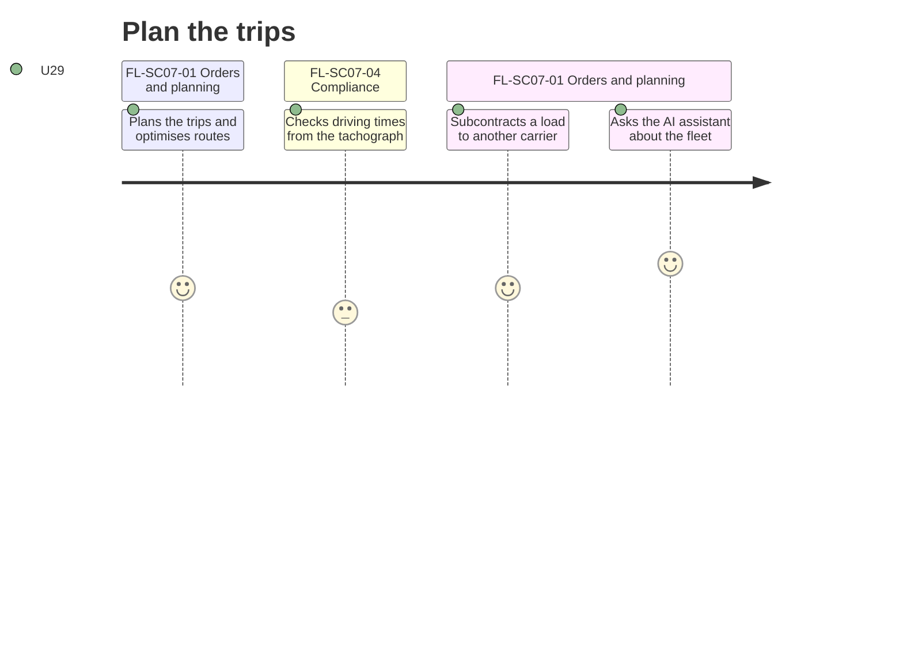
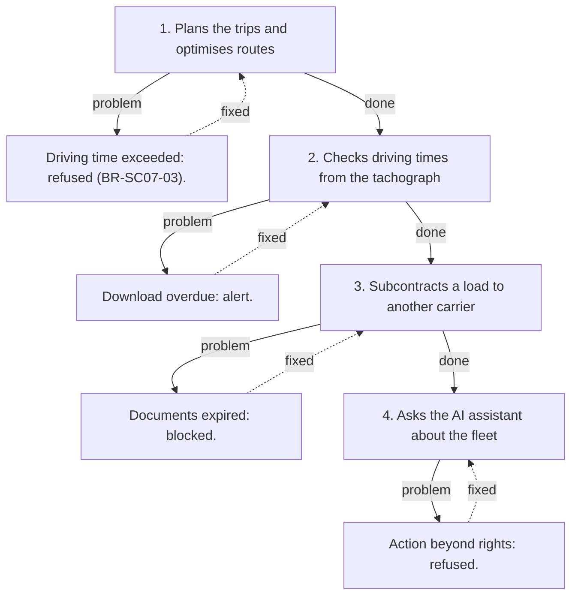

🏠 [Specs](../../../../README.md) › 🎨 [UX](../../../README.md) › 🪟 [Views](../../README.md) ›
🗺️ [Dispatcher: app shell and home](../README.md) › 🧭 [Journeys](README.md) › 🧭 J-U29-01 Plan the trips

# 🧭 J-U29-01 Plan the trips

**Status:** ✅ specified

## Persona

[U29 Dispatcher](../../../../01-users/personas/u29-dispatcher.md)

## Goal

Every load moved on time at the lowest cost, with drivers within their legal times.

## Journey

Satisfaction at each step, from 1 (painful) to 5 (effortless): these scores are drawn from the
specs and confirmed by the owner (D572).

## Flowchart

The same steps; each problem is the first error flow of the step's use case (once per use case), shown with the error
message pattern ([D122](../../../../06-decisions/ux/d122-error-message-standard.md)).

## Steps

| Step | Screen | Use case | What the persona does | What the system does |
|---|---|---|---|---|
| 1 | [S-SC07-02 Trip planning](../../../../08-sectors/sc07-transport/screens/01-orders-and-planning/s-sc07-02-trip-planning.md) | [UC-SC07-02 Plan trips and optimise routes](../../../../08-sectors/sc07-transport/use-cases/01-orders-and-planning/uc-sc07-02-plan-trips-and-optimise-routes.md) | Plans the trips and optimises routes | Groups and optimises orders; refuses a trip over the driving time (BR-SC07-03). |
| 2 | [S-SC07-08 Tachograph](../../../../08-sectors/sc07-transport/screens/04-compliance/s-sc07-08-tachograph.md) | [UC-SC07-08 Import tachograph data and check driving times](../../../../08-sectors/sc07-transport/use-cases/04-compliance/uc-sc07-08-import-tachograph-data-and-check-driving-times.md) | Checks driving times from the tachograph | Imports the tachograph data and flags infringements. |
| 3 | [S-SC07-12 Chartering](../../../../08-sectors/sc07-transport/screens/01-orders-and-planning/s-sc07-12-chartering.md) | [UC-SC07-12 Subcontract to other carriers](../../../../08-sectors/sc07-transport/use-cases/01-orders-and-planning/uc-sc07-12-subcontract-to-other-carriers.md) | Subcontracts a load to another carrier | Checks the carrier's documents before chartering. |
| 4 | [S-SC07-20 Fleet assistant](../../../../08-sectors/sc07-transport/screens/01-orders-and-planning/s-sc07-20-fleet-assistant.md) | [UC-SC07-20 Ask the AI assistant about the fleet](../../../../08-sectors/sc07-transport/use-cases/01-orders-and-planning/uc-sc07-20-ask-the-assistant-about-the-fleet.md) | Asks the AI assistant about the fleet | Answers from data or prepares an action to confirm (BR-F3-07). |

This persona's images of these flows (D120):
[FL-SC07-01 Orders and planning](../../../../08-sectors/sc07-transport/images/01-orders-and-planning/u29-dispatcher/README.md),
[FL-SC07-04 Compliance](../../../../08-sectors/sc07-transport/images/04-compliance/u29-dispatcher/README.md).

## Open questions

None.

---

⬆️ [Up](README.md)
