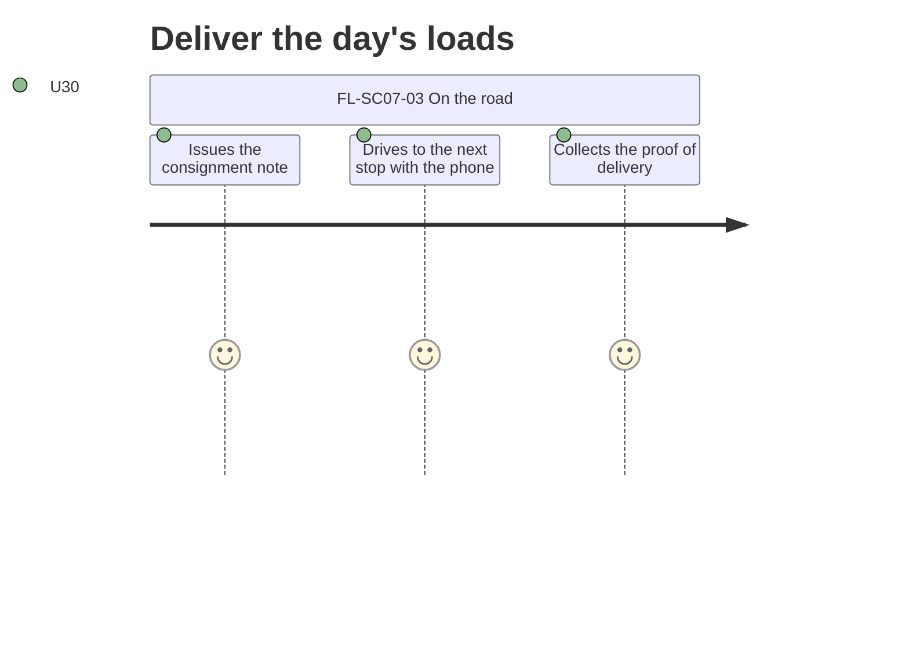
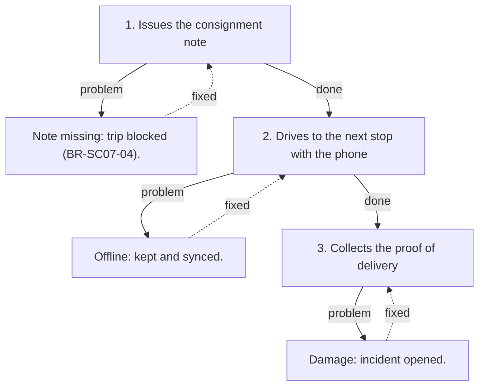

🏠 [Specs](../../../../README.md) › 🎨 [UX](../../../README.md) › 🪟 [Views](../../README.md) ›
🚚 [Driver: app shell and home](../README.md) › 🧭 [Journeys](README.md) › 🧭 J-U30-01 Deliver the day's loads

# 🧭 J-U30-01 Deliver the day's loads

**Status:** 🔄 waiting for the owner

## Persona

[U30 Driver](../../../../01-users/personas/u30-driver.md)

## Goal

Know the next stop and what to load, with no paperwork at the end of the day.

## Journey

Satisfaction at each step, from 1 (painful) to 5 (effortless): these scores are a proposal (Proposed), drawn from the
specs, for the owner to confirm.

## Flowchart

The same steps; each problem is the first error flow of the step's use case (once per use case), shown with the error
message pattern ([D122](../../../../06-decisions/ux/d122-error-message-standard.md)).

## Steps

| Step | Screen | Use case | What the persona does | What the system does |
|---|---|---|---|---|
| 1 | [S-SC07-05 Consignment notes](../../../../08-sectors/sc07-transport/screens/03-on-the-road/s-sc07-05-consignment-notes.md) | [UC-SC07-05 Issue consignment notes, paper or e-CMR](../../../../08-sectors/sc07-transport/use-cases/03-on-the-road/uc-sc07-05-issue-consignment-notes-paper-or-e-cmr.md) | Issues the consignment note | Generates the note, paper or e-CMR, for signature at loading and delivery (BR-SC07-04). |
| 2 | [S-SC07-06 Driver app](../../../../08-sectors/sc07-transport/screens/03-on-the-road/s-sc07-06-driver-app.md) | [UC-SC07-06 Drive with the phone](../../../../08-sectors/sc07-transport/use-cases/03-on-the-road/uc-sc07-06-drive-with-the-phone.md) | Drives to the next stop with the phone | Guides stop by stop; keeps scans offline and syncs them. |
| 3 | [S-SC07-07 Proof of delivery](../../../../08-sectors/sc07-transport/screens/03-on-the-road/s-sc07-07-proof-of-delivery.md) | [UC-SC07-07 Collect proofs of delivery and report incidents](../../../../08-sectors/sc07-transport/use-cases/03-on-the-road/uc-sc07-07-collect-proofs-of-delivery-and-report-incidents.md) | Collects the proof of delivery | Records the proof and reservations; opens an incident on damage. |

This persona's images of these flows (D120):
[FL-SC07-03 On the road](../../../../08-sectors/sc07-transport/images/03-on-the-road/u30-driver/README.md).

## Open questions

None.

---

⬆️ [Up](README.md)
