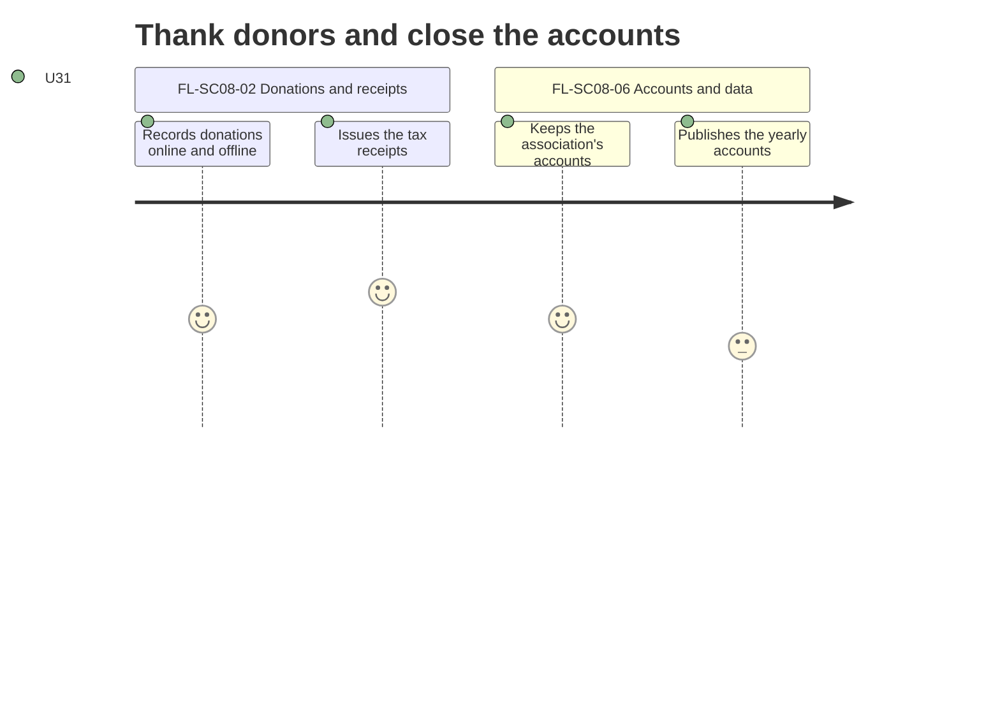
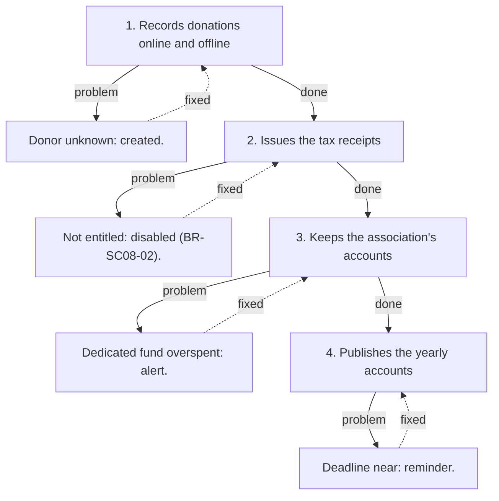

🏠 [Specs](../../../../README.md) › 🎨 [UX](../../../README.md) › 🪟 [Views](../../README.md) ›
💰 [Treasurer: app shell and home](../README.md) › 🧭 [Journeys](README.md) ›
🧭 J-U31-01 Thank donors and close the accounts

# 🧭 J-U31-01 Thank donors and close the accounts

**Status:** ✅ specified

## Persona

[U31 Treasurer](../../../../01-users/personas/u31-treasurer.md)

## Goal

Accounts the assembly approves without questions, and every donor thanked and receipted on time.

## Journey

Satisfaction at each step, from 1 (painful) to 5 (effortless): these scores are drawn from the
specs and confirmed by the owner (D572).

## Flowchart

The same steps; each problem is the first error flow of the step's use case (once per use case), shown with the error
message pattern ([D122](../../../../06-decisions/ux/d122-error-message-standard.md)).

## Steps

| Step | Screen | Use case | What the persona does | What the system does |
|---|---|---|---|---|
| 1 | [S-SC08-04 Donations](../../../../08-sectors/sc08-non-profit/screens/02-donations-and-receipts/s-sc08-04-donations.md) | [UC-SC08-04 Collect donations online and offline](../../../../08-sectors/sc08-non-profit/use-cases/02-donations-and-receipts/uc-sc08-04-collect-donations-online-and-offline.md) | Records donations online and offline | Matches the donor, or creates them, and thanks them. |
| 2 | [S-SC08-06 Tax receipts](../../../../08-sectors/sc08-non-profit/screens/02-donations-and-receipts/s-sc08-06-tax-receipts.md) | [UC-SC08-06 Issue tax receipts for gifts](../../../../08-sectors/sc08-non-profit/use-cases/02-donations-and-receipts/uc-sc08-06-issue-tax-receipts-for-gifts.md) | Issues the tax receipts | Generates the receipts for checking and sending; disabled when not entitled (BR-SC08-02). |
| 3 | [S-SC08-14 Association accounts](../../../../08-sectors/sc08-non-profit/screens/06-accounts-and-data/s-sc08-14-association-accounts.md) | [UC-SC08-14 Keep association accounts](../../../../08-sectors/sc08-non-profit/use-cases/06-accounts-and-data/uc-sc08-14-keep-association-accounts.md) | Keeps the association's accounts | Records the entries, closes the year and prepares the presentation to the assembly. |
| 4 | [S-SC08-15 Publication](../../../../08-sectors/sc08-non-profit/screens/06-accounts-and-data/s-sc08-15-publication.md) | [UC-SC08-15 Publish the yearly accounts above the thresholds](../../../../08-sectors/sc08-non-profit/use-cases/06-accounts-and-data/uc-sc08-15-publish-the-yearly-accounts-above-the-thresholds.md) | Publishes the yearly accounts | Checks the thresholds and reminds before the deadline. |

This persona's images of these flows (D120):
[FL-SC08-02 Donations and receipts](../../../../08-sectors/sc08-non-profit/images/02-donations-and-receipts/u31-treasurer/README.md),
[FL-SC08-06 Accounts and data](../../../../08-sectors/sc08-non-profit/images/06-accounts-and-data/u31-treasurer/README.md).

## Open questions

None.

---

⬆️ [Up](README.md)
