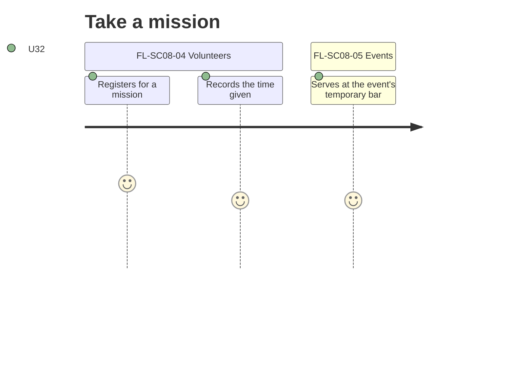
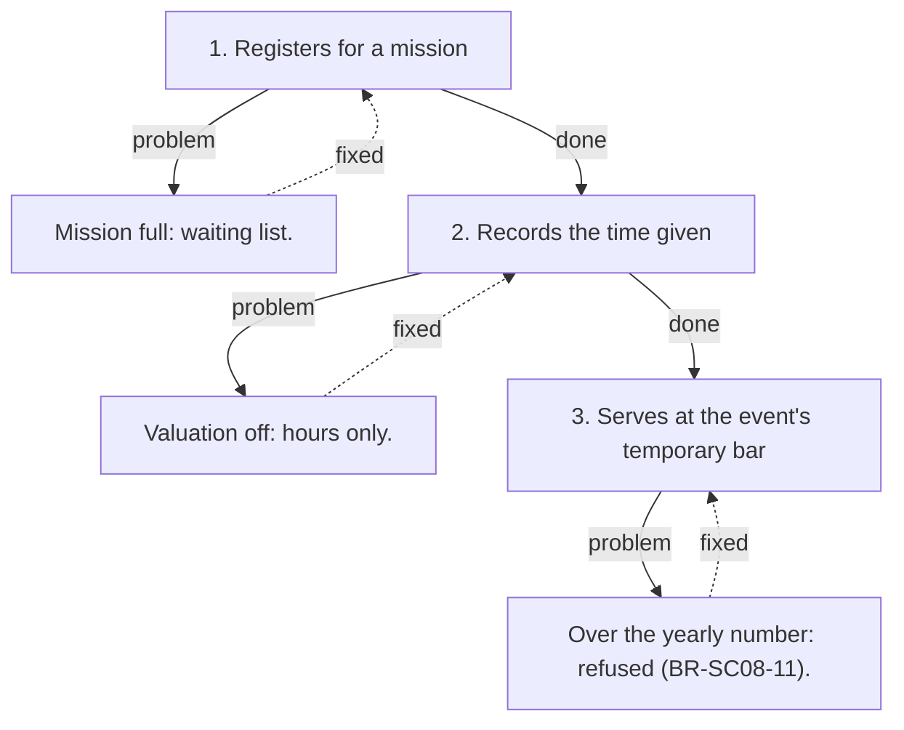

🏠 [Specs](../../../../README.md) › 🎨 [UX](../../../README.md) › 🪟 [Views](../../README.md) ›
🙋 [Volunteer: app shell and home](../README.md) › 🧭 [Journeys](README.md) › 🧭 J-U32-01 Take a mission

# 🧭 J-U32-01 Take a mission

**Status:** 🔄 waiting for the owner

## Persona

[U32 Volunteer](../../../../01-users/personas/u32-volunteer.md)

## Goal

Find a mission that fits their time and be repaid quickly.

## Journey

Satisfaction at each step, from 1 (painful) to 5 (effortless): these scores are a proposal (Proposed), drawn from the
specs, for the owner to confirm.

## Flowchart

The same steps; each problem is the first error flow of the step's use case (once per use case), shown with the error
message pattern ([D122](../../../../06-decisions/ux/d122-error-message-standard.md)).

## Steps

| Step | Screen | Use case | What the persona does | What the system does |
|---|---|---|---|---|
| 1 | [S-SC08-10 Missions](../../../../08-sectors/sc08-non-profit/screens/04-volunteers/s-sc08-10-missions.md) | [UC-SC08-10 Recruit and register volunteers for missions](../../../../08-sectors/sc08-non-profit/use-cases/04-volunteers/uc-sc08-10-recruit-and-register-volunteers-for-missions.md) | Registers for a mission | Confirms the sign-up, or puts them on the waiting list. |
| 2 | [S-SC08-11 Volunteer time](../../../../08-sectors/sc08-non-profit/screens/04-volunteers/s-sc08-11-volunteer-time.md) | [UC-SC08-11 Record and value volunteer time](../../../../08-sectors/sc08-non-profit/use-cases/04-volunteers/uc-sc08-11-record-and-value-volunteer-time.md) | Records the time given | Sends the hours for approval and values them if chosen. |
| 3 | [S-SC08-13 Temporary bar](../../../../08-sectors/sc08-non-profit/screens/05-events/s-sc08-13-temporary-bar.md) | [UC-SC08-13 Run a temporary bar at events](../../../../08-sectors/sc08-non-profit/use-cases/05-events/uc-sc08-13-run-a-temporary-bar-at-events.md) | Serves at the event's temporary bar | Records the sales and closes the takings. |

This persona's images of these flows (D120):
[FL-SC08-04 Volunteers](../../../../08-sectors/sc08-non-profit/images/04-volunteers/u32-volunteer/README.md),
[FL-SC08-05 Events](../../../../08-sectors/sc08-non-profit/images/05-events/u32-volunteer/README.md).

## Open questions

None.

---

⬆️ [Up](README.md)
