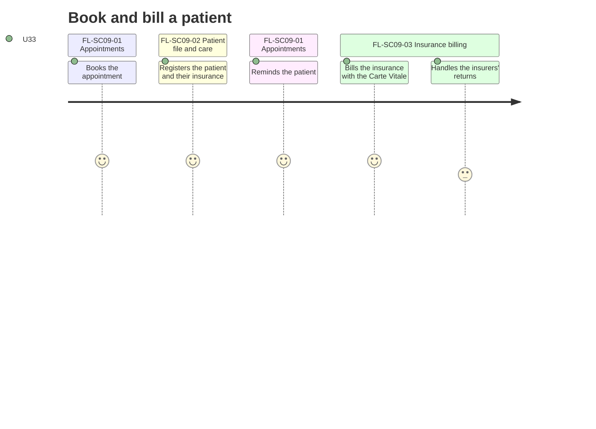
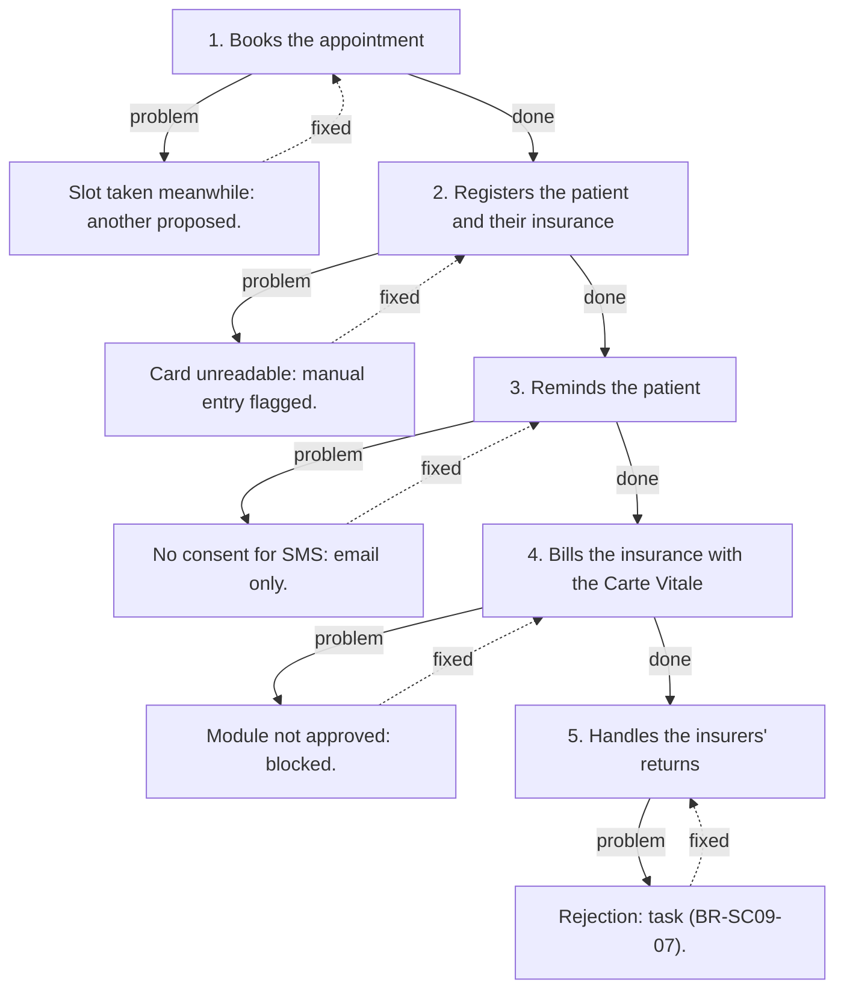

🏠 [Specs](../../../../README.md) › 🎨 [UX](../../../README.md) › 🪟 [Views](../../README.md) ›
📋 [Medical secretary: app shell and home](../README.md) › 🧭 [Journeys](README.md) › 🧭 J-U33-01 Book and bill a patient

# 🧭 J-U33-01 Book and bill a patient

**Status:** 🔄 waiting for the owner

## Persona

[U33 Medical secretary](../../../../01-users/personas/u33-medical-secretary.md)

## Goal

A full, well-kept schedule, and every act billed and paid.

## Journey

Satisfaction at each step, from 1 (painful) to 5 (effortless): these scores are a proposal (Proposed), drawn from the
specs, for the owner to confirm.

## Flowchart

The same steps; each problem is the first error flow of the step's use case (once per use case), shown with the error
message pattern ([D122](../../../../06-decisions/ux/d122-error-message-standard.md)).

## Steps

| Step | Screen | Use case | What the persona does | What the system does |
|---|---|---|---|---|
| 1 | [S-SC09-01 Agenda](../../../../08-sectors/sc09-health-practices/screens/01-appointments/s-sc09-01-agenda.md) | [UC-SC09-01 Book appointments online and at the desk](../../../../08-sectors/sc09-health-practices/use-cases/01-appointments/uc-sc09-01-book-appointments-online-and-at-the-desk.md) | Books the appointment | Finds a slot and confirms; proposes another if it was taken meanwhile. |
| 2 | [S-SC09-03 Patient file](../../../../08-sectors/sc09-health-practices/screens/02-patient-file-and-care/s-sc09-03-patient-file.md) | [UC-SC09-03 Register patients and their insurance](../../../../08-sectors/sc09-health-practices/use-cases/02-patient-file-and-care/uc-sc09-03-register-patients-and-their-insurance.md) | Registers the patient and their insurance | Reads the card and records consents. |
| 3 | [S-SC09-02 Reminders](../../../../08-sectors/sc09-health-practices/screens/01-appointments/s-sc09-02-reminders.md) | [UC-SC09-02 Remind patients and handle no-shows](../../../../08-sectors/sc09-health-practices/use-cases/01-appointments/uc-sc09-02-remind-patients-and-handle-no-shows.md) | Reminds the patient | Sends reminders by consent; marks no-shows. |
| 4 | [S-SC09-06 Care sheets](../../../../08-sectors/sc09-health-practices/screens/03-insurance-billing/s-sc09-06-care-sheets.md) | [UC-SC09-06 Bill health insurance with the Carte Vitale](../../../../08-sectors/sc09-health-practices/use-cases/03-insurance-billing/uc-sc09-06-bill-health-insurance-with-the-carte-vitale.md) | Bills the insurance with the Carte Vitale | Codes the acts, signs and sends them. |
| 5 | [S-SC09-07 Returns](../../../../08-sectors/sc09-health-practices/screens/03-insurance-billing/s-sc09-07-returns.md) | [UC-SC09-07 Handle third-party payment and insurers' returns](../../../../08-sectors/sc09-health-practices/use-cases/03-insurance-billing/uc-sc09-07-handle-third-party-payment-and-insurers-returns.md) | Handles the insurers' returns | Applies third-party payment; turns each rejection into a task (BR-SC09-07). |

This persona's images of these flows (D120):
[FL-SC09-01 Appointments](../../../../08-sectors/sc09-health-practices/images/01-appointments/u33-medical-secretary/README.md),
[FL-SC09-02 Patient file and care](../../../../08-sectors/sc09-health-practices/images/02-patient-file-and-care/u33-medical-secretary/README.md),
[FL-SC09-03 Insurance billing](../../../../08-sectors/sc09-health-practices/images/03-insurance-billing/u33-medical-secretary/README.md).

## Open questions

None.

---

⬆️ [Up](README.md)
