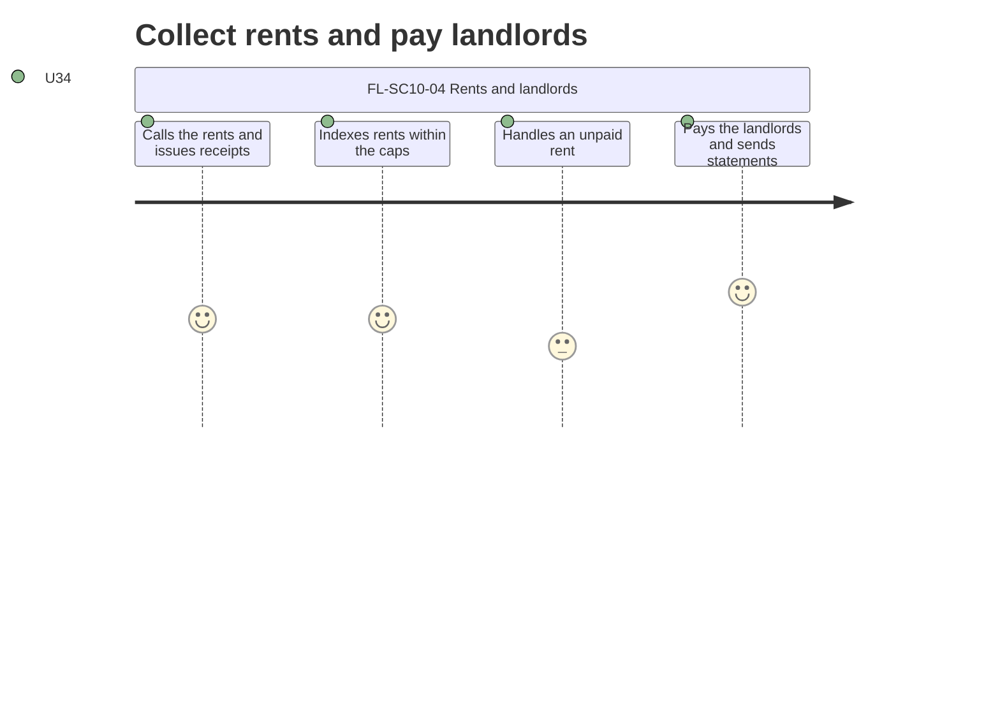
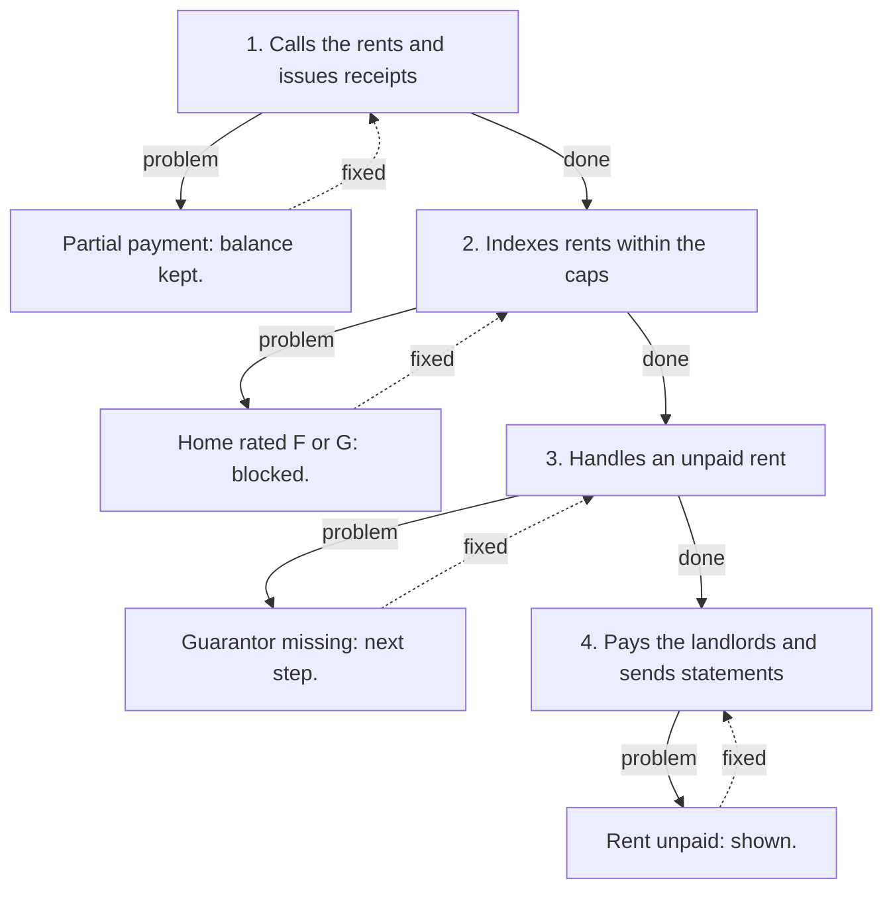

🏠 [Specs](../../../../README.md) › 🎨 [UX](../../../README.md) › 🪟 [Views](../../README.md) ›
🏢 [Property manager: app shell and home](../README.md) › 🧭 [Journeys](README.md) ›
🧭 J-U34-01 Collect rents and pay landlords

# 🧭 J-U34-01 Collect rents and pay landlords

**Status:** 🔄 waiting for the owner

## Persona

[U34 Property manager](../../../../01-users/personas/u34-property-manager.md)

## Goal

Every rent collected and every landlord paid on time.

## Journey

Satisfaction at each step, from 1 (painful) to 5 (effortless): these scores are a proposal (Proposed), drawn from the
specs, for the owner to confirm.

## Flowchart

The same steps; each problem is the first error flow of the step's use case (once per use case), shown with the error
message pattern ([D122](../../../../06-decisions/ux/d122-error-message-standard.md)).

## Steps

| Step | Screen | Use case | What the persona does | What the system does |
|---|---|---|---|---|
| 1 | [S-SC10-08 Rents](../../../../08-sectors/sc10-real-estate/screens/04-rents-and-landlords/s-sc10-08-rents.md) | [UC-SC10-08 Call rents and issue receipts](../../../../08-sectors/sc10-real-estate/use-cases/04-rents-and-landlords/uc-sc10-08-call-rents-and-issue-receipts.md) | Calls the rents and issues receipts | Calls the rents, records payments and issues receipts; keeps partial balances. |
| 2 | [S-SC10-09 Indexation](../../../../08-sectors/sc10-real-estate/screens/04-rents-and-landlords/s-sc10-09-indexation.md) | [UC-SC10-09 Index rents within the caps](../../../../08-sectors/sc10-real-estate/use-cases/04-rents-and-landlords/uc-sc10-09-index-rents-within-the-caps.md) | Indexes rents within the caps | Computes the new rent and checks the caps; blocks homes rated F or G. |
| 3 | [S-SC10-14 Unpaid rents](../../../../08-sectors/sc10-real-estate/screens/04-rents-and-landlords/s-sc10-14-unpaid-rents.md) | [UC-SC10-14 Handle unpaid rents](../../../../08-sectors/sc10-real-estate/use-cases/04-rents-and-landlords/uc-sc10-14-handle-unpaid-rents.md) | Handles an unpaid rent | Sends the reminder, then the notice, then escalates. |
| 4 | [S-SC10-12 Landlord statements](../../../../08-sectors/sc10-real-estate/screens/04-rents-and-landlords/s-sc10-12-landlord-statements.md) | [UC-SC10-12 Pay landlords and send statements](../../../../08-sectors/sc10-real-estate/use-cases/04-rents-and-landlords/uc-sc10-12-pay-landlords-and-send-statements.md) | Pays the landlords and sends statements | Deducts fees and expenses, pays and sends the statements. |

This persona's images of these flows (D120):
[FL-SC10-04 Rents and landlords](../../../../08-sectors/sc10-real-estate/images/04-rents-and-landlords/u34-property-manager/README.md).

## Open questions

None.

---

⬆️ [Up](README.md)
