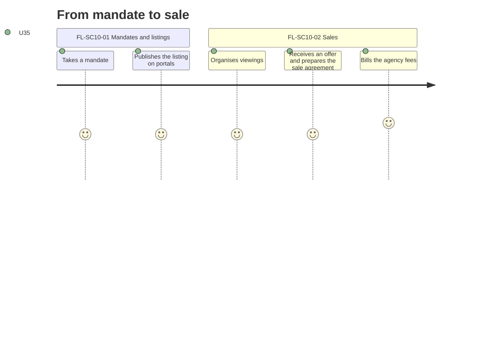
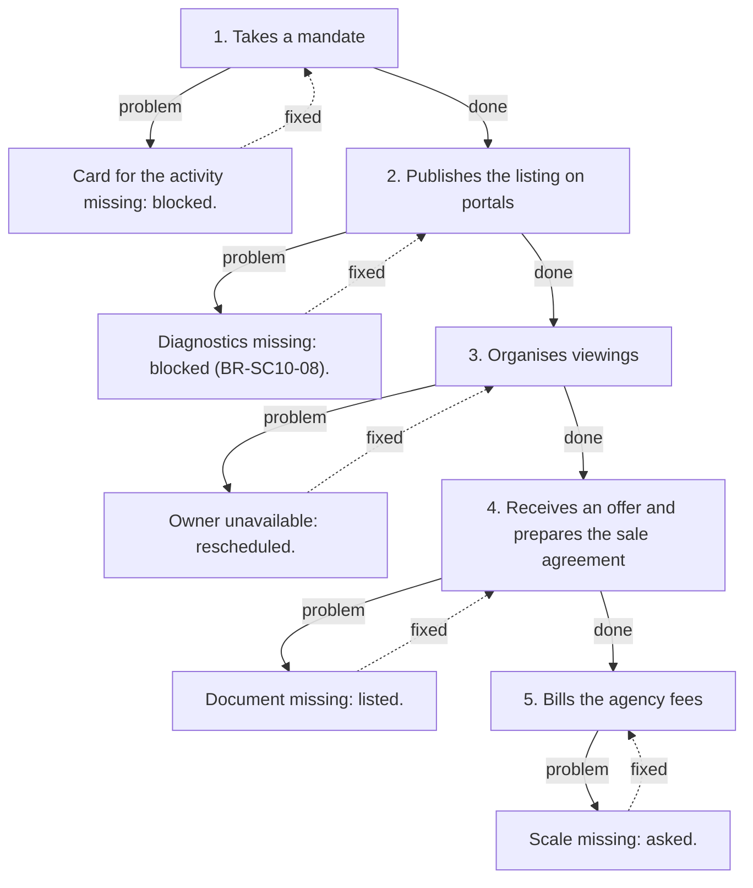

🏠 [Specs](../../../../README.md) › 🎨 [UX](../../../README.md) › 🪟 [Views](../../README.md) ›
🔑 [Real-estate agent: app shell and home](../README.md) › 🧭 [Journeys](README.md) › 🧭 J-U35-01 From mandate to sale

# 🧭 J-U35-01 From mandate to sale

**Status:** 🔄 waiting for the owner

## Persona

[U35 Real-estate agent](../../../../01-users/personas/u35-real-estate-agent.md)

## Goal

Sign mandates and close sales, and never miss a buyer's call.

## Journey

Satisfaction at each step, from 1 (painful) to 5 (effortless): these scores are a proposal (Proposed), drawn from the
specs, for the owner to confirm.

## Flowchart

The same steps; each problem is the first error flow of the step's use case (once per use case), shown with the error
message pattern ([D122](../../../../06-decisions/ux/d122-error-message-standard.md)).

## Steps

| Step | Screen | Use case | What the persona does | What the system does |
|---|---|---|---|---|
| 1 | [S-SC10-01 Mandates](../../../../08-sectors/sc10-real-estate/screens/01-mandates-and-listings/s-sc10-01-mandates.md) | [UC-SC10-01 Take a mandate and record it in the register](../../../../08-sectors/sc10-real-estate/use-cases/01-mandates-and-listings/uc-sc10-01-take-a-mandate-and-record-it-in-the-register.md) | Takes a mandate | Numbers the mandate in the register for signature. |
| 2 | [S-SC10-02 Listings](../../../../08-sectors/sc10-real-estate/screens/01-mandates-and-listings/s-sc10-02-listings.md) | [UC-SC10-02 Publish listings on portals](../../../../08-sectors/sc10-real-estate/use-cases/01-mandates-and-listings/uc-sc10-02-publish-listings-on-portals.md) | Publishes the listing on portals | Checks the diagnostics before publishing (BR-SC10-08). |
| 3 | [S-SC10-03 Viewings](../../../../08-sectors/sc10-real-estate/screens/02-sales/s-sc10-03-viewings.md) | [UC-SC10-03 Organise viewings](../../../../08-sectors/sc10-real-estate/use-cases/02-sales/uc-sc10-03-organise-viewings.md) | Organises viewings | Books the viewings and records feedback. |
| 4 | [S-SC10-04 Offers](../../../../08-sectors/sc10-real-estate/screens/02-sales/s-sc10-04-offers.md) | [UC-SC10-04 Receive offers and prepare the sale agreement](../../../../08-sectors/sc10-real-estate/use-cases/02-sales/uc-sc10-04-receive-offers-and-prepare-the-sale-agreement.md) | Receives an offer and prepares the sale agreement | Records the offers and prepares the file for the notary. |
| 5 | [S-SC10-06 Agency fees](../../../../08-sectors/sc10-real-estate/screens/02-sales/s-sc10-06-agency-fees.md) | [UC-SC10-06 Bill and display agency fees](../../../../08-sectors/sc10-real-estate/use-cases/02-sales/uc-sc10-06-bill-and-display-agency-fees.md) | Bills the agency fees | Applies the fee scale, shows it on the listing and bills it. |

This persona's images of these flows (D120):
[FL-SC10-01 Mandates and listings](../../../../08-sectors/sc10-real-estate/images/01-mandates-and-listings/u35-real-estate-agent/README.md),
[FL-SC10-02 Sales](../../../../08-sectors/sc10-real-estate/images/02-sales/u35-real-estate-agent/README.md).

## Open questions

None.

---

⬆️ [Up](README.md)
