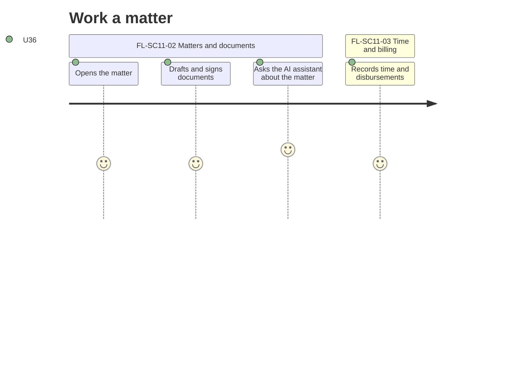
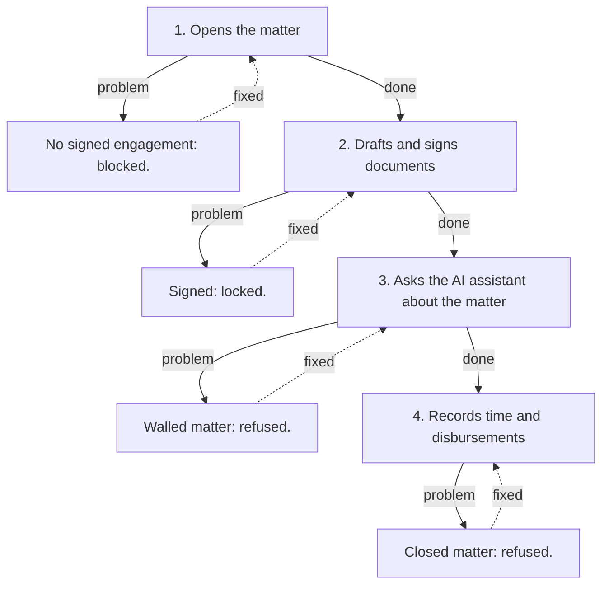

🏠 [Specs](../../../../README.md) › 🎨 [UX](../../../README.md) › 🪟 [Views](../../README.md) ›
⚖️ [Professional: app shell and home](../README.md) › 🧭 [Journeys](README.md) › 🧭 J-U36-01 Work a matter

# 🧭 J-U36-01 Work a matter

**Status:** 🔄 waiting for the owner

## Persona

[U36 Professional](../../../../01-users/personas/u36-professional.md)

## Goal

Never miss a deadline and bill the time really spent.

## Journey

Satisfaction at each step, from 1 (painful) to 5 (effortless): these scores are a proposal (Proposed), drawn from the
specs, for the owner to confirm.

## Flowchart

The same steps; each problem is the first error flow of the step's use case (once per use case), shown with the error
message pattern ([D122](../../../../06-decisions/ux/d122-error-message-standard.md)).

## Steps

| Step | Screen | Use case | What the persona does | What the system does |
|---|---|---|---|---|
| 1 | [S-SC11-04 Matters](../../../../08-sectors/sc11-professional-firms/screens/02-matters-and-documents/s-sc11-04-matters.md) | [UC-SC11-04 Open and organise matters](../../../../08-sectors/sc11-professional-firms/use-cases/02-matters-and-documents/uc-sc11-04-open-and-organise-matters.md) | Opens the matter | Blocks a matter without a signed engagement; plans its steps. |
| 2 | [S-SC11-09 Documents](../../../../08-sectors/sc11-professional-firms/screens/02-matters-and-documents/s-sc11-09-documents.md) | [UC-SC11-09 Manage documents with versions and e-signature](../../../../08-sectors/sc11-professional-firms/use-cases/02-matters-and-documents/uc-sc11-09-manage-documents-with-versions-and-e-signature.md) | Drafts and signs documents | Keeps versions; locks the signed document. |
| 3 | [S-SC11-20 Matter assistant](../../../../08-sectors/sc11-professional-firms/screens/02-matters-and-documents/s-sc11-20-matter-assistant.md) | [UC-SC11-20 Ask the AI assistant about a matter](../../../../08-sectors/sc11-professional-firms/use-cases/02-matters-and-documents/uc-sc11-20-ask-the-assistant-about-a-matter.md) | Asks the AI assistant about the matter | Answers from data, never from a walled matter (BR-F3-07). |
| 4 | [S-SC11-05 Time](../../../../08-sectors/sc11-professional-firms/screens/03-time-and-billing/s-sc11-05-time.md) | [UC-SC11-05 Record time and disbursements](../../../../08-sectors/sc11-professional-firms/use-cases/03-time-and-billing/uc-sc11-05-record-time-and-disbursements.md) | Records time and disbursements | Sends time and disbursements for review; refuses a closed matter. |

This persona's images of these flows (D120):
[FL-SC11-02 Matters and documents](../../../../08-sectors/sc11-professional-firms/images/02-matters-and-documents/u36-professional/README.md),
[FL-SC11-03 Time and billing](../../../../08-sectors/sc11-professional-firms/images/03-time-and-billing/u36-professional/README.md).

## Open questions

None.

---

⬆️ [Up](README.md)
