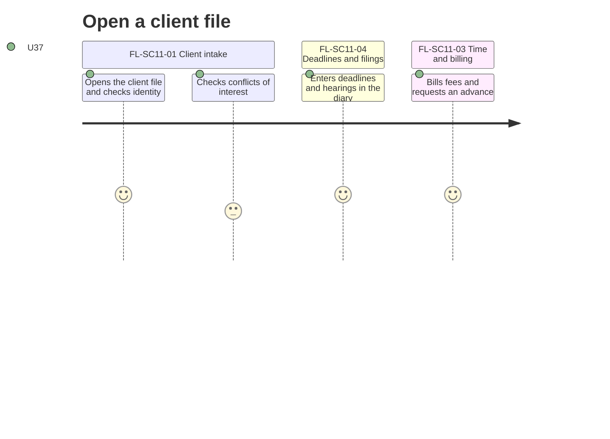
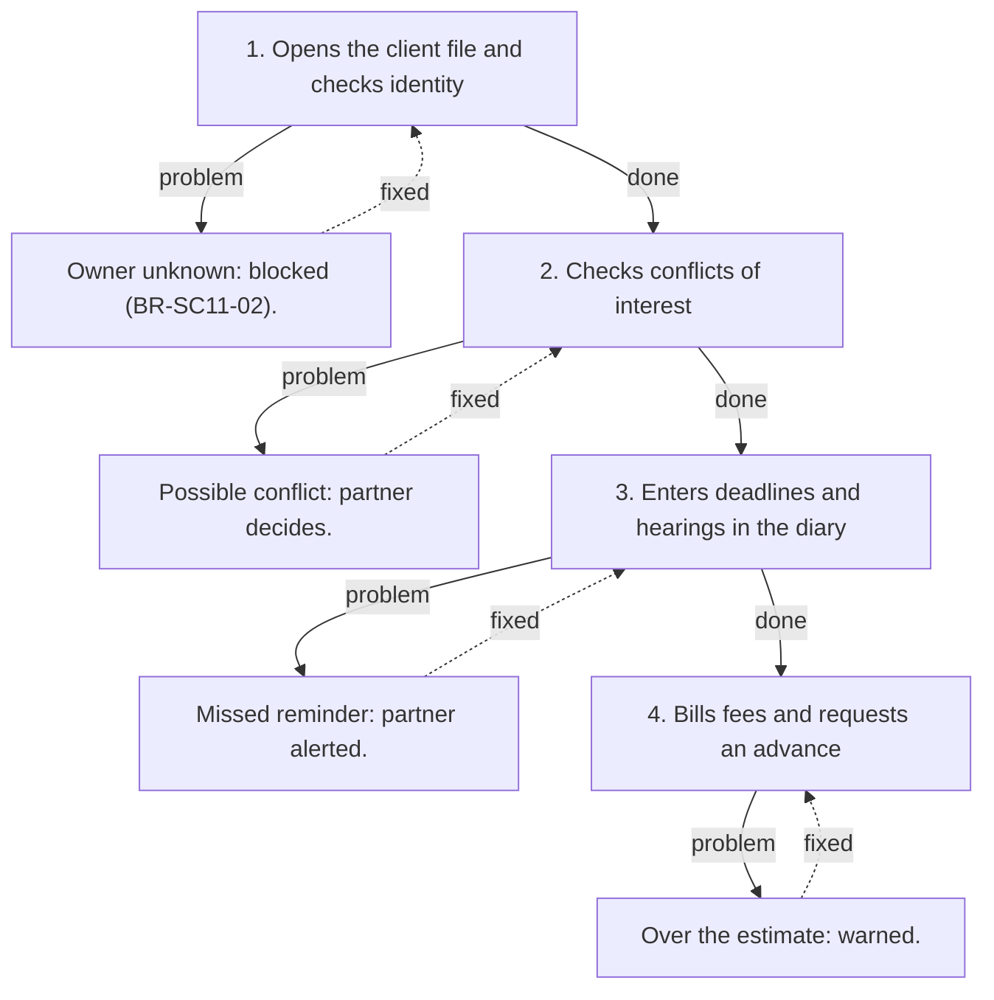

🏠 [Specs](../../../../README.md) › 🎨 [UX](../../../README.md) › 🪟 [Views](../../README.md) ›
🗂️ [Assistant: app shell and home](../README.md) › 🧭 [Journeys](README.md) › 🧭 J-U37-01 Open a client file

# 🧭 J-U37-01 Open a client file

**Status:** ✅ specified

## Persona

[U37 Professional's assistant](../../../../01-users/personas/u37-assistant.md)

## Goal

Every file complete and every deadline in the diary, and bills out on time.

## Journey

Satisfaction at each step, from 1 (painful) to 5 (effortless): these scores are drawn from the
specs and confirmed by the owner (D572).

## Flowchart

The same steps; each problem is the first error flow of the step's use case (once per use case), shown with the error
message pattern ([D122](../../../../06-decisions/ux/d122-error-message-standard.md)).

## Steps

| Step | Screen | Use case | What the persona does | What the system does |
|---|---|---|---|---|
| 1 | [S-SC11-01 Client intake](../../../../08-sectors/sc11-professional-firms/screens/01-client-intake/s-sc11-01-client-intake.md) | [UC-SC11-01 Open a client file and check identity](../../../../08-sectors/sc11-professional-firms/use-cases/01-client-intake/uc-sc11-01-open-a-client-file-and-check-identity.md) | Opens the client file and checks identity | Rates the risk from the documents; blocks an unknown owner (BR-SC11-02). |
| 2 | [S-SC11-02 Conflict check](../../../../08-sectors/sc11-professional-firms/screens/01-client-intake/s-sc11-02-conflict-check.md) | [UC-SC11-02 Check conflicts of interest](../../../../08-sectors/sc11-professional-firms/use-cases/01-client-intake/uc-sc11-02-check-conflicts-of-interest.md) | Checks conflicts of interest | Searches the parties; sends a possible conflict to a partner. |
| 3 | [S-SC11-08 Deadlines](../../../../08-sectors/sc11-professional-firms/screens/04-deadlines-and-filings/s-sc11-08-deadlines.md) | [UC-SC11-08 Follow deadlines, hearings and limitation periods](../../../../08-sectors/sc11-professional-firms/use-cases/04-deadlines-and-filings/uc-sc11-08-follow-deadlines-hearings-and-limitation-periods.md) | Enters deadlines and hearings in the diary | Reminds before each deadline; alerts a partner on a missed one. |
| 4 | [S-SC11-06 Fees](../../../../08-sectors/sc11-professional-firms/screens/03-time-and-billing/s-sc11-06-fees.md) | [UC-SC11-06 Bill fees and request advances](../../../../08-sectors/sc11-professional-firms/use-cases/03-time-and-billing/uc-sc11-06-bill-fees-and-request-advances.md) | Bills fees and requests an advance | Prepares the bill for approval; warns over the estimate. |

This persona's images of these flows (D120):
[FL-SC11-01 Client intake](../../../../08-sectors/sc11-professional-firms/images/01-client-intake/u37-assistant/README.md),
[FL-SC11-04 Deadlines and filings](../../../../08-sectors/sc11-professional-firms/images/04-deadlines-and-filings/u37-assistant/README.md),
[FL-SC11-03 Time and billing](../../../../08-sectors/sc11-professional-firms/images/03-time-and-billing/u37-assistant/README.md).

## Open questions

None.

---

⬆️ [Up](README.md)
