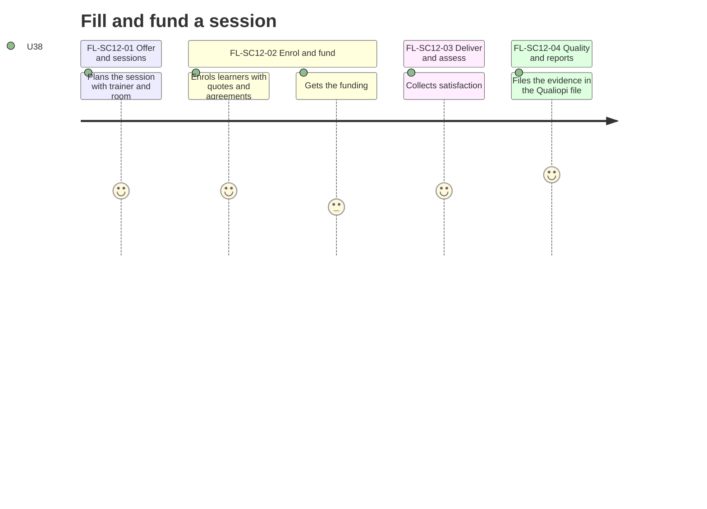
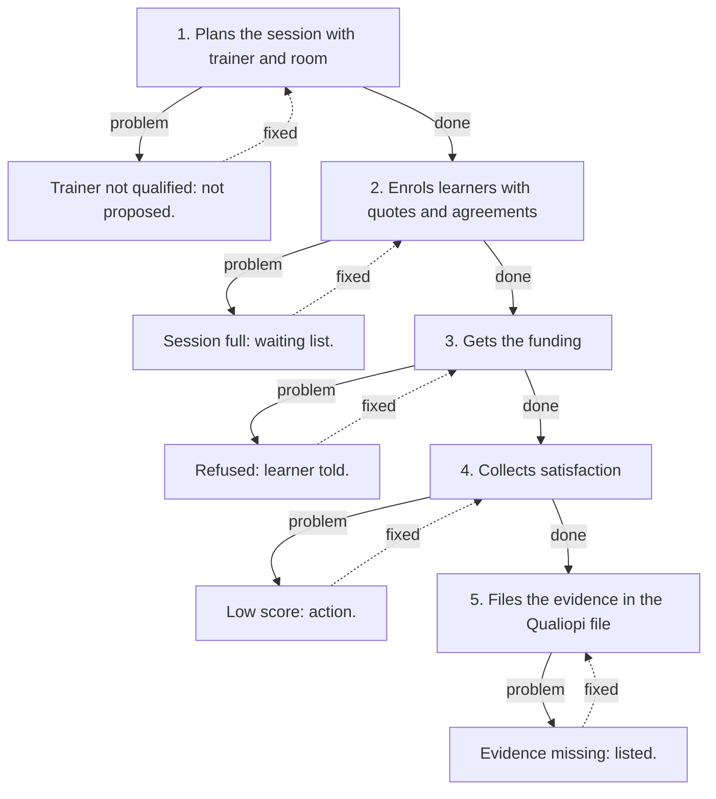

🏠 [Specs](../../../../README.md) › 🎨 [UX](../../../README.md) › 🪟 [Views](../../README.md) ›
🧑‍🏫 [Training coordinator: app shell and home](../README.md) › 🧭 [Journeys](README.md) ›
🧭 J-U38-01 Fill and fund a session

# 🧭 J-U38-01 Fill and fund a session

**Status:** ✅ specified

## Persona

[U38 Training coordinator](../../../../01-users/personas/u38-training-coordinator.md)

## Goal

Full sessions with every learner funded, and a quality file ready for the audit.

## Journey

Satisfaction at each step, from 1 (painful) to 5 (effortless): these scores are drawn from the
specs and confirmed by the owner (D572).

## Flowchart

The same steps; each problem is the first error flow of the step's use case (once per use case), shown with the error
message pattern ([D122](../../../../06-decisions/ux/d122-error-message-standard.md)).

## Steps

| Step | Screen | Use case | What the persona does | What the system does |
|---|---|---|---|---|
| 1 | [S-SC12-02 Sessions](../../../../08-sectors/sc12-education-and-training/screens/01-offer-and-sessions/s-sc12-02-sessions.md) | [UC-SC12-02 Plan sessions with trainers and rooms](../../../../08-sectors/sc12-education-and-training/use-cases/01-offer-and-sessions/uc-sc12-02-plan-sessions-with-trainers-and-rooms.md) | Plans the session with trainer and room | Proposes only qualified trainers; opens enrolment. |
| 2 | [S-SC12-03 Enrolment](../../../../08-sectors/sc12-education-and-training/screens/02-enrol-and-fund/s-sc12-03-enrolment.md) | [UC-SC12-03 Enrol learners with quotes and agreements](../../../../08-sectors/sc12-education-and-training/use-cases/02-enrol-and-fund/uc-sc12-03-enrol-learners-with-quotes-and-agreements.md) | Enrols learners with quotes and agreements | Sends the quote and the agreement to sign; keeps a waiting list when full. |
| 3 | [S-SC12-04 Funding](../../../../08-sectors/sc12-education-and-training/screens/02-enrol-and-fund/s-sc12-04-funding.md) | [UC-SC12-04 Get funding](../../../../08-sectors/sc12-education-and-training/use-cases/02-enrol-and-fund/uc-sc12-04-get-funding.md) | Gets the funding | Records the funder's decision and splits the price. |
| 4 | [S-SC12-09 Satisfaction](../../../../08-sectors/sc12-education-and-training/screens/03-deliver-and-assess/s-sc12-09-satisfaction.md) | [UC-SC12-09 Collect satisfaction](../../../../08-sectors/sc12-education-and-training/use-cases/03-deliver-and-assess/uc-sc12-09-collect-satisfaction.md) | Collects satisfaction | Sends the survey and analyses the answers. |
| 5 | [S-SC12-12 Quality file](../../../../08-sectors/sc12-education-and-training/screens/04-quality-and-reports/s-sc12-12-quality-file.md) | [UC-SC12-12 Keep the Qualiopi evidence file](../../../../08-sectors/sc12-education-and-training/use-cases/04-quality-and-reports/uc-sc12-12-keep-the-qualiopi-evidence-file.md) | Files the evidence in the Qualiopi file | Lists missing evidence and prepares the audit. |

This persona's images of these flows (D120):
[FL-SC12-01 Offer and sessions](../../../../08-sectors/sc12-education-and-training/images/01-offer-and-sessions/u38-training-coordinator/README.md),
[FL-SC12-02 Enrol and fund](../../../../08-sectors/sc12-education-and-training/images/02-enrol-and-fund/u38-training-coordinator/README.md),
[FL-SC12-03 Deliver and assess](../../../../08-sectors/sc12-education-and-training/images/03-deliver-and-assess/u38-training-coordinator/README.md),
[FL-SC12-04 Quality and reports](../../../../08-sectors/sc12-education-and-training/images/04-quality-and-reports/u38-training-coordinator/README.md).

## Open questions

None.

---

⬆️ [Up](README.md)
