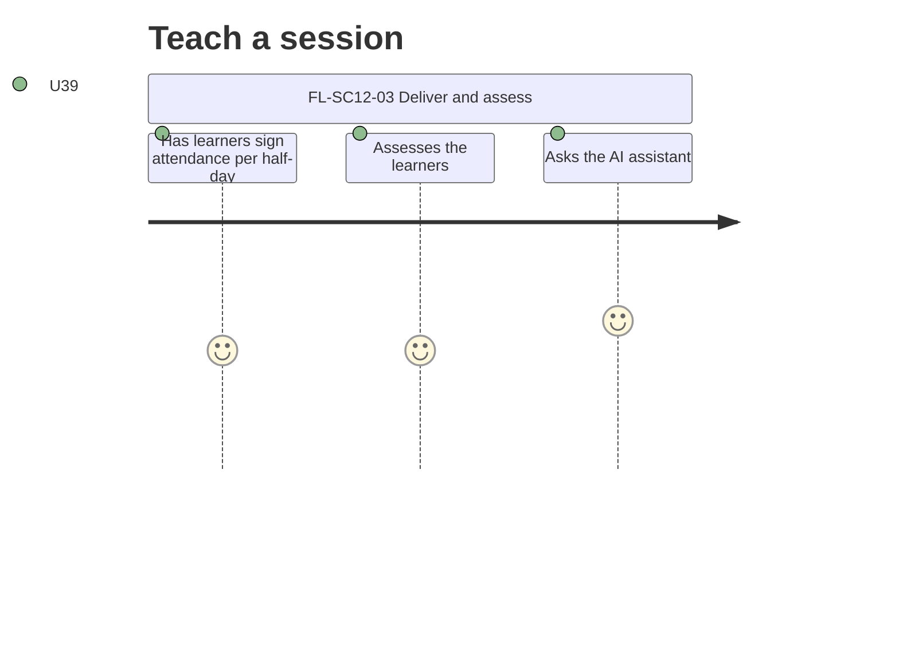
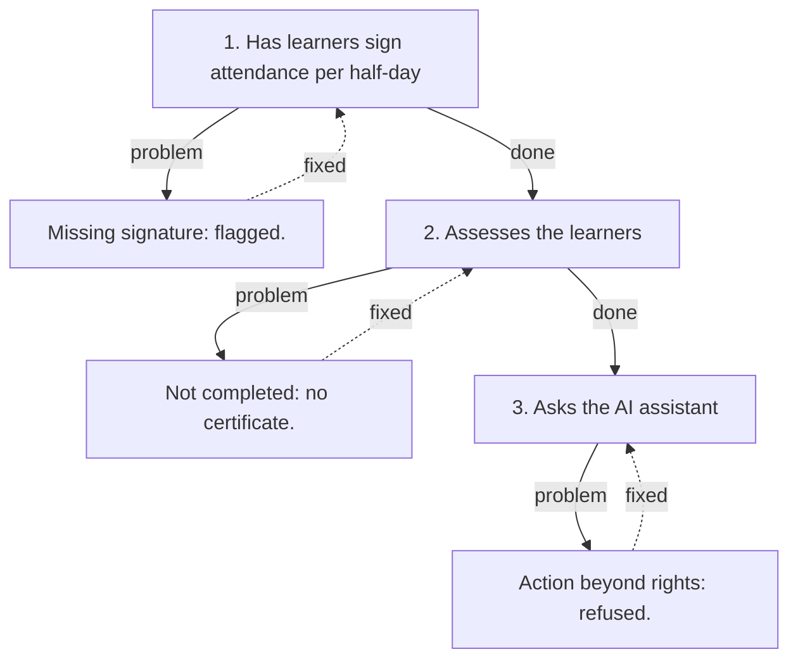

🏠 [Specs](../../../../README.md) › 🎨 [UX](../../../README.md) › 🪟 [Views](../../README.md) ›
🎤 [Trainer: app shell and home](../README.md) › 🧭 [Journeys](README.md) › 🧭 J-U39-01 Teach a session

# 🧭 J-U39-01 Teach a session

**Status:** ✅ specified

## Persona

[U39 Trainer](../../../../01-users/personas/u39-trainer.md)

## Goal

Teach, not fill forms, and know who attends and what they need.

## Journey

Satisfaction at each step, from 1 (painful) to 5 (effortless): these scores are drawn from the
specs and confirmed by the owner (D572).

## Flowchart

The same steps; each problem is the first error flow of the step's use case (once per use case), shown with the error
message pattern ([D122](../../../../06-decisions/ux/d122-error-message-standard.md)).

## Steps

| Step | Screen | Use case | What the persona does | What the system does |
|---|---|---|---|---|
| 1 | [S-SC12-06 Attendance](../../../../08-sectors/sc12-education-and-training/screens/03-deliver-and-assess/s-sc12-06-attendance.md) | [UC-SC12-06 Sign attendance per half-day](../../../../08-sectors/sc12-education-and-training/use-cases/03-deliver-and-assess/uc-sc12-06-sign-attendance-per-half-day.md) | Has learners sign attendance per half-day | Opens the sheet for signatures; flags a missing one. |
| 2 | [S-SC12-08 Certificates](../../../../08-sectors/sc12-education-and-training/screens/03-deliver-and-assess/s-sc12-08-certificates.md) | [UC-SC12-08 Assess learners and issue certificates](../../../../08-sectors/sc12-education-and-training/use-cases/03-deliver-and-assess/uc-sc12-08-assess-learners-and-issue-certificates.md) | Assesses the learners | Checks completion before any certificate. |
| 3 | [S-SC12-20 Training assistant](../../../../08-sectors/sc12-education-and-training/screens/03-deliver-and-assess/s-sc12-20-training-assistant.md) | [UC-SC12-20 Ask the AI assistant](../../../../08-sectors/sc12-education-and-training/use-cases/03-deliver-and-assess/uc-sc12-20-ask-the-assistant.md) | Asks the AI assistant | Answers from data or prepares an action to confirm (BR-F3-07). |

This persona's images of these flows (D120):
[FL-SC12-03 Deliver and assess](../../../../08-sectors/sc12-education-and-training/images/03-deliver-and-assess/u39-trainer/README.md).

## Open questions

None.

---

⬆️ [Up](README.md)
