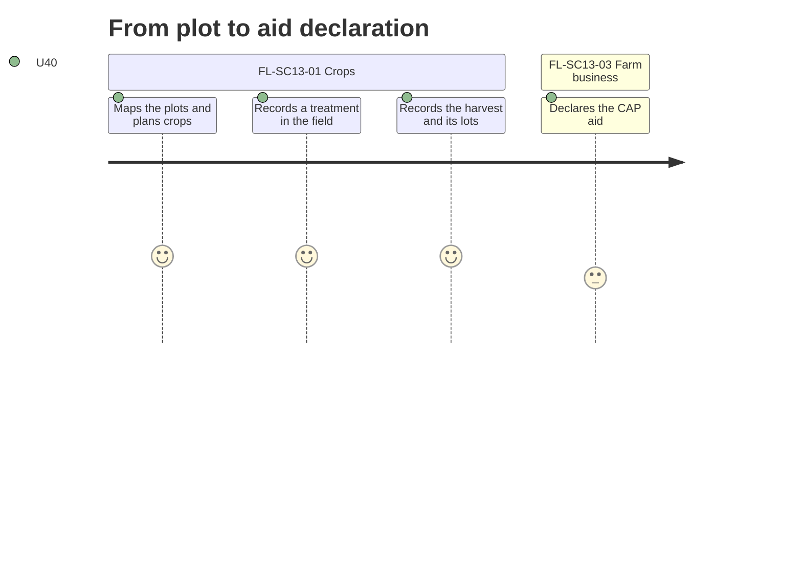
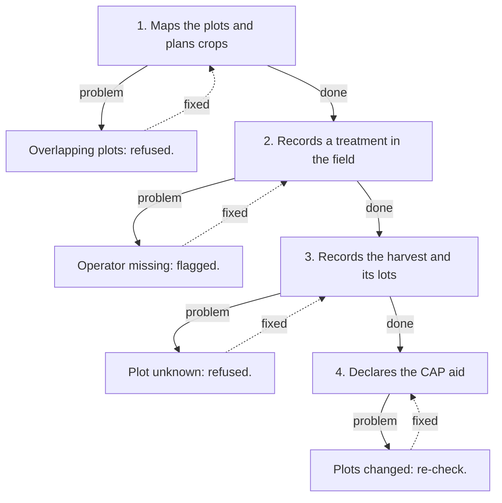

🏠 [Specs](../../../../README.md) › 🎨 [UX](../../../README.md) › 🪟 [Views](../../README.md) ›
🧑‍🌾 [Farmer: app shell and home](../README.md) › 🧭 [Journeys](README.md) › 🧭 J-U40-01 From plot to aid declaration

# 🧭 J-U40-01 From plot to aid declaration

**Status:** 🔄 waiting for the owner

## Persona

[U40 Farmer](../../../../01-users/personas/u40-farmer.md)

## Goal

Good yields at the right cost, and registers and aid files right without evenings of paperwork.

## Journey

Satisfaction at each step, from 1 (painful) to 5 (effortless): these scores are a proposal (Proposed), drawn from the
specs, for the owner to confirm.

## Flowchart

The same steps; each problem is the first error flow of the step's use case (once per use case), shown with the error
message pattern ([D122](../../../../06-decisions/ux/d122-error-message-standard.md)).

## Steps

| Step | Screen | Use case | What the persona does | What the system does |
|---|---|---|---|---|
| 1 | [S-SC13-01 Plots](../../../../08-sectors/sc13-agriculture-and-food/screens/01-crops/s-sc13-01-plots.md) | [UC-SC13-01 Map plots and plan crops](../../../../08-sectors/sc13-agriculture-and-food/use-cases/01-crops/uc-sc13-01-map-plots-and-plan-crops.md) | Maps the plots and plans crops | Refuses overlapping plots; follows the rotation. |
| 2 | [S-SC13-02 Treatments](../../../../08-sectors/sc13-agriculture-and-food/screens/01-crops/s-sc13-02-treatments.md) | [UC-SC13-02 Record treatments and inputs](../../../../08-sectors/sc13-agriculture-and-food/use-cases/01-crops/uc-sc13-02-record-treatments-and-inputs.md) | Records a treatment in the field | Saves the treatment, offline if needed; flags a missing operator. |
| 3 | [S-SC13-04 Harvests](../../../../08-sectors/sc13-agriculture-and-food/screens/01-crops/s-sc13-04-harvests.md) | [UC-SC13-04 Record harvests, yields and lots](../../../../08-sectors/sc13-agriculture-and-food/use-cases/01-crops/uc-sc13-04-record-harvests-yields-and-lots.md) | Records the harvest and its lots | Creates the lot from the harvest. |
| 4 | [S-SC13-07 Aid declaration](../../../../08-sectors/sc13-agriculture-and-food/screens/03-farm-business/s-sc13-07-aid-declaration.md) | [UC-SC13-07 Declare CAP aid](../../../../08-sectors/sc13-agriculture-and-food/use-cases/03-farm-business/uc-sc13-07-declare-cap-aid.md) | Declares the CAP aid | Prepares the declaration from the records for filing on the official service. |

This persona's images of these flows (D120):
[FL-SC13-01 Crops](../../../../08-sectors/sc13-agriculture-and-food/images/01-crops/u40-farmer/README.md),
[FL-SC13-03 Farm business](../../../../08-sectors/sc13-agriculture-and-food/images/03-farm-business/u40-farmer/README.md).

## Open questions

None.

---

⬆️ [Up](README.md)
