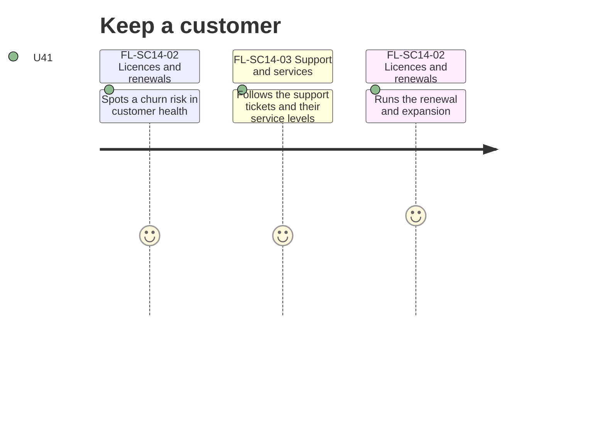
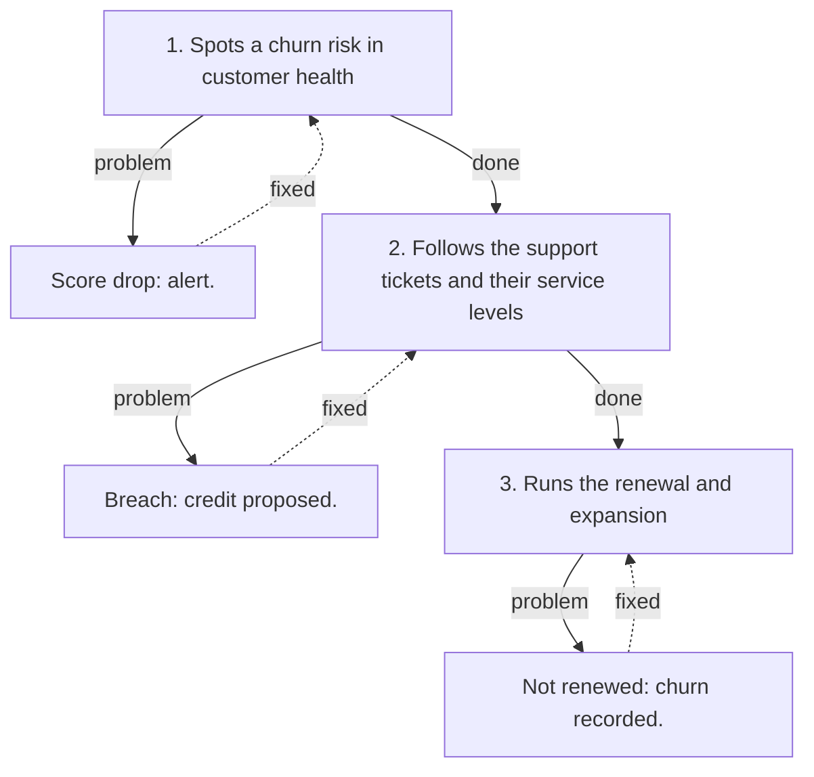

🏠 [Specs](../../../../README.md) › 🎨 [UX](../../../README.md) › 🪟 [Views](../../README.md) ›
🚀 [Customer success manager: app shell and home](../README.md) › 🧭 [Journeys](README.md) › 🧭 J-U41-01 Keep a customer

# 🧭 J-U41-01 Keep a customer

**Status:** ✅ specified

## Persona

[U41 Customer success manager](../../../../01-users/personas/u41-customer-success-manager.md)

## Goal

Customers who renew and grow, and a risk known before the customer leaves.

## Journey

Satisfaction at each step, from 1 (painful) to 5 (effortless): these scores are drawn from the
specs and confirmed by the owner (D572).

## Flowchart

The same steps; each problem is the first error flow of the step's use case (once per use case), shown with the error
message pattern ([D122](../../../../06-decisions/ux/d122-error-message-standard.md)).

## Steps

| Step | Screen | Use case | What the persona does | What the system does |
|---|---|---|---|---|
| 1 | [S-SC14-09 Health](../../../../08-sectors/sc14-it-and-software/screens/02-licences-and-renewals/s-sc14-09-health.md) | [UC-SC14-09 Follow customer health and churn risk](../../../../08-sectors/sc14-it-and-software/use-cases/02-licences-and-renewals/uc-sc14-09-follow-customer-health-and-churn-risk.md) | Spots a churn risk in customer health | Shows health scores and alerts on a drop. |
| 2 | [S-SC14-05 Support levels](../../../../08-sectors/sc14-it-and-software/screens/03-support-and-services/s-sc14-05-support-levels.md) | [UC-SC14-05 Run support with service levels](../../../../08-sectors/sc14-it-and-software/use-cases/03-support-and-services/uc-sc14-05-run-support-with-service-levels.md) | Follows the support tickets and their service levels | Tracks each ticket against its service level; proposes a credit on a breach. |
| 3 | [S-SC14-10 Renewals](../../../../08-sectors/sc14-it-and-software/screens/02-licences-and-renewals/s-sc14-10-renewals.md) | [UC-SC14-10 Run renewals and expansion](../../../../08-sectors/sc14-it-and-software/use-cases/02-licences-and-renewals/uc-sc14-10-run-renewals-and-expansion.md) | Runs the renewal and expansion | Prepares the renewal quote; records churn if not renewed. |

This persona's images of these flows (D120):
[FL-SC14-02 Licences and renewals](../../../../08-sectors/sc14-it-and-software/images/02-licences-and-renewals/u41-customer-success-manager/README.md),
[FL-SC14-03 Support and services](../../../../08-sectors/sc14-it-and-software/images/03-support-and-services/u41-customer-success-manager/README.md).

## Open questions

None.

---

⬆️ [Up](README.md)
