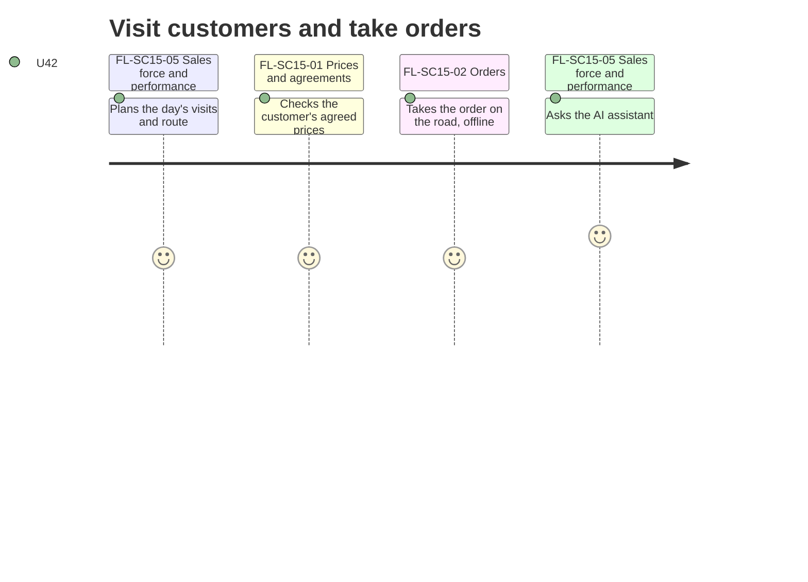
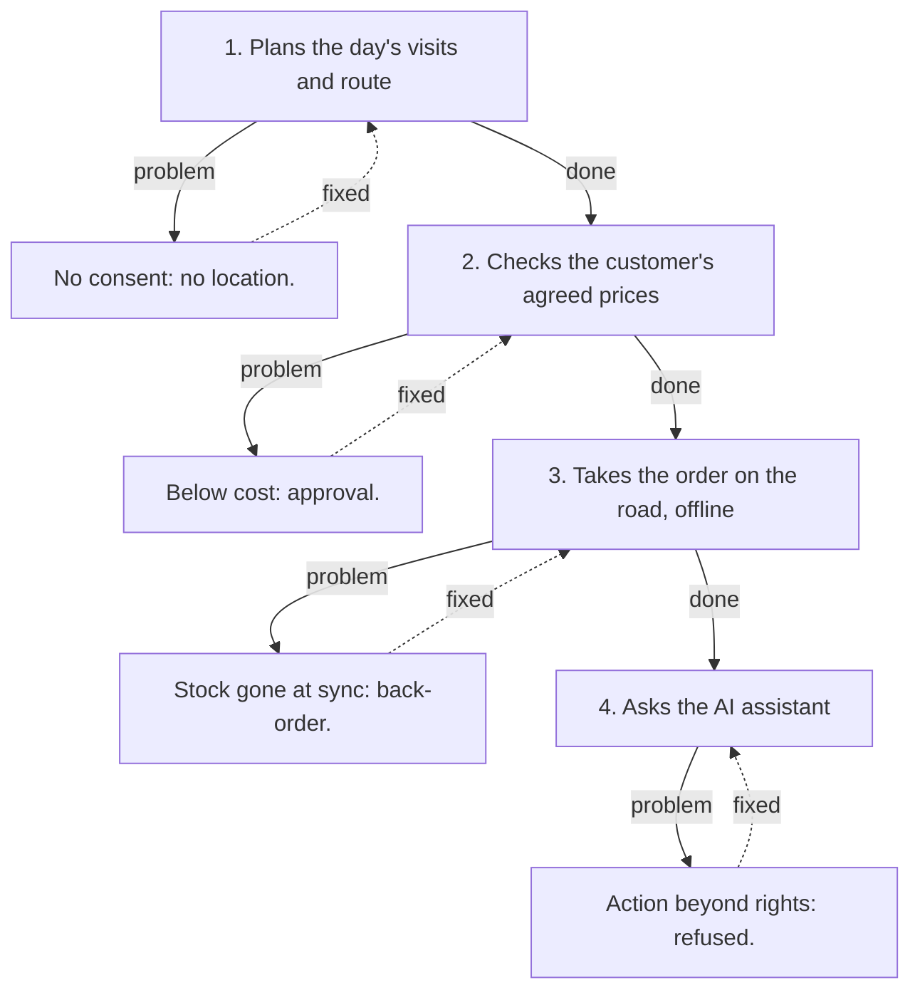

🏠 [Specs](../../../../README.md) › 🎨 [UX](../../../README.md) › 🪟 [Views](../../README.md) ›
🧳 [Sales representative: app shell and home](../README.md) › 🧭 [Journeys](README.md) ›
🧭 J-U42-01 Visit customers and take orders

# 🧭 J-U42-01 Visit customers and take orders

**Status:** 🔄 waiting for the owner

## Persona

[U42 Sales representative](../../../../01-users/personas/u42-sales-representative.md)

## Goal

Visit the right customers and sell more, promising only what can be delivered.

## Journey

Satisfaction at each step, from 1 (painful) to 5 (effortless): these scores are a proposal (Proposed), drawn from the
specs, for the owner to confirm.

## Flowchart

The same steps; each problem is the first error flow of the step's use case (once per use case), shown with the error
message pattern ([D122](../../../../06-decisions/ux/d122-error-message-standard.md)).

## Steps

| Step | Screen | Use case | What the persona does | What the system does |
|---|---|---|---|---|
| 1 | [S-SC15-14 Visits](../../../../08-sectors/sc15-wholesale-and-distribution/screens/05-sales-force-and-performance/s-sc15-14-visits.md) | [UC-SC15-14 Follow sales reps' visits, routes and targets](../../../../08-sectors/sc15-wholesale-and-distribution/use-cases/05-sales-force-and-performance/uc-sc15-14-follow-sales-reps-visits-routes-and-targets.md) | Plans the day's visits and route | Plans the route; tracks location only with consent. |
| 2 | [S-SC15-01 Price agreements](../../../../08-sectors/sc15-wholesale-and-distribution/screens/01-prices-and-agreements/s-sc15-01-price-agreements.md) | [UC-SC15-01 Agree customer prices and tiers](../../../../08-sectors/sc15-wholesale-and-distribution/use-cases/01-prices-and-agreements/uc-sc15-01-agree-customer-prices-and-tiers.md) | Checks the customer's agreed prices | Shows the prices agreed and published to reps. |
| 3 | [S-SC15-05 Rep orders](../../../../08-sectors/sc15-wholesale-and-distribution/screens/02-orders/s-sc15-05-rep-orders.md) | [UC-SC15-05 Take orders on the road, offline](../../../../08-sectors/sc15-wholesale-and-distribution/use-cases/02-orders/uc-sc15-05-take-orders-on-the-road-offline.md) | Takes the order on the road, offline | Keeps the order offline and syncs it; back-orders stock gone at sync. |
| 4 | [S-SC15-20 Sales assistant](../../../../08-sectors/sc15-wholesale-and-distribution/screens/05-sales-force-and-performance/s-sc15-20-sales-assistant.md) | [UC-SC15-20 Ask the AI assistant](../../../../08-sectors/sc15-wholesale-and-distribution/use-cases/05-sales-force-and-performance/uc-sc15-20-ask-the-assistant.md) | Asks the AI assistant | Answers from data or prepares an action to confirm (BR-F3-07). |

This persona's images of these flows (D120):
[FL-SC15-05 Sales force and performance](../../../../08-sectors/sc15-wholesale-and-distribution/images/05-sales-force-and-performance/u42-sales-representative/README.md),
[FL-SC15-01 Prices and agreements](../../../../08-sectors/sc15-wholesale-and-distribution/images/01-prices-and-agreements/u42-sales-representative/README.md),
[FL-SC15-02 Orders](../../../../08-sectors/sc15-wholesale-and-distribution/images/02-orders/u42-sales-representative/README.md).

## Open questions

None.

---

⬆️ [Up](README.md)
