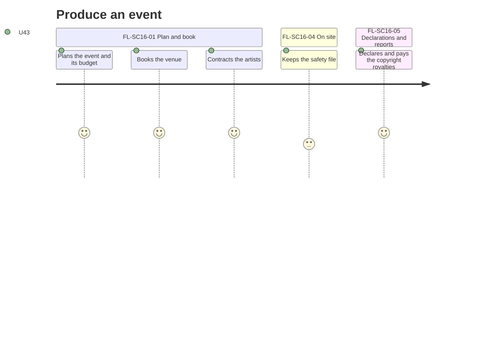
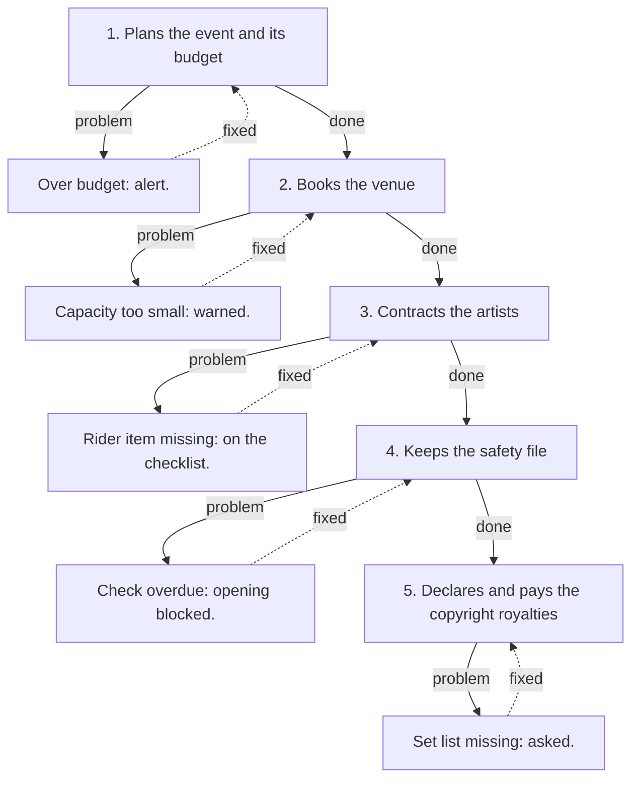

🏠 [Specs](../../../../README.md) › 🎨 [UX](../../../README.md) › 🪟 [Views](../../README.md) ›
🎬 [Event producer: app shell and home](../README.md) › 🧭 [Journeys](README.md) › 🧭 J-U43-01 Produce an event

# 🧭 J-U43-01 Produce an event

**Status:** 🔄 waiting for the owner

## Persona

[U43 Event producer](../../../../01-users/personas/u43-event-producer.md)

## Goal

A safe, sold-out event within budget, and every declaration done on time.

## Journey

Satisfaction at each step, from 1 (painful) to 5 (effortless): these scores are a proposal (Proposed), drawn from the
specs, for the owner to confirm.

## Flowchart

The same steps; each problem is the first error flow of the step's use case (once per use case), shown with the error
message pattern ([D122](../../../../06-decisions/ux/d122-error-message-standard.md)).

## Steps

| Step | Screen | Use case | What the persona does | What the system does |
|---|---|---|---|---|
| 1 | [S-SC16-01 Event plan](../../../../08-sectors/sc16-events-and-culture/screens/01-plan-and-book/s-sc16-01-event-plan.md) | [UC-SC16-01 Plan an event and its budget](../../../../08-sectors/sc16-events-and-culture/use-cases/01-plan-and-book/uc-sc16-01-plan-an-event-and-its-budget.md) | Plans the event and its budget | Records the budget for approval; alerts when it is over. |
| 2 | [S-SC16-02 Venues](../../../../08-sectors/sc16-events-and-culture/screens/01-plan-and-book/s-sc16-02-venues.md) | [UC-SC16-02 Book venues and rooms](../../../../08-sectors/sc16-events-and-culture/use-cases/01-plan-and-book/uc-sc16-02-book-venues-and-rooms.md) | Books the venue | Books the venue; warns when its capacity is too small. |
| 3 | [S-SC16-03 Artists](../../../../08-sectors/sc16-events-and-culture/screens/01-plan-and-book/s-sc16-03-artists.md) | [UC-SC16-03 Contract artists and manage riders](../../../../08-sectors/sc16-events-and-culture/use-cases/01-plan-and-book/uc-sc16-03-contract-artists-and-manage-riders.md) | Contracts the artists | Turns the rider into tasks once signed. |
| 4 | [S-SC16-13 Safety](../../../../08-sectors/sc16-events-and-culture/screens/04-on-site/s-sc16-13-safety.md) | [UC-SC16-13 Keep the safety file and register](../../../../08-sectors/sc16-events-and-culture/use-cases/04-on-site/uc-sc16-13-keep-the-safety-file-and-register.md) | Keeps the safety file | Records the checks; blocks opening when one is overdue. |
| 5 | [S-SC16-14 Copyright](../../../../08-sectors/sc16-events-and-culture/screens/05-declarations-and-reports/s-sc16-14-copyright.md) | [UC-SC16-14 Declare and pay copyright royalties](../../../../08-sectors/sc16-events-and-culture/use-cases/05-declarations-and-reports/uc-sc16-14-declare-and-pay-copyright-royalties.md) | Declares and pays the copyright royalties | Prepares the declaration after the show; asks for a missing set list. |

This persona's images of these flows (D120):
[FL-SC16-01 Plan and book](../../../../08-sectors/sc16-events-and-culture/images/01-plan-and-book/u43-event-producer/README.md),
[FL-SC16-04 On site](../../../../08-sectors/sc16-events-and-culture/images/04-on-site/u43-event-producer/README.md),
[FL-SC16-05 Declarations and reports](../../../../08-sectors/sc16-events-and-culture/images/05-declarations-and-reports/u43-event-producer/README.md).

## Open questions

None.

---

⬆️ [Up](README.md)
