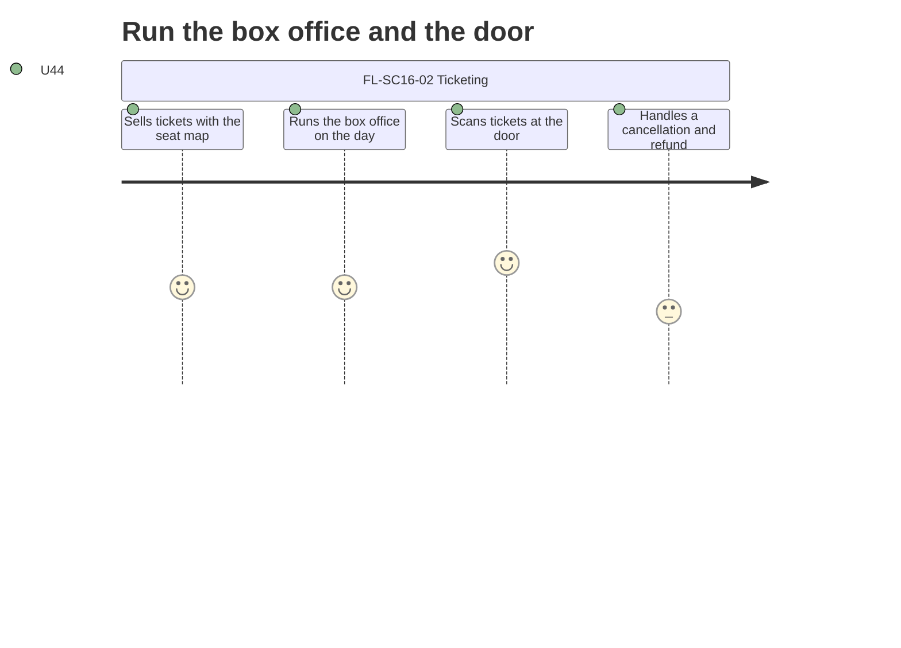
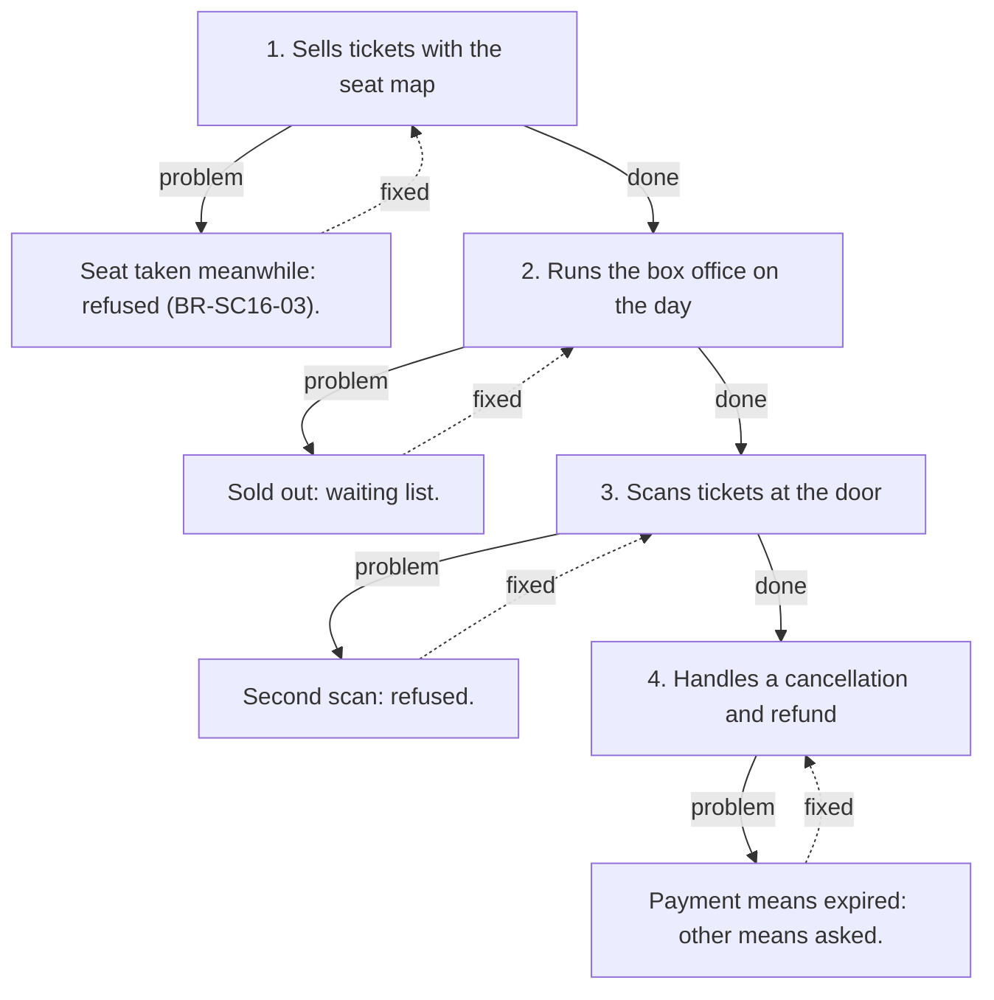

🏠 [Specs](../../../../README.md) › 🎨 [UX](../../../README.md) › 🪟 [Views](../../README.md) ›
🎟️ [Box-office agent: app shell and home](../README.md) › 🧭 [Journeys](README.md) ›
🧭 J-U44-01 Run the box office and the door

# 🧭 J-U44-01 Run the box office and the door

**Status:** ✅ specified

## Persona

[U44 Box-office agent](../../../../01-users/personas/u44-box-office-agent.md)

## Goal

Short queues and no fake or double tickets.

## Journey

Satisfaction at each step, from 1 (painful) to 5 (effortless): these scores are drawn from the
specs and confirmed by the owner (D572).

## Flowchart

The same steps; each problem is the first error flow of the step's use case (once per use case), shown with the error
message pattern ([D122](../../../../06-decisions/ux/d122-error-message-standard.md)).

## Steps

| Step | Screen | Use case | What the persona does | What the system does |
|---|---|---|---|---|
| 1 | [S-SC16-05 Ticketing](../../../../08-sectors/sc16-events-and-culture/screens/02-ticketing/s-sc16-05-ticketing.md) | [UC-SC16-05 Sell tickets with seat maps and price categories](../../../../08-sectors/sc16-events-and-culture/use-cases/02-ticketing/uc-sc16-05-sell-tickets-with-seat-maps-and-price-categories.md) | Sells tickets with the seat map | Holds the chosen seats during payment (BR-SC16-03); issues the ticket. |
| 2 | [S-SC16-07 Box office](../../../../08-sectors/sc16-events-and-culture/screens/02-ticketing/s-sc16-07-box-office.md) | [UC-SC16-07 Run the box office on the day](../../../../08-sectors/sc16-events-and-culture/use-cases/02-ticketing/uc-sc16-07-run-the-box-office-on-the-day.md) | Runs the box office on the day | Sells and exchanges; closes the till. |
| 3 | [S-SC16-06 Access control](../../../../08-sectors/sc16-events-and-culture/screens/02-ticketing/s-sc16-06-access-control.md) | [UC-SC16-06 Control access by scanning](../../../../08-sectors/sc16-events-and-culture/use-cases/02-ticketing/uc-sc16-06-control-access-by-scanning.md) | Scans tickets at the door | Admits on the first scan, refuses a second, counts entries. |
| 4 | [S-SC16-17 Refunds](../../../../08-sectors/sc16-events-and-culture/screens/02-ticketing/s-sc16-17-refunds.md) | [UC-SC16-17 Handle cancellations and refunds](../../../../08-sectors/sc16-events-and-culture/use-cases/02-ticketing/uc-sc16-17-handle-cancellations-and-refunds.md) | Handles a cancellation and refund | Refunds or exchanges and tells the holders. |

This persona's images of these flows (D120):
[FL-SC16-02 Ticketing](../../../../08-sectors/sc16-events-and-culture/images/02-ticketing/u44-box-office-agent/README.md).

## Open questions

None.

---

⬆️ [Up](README.md)
