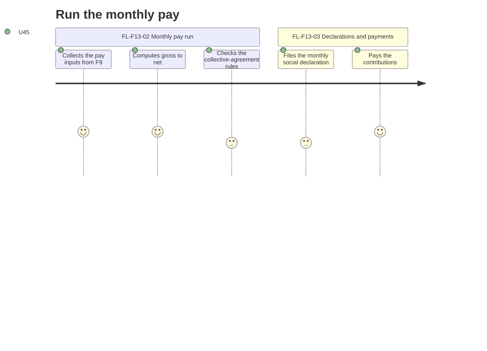
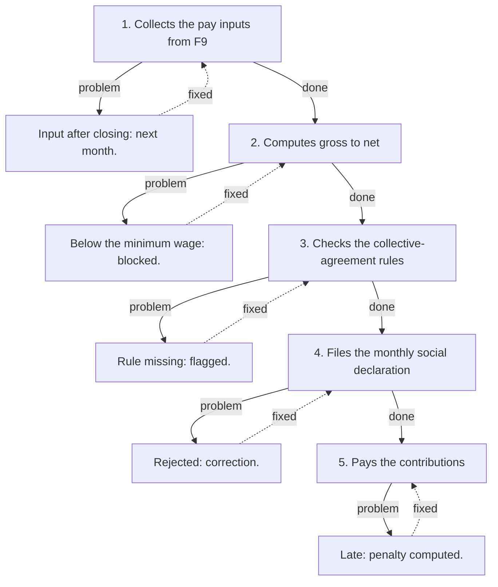

🏠 [Specs](../../../../README.md) › 🎨 [UX](../../../README.md) › 🪟 [Views](../../README.md) ›
🧮 [Payroll officer: app shell and home](../README.md) › 🧭 [Journeys](README.md) › 🧭 J-U45-01 Run the monthly pay

# 🧭 J-U45-01 Run the monthly pay

**Status:** 🔄 waiting for the owner

## Persona

[U45 Payroll officer](../../../../01-users/personas/u45-payroll-officer.md)

## Goal

Every employee paid right and on time, and declarations accepted the first time.

## Journey

Satisfaction at each step, from 1 (painful) to 5 (effortless): these scores are a proposal (Proposed), drawn from the
specs, for the owner to confirm.

## Flowchart

The same steps; each problem is the first error flow of the step's use case (once per use case), shown with the error
message pattern ([D122](../../../../06-decisions/ux/d122-error-message-standard.md)).

## Steps

| Step | Screen | Use case | What the persona does | What the system does |
|---|---|---|---|---|
| 1 | [S-F13-03 Pay inputs](../../../../02-functional/f13-payroll/screens/02-monthly-pay-run/s-f13-03-pay-inputs.md) | [UC-F13-03 Collect pay inputs from F9](../../../../02-functional/f13-payroll/use-cases/02-monthly-pay-run/uc-f13-03-collect-pay-inputs-from-f9.md) | Collects the pay inputs from F9 | Imports the closed inputs; later inputs go to next month. |
| 2 | [S-F13-04 Pay computation](../../../../02-functional/f13-payroll/screens/02-monthly-pay-run/s-f13-04-pay-computation.md) | [UC-F13-04 Compute gross to net](../../../../02-functional/f13-payroll/use-cases/02-monthly-pay-run/uc-f13-04-compute-gross-to-net.md) | Computes gross to net | Computes and explains each line; blocks pay below the minimum wage. |
| 3 | [S-F13-05 Agreement rules](../../../../02-functional/f13-payroll/screens/02-monthly-pay-run/s-f13-05-agreement-rules.md) | [UC-F13-05 Apply collective-agreement rules](../../../../02-functional/f13-payroll/use-cases/02-monthly-pay-run/uc-f13-05-apply-collective-agreement-rules.md) | Checks the collective-agreement rules | Applies the agreement's rules; flags a missing rule. |
| 4 | [S-F13-10 Social declaration](../../../../02-functional/f13-payroll/screens/03-declarations-and-payments/s-f13-10-social-declaration.md) | [UC-F13-10 File the monthly social declaration and handle returns](../../../../02-functional/f13-payroll/use-cases/03-declarations-and-payments/uc-f13-10-file-the-monthly-social-declaration-and-handle-returns.md) | Files the monthly social declaration | Builds and files the declaration; turns returns into corrections. |
| 5 | [S-F13-12 Contributions](../../../../02-functional/f13-payroll/screens/03-declarations-and-payments/s-f13-12-contributions.md) | [UC-F13-12 Pay contributions to the collectors](../../../../02-functional/f13-payroll/use-cases/03-declarations-and-payments/uc-f13-12-pay-contributions-to-the-collectors.md) | Pays the contributions | Computes and pays each collector; reconciles. |

This persona's images of these flows (D120):
[FL-F13-02 Monthly pay run](../../../../02-functional/f13-payroll/images/02-monthly-pay-run/u45-payroll-officer/README.md),
[FL-F13-03 Declarations and payments](../../../../02-functional/f13-payroll/images/03-declarations-and-payments/u45-payroll-officer/README.md).

## Open questions

None.

---

⬆️ [Up](README.md)
